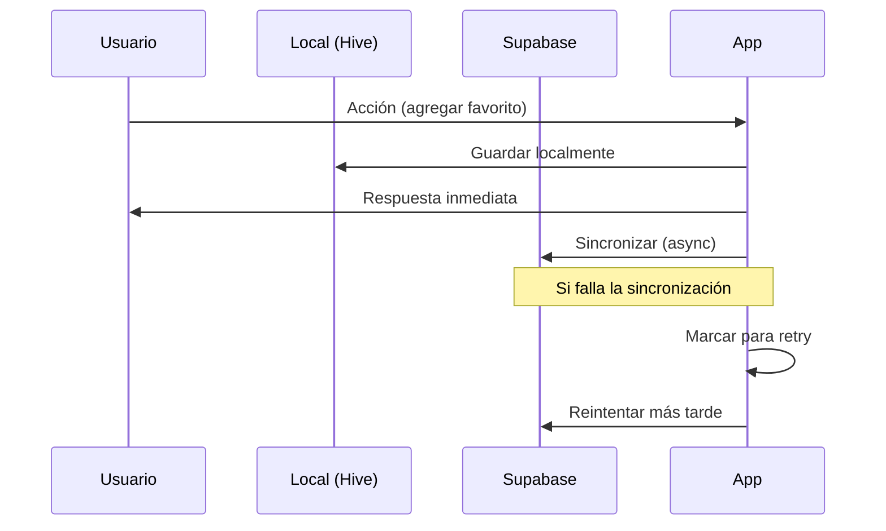

# Arquitectura de Sincronización con Supabase

## 1. Resumen Ejecutivo

Este documento define la implementación completa de sincronización bidireccional entre el almacenamiento local (Hive) y Supabase para datos de usuario incluyendo favoritos, películas vistas y listas personalizadas.

## 2. Esquema de Base de Datos

### 2.1 Tablas Faltantes en Supabase

#### Tabla: user_favorites
```sql
CREATE TABLE user_favorites (
    id UUID PRIMARY KEY DEFAULT gen_random_uuid(),
    user_id UUID REFERENCES auth.users(id) ON DELETE CASCADE,
    movie_id INTEGER NOT NULL,
    movie_title VARCHAR(255) NOT NULL,
    movie_poster_path TEXT,
    movie_backdrop_path TEXT,
    movie_overview TEXT,
    movie_release_date DATE,
    movie_vote_average DECIMAL(3,1),
    added_at TIMESTAMP WITH TIME ZONE DEFAULT NOW(),
    updated_at TIMESTAMP WITH TIME ZONE DEFAULT NOW()
);

-- Índices
CREATE UNIQUE INDEX idx_user_favorites_user_movie ON user_favorites(user_id, movie_id);
CREATE INDEX idx_user_favorites_added_at ON user_favorites(added_at DESC);
```

#### Tabla: user_watched_movies
```sql
CREATE TABLE user_watched_movies (
    id UUID PRIMARY KEY DEFAULT gen_random_uuid(),
    user_id UUID REFERENCES auth.users(id) ON DELETE CASCADE,
    movie_id INTEGER NOT NULL,
    movie_title VARCHAR(255) NOT NULL,
    movie_poster_path TEXT,
    movie_backdrop_path TEXT,
    movie_overview TEXT,
    movie_release_date DATE,
    movie_vote_average DECIMAL(3,1),
    watched_at TIMESTAMP WITH TIME ZONE DEFAULT NOW(),
    updated_at TIMESTAMP WITH TIME ZONE DEFAULT NOW()
);

-- Índices
CREATE UNIQUE INDEX idx_user_watched_user_movie ON user_watched_movies(user_id, movie_id);
CREATE INDEX idx_user_watched_watched_at ON user_watched_movies(watched_at DESC);
```

#### Tabla: user_lists
```sql
CREATE TABLE user_lists (
    id UUID PRIMARY KEY DEFAULT gen_random_uuid(),
    user_id UUID REFERENCES auth.users(id) ON DELETE CASCADE,
    name VARCHAR(100) NOT NULL,
    description TEXT,
    color_hex VARCHAR(7) DEFAULT '#FF5722',
    is_public BOOLEAN DEFAULT false,
    created_at TIMESTAMP WITH TIME ZONE DEFAULT NOW(),
    updated_at TIMESTAMP WITH TIME ZONE DEFAULT NOW()
);

-- Índices
CREATE INDEX idx_user_lists_user_id ON user_lists(user_id);
CREATE INDEX idx_user_lists_created_at ON user_lists(created_at DESC);
```

#### Tabla: user_list_items
```sql
CREATE TABLE user_list_items (
    id UUID PRIMARY KEY DEFAULT gen_random_uuid(),
    list_id UUID REFERENCES user_lists(id) ON DELETE CASCADE,
    movie_id INTEGER NOT NULL,
    movie_title VARCHAR(255) NOT NULL,
    movie_poster_path TEXT,
    movie_backdrop_path TEXT,
    movie_overview TEXT,
    movie_release_date DATE,
    movie_vote_average DECIMAL(3,1),
    position INTEGER DEFAULT 0,
    added_at TIMESTAMP WITH TIME ZONE DEFAULT NOW(),
    updated_at TIMESTAMP WITH TIME ZONE DEFAULT NOW()
);

-- Índices
CREATE UNIQUE INDEX idx_list_items_list_movie ON user_list_items(list_id, movie_id);
CREATE INDEX idx_list_items_position ON user_list_items(list_id, position);
```

### 2.2 Políticas de Seguridad (RLS)

```sql
-- Habilitar RLS para todas las tablas
ALTER TABLE user_favorites ENABLE ROW LEVEL SECURITY;
ALTER TABLE user_watched_movies ENABLE ROW LEVEL SECURITY;
ALTER TABLE user_lists ENABLE ROW LEVEL SECURITY;
ALTER TABLE user_list_items ENABLE ROW LEVEL SECURITY;

-- Políticas para user_favorites
CREATE POLICY "Users can manage their own favorites" ON user_favorites
    FOR ALL USING (auth.uid() = user_id);

-- Políticas para user_watched_movies
CREATE POLICY "Users can manage their own watched movies" ON user_watched_movies
    FOR ALL USING (auth.uid() = user_id);

-- Políticas para user_lists
CREATE POLICY "Users can manage their own lists" ON user_lists
    FOR ALL USING (auth.uid() = user_id);

CREATE POLICY "Public lists are viewable" ON user_lists
    FOR SELECT USING (is_public = true);

-- Políticas para user_list_items
CREATE POLICY "Users can manage items in their own lists" ON user_list_items
    FOR ALL USING (
        EXISTS (
            SELECT 1 FROM user_lists 
            WHERE user_lists.id = user_list_items.list_id 
            AND user_lists.user_id = auth.uid()
        )
    );

CREATE POLICY "Public list items are viewable" ON user_list_items
    FOR SELECT USING (
        EXISTS (
            SELECT 1 FROM user_lists 
            WHERE user_lists.id = user_list_items.list_id 
            AND user_lists.is_public = true
        )
    );
```

## 3. Estrategia de Sincronización Bidireccional

### 3.1 Principios de Sincronización

1. **Local First**: Todas las operaciones se realizan primero localmente para garantizar responsividad
2. **Eventual Consistency**: Los datos se sincronizan de forma asíncrona
3. **Conflict Resolution**: Se usa timestamp para resolver conflictos (último cambio gana)
4. **Offline Support**: La app funciona completamente offline

### 3.2 Flujo de Sincronización



### 3.3 Estados de Sincronización

- **SYNCED**: Datos sincronizados correctamente
- **PENDING**: Cambios locales pendientes de sincronizar
- **CONFLICT**: Conflicto detectado, requiere resolución
- **ERROR**: Error en sincronización, requiere retry

## 4. Implementación de Repositorios Híbridos

### 4.1 Interfaz Base para Sincronización

```dart
abstract class SyncableRepository<T> {
  Future<void> syncWithSupabase();
  Future<List<T>> getLocalData();
  Future<List<T>> getRemoteData();
  Future<void> resolveConflicts(List<T> local, List<T> remote);
  Future<void> markForSync(String itemId);
}
```

### 4.2 Implementación de FavoritesRepository

```dart
class HybridFavoritesRepository implements SyncableRepository<Movie> {
  // Métodos de sincronización
  @override
  Future<void> syncWithSupabase() async {
    if (!_isAuthenticated()) return;
    
    try {
      // 1. Obtener datos locales y remotos
      final localFavorites = await getLocalData();
      final remoteFavorites = await getRemoteData();
      
      // 2. Identificar cambios
      final toUpload = _findLocalChanges(localFavorites, remoteFavorites);
      final toDownload = _findRemoteChanges(localFavorites, remoteFavorites);
      
      // 3. Subir cambios locales
      await _uploadToSupabase(toUpload);
      
      // 4. Descargar cambios remotos
      await _downloadFromSupabase(toDownload);
      
      // 5. Resolver conflictos
      await resolveConflicts(localFavorites, remoteFavorites);
      
    } catch (e) {
      // Manejar errores de sincronización
      _handleSyncError(e);
    }
  }
  
  // Operaciones CRUD con sincronización
  Future<void> toggleFavorite(Movie movie) async {
    // 1. Actualizar localmente
    await _hiveDatasource.toggleFavorite(movie);
    
    // 2. Marcar para sincronización
    await markForSync(movie.id.toString());
    
    // 3. Sincronizar si está online
    if (_isAuthenticated() && _isOnline()) {
      await _syncSingleItem(movie);
    }
  }
}
```

### 4.3 Resolución de Conflictos

```dart
class ConflictResolver {
  static T resolveByTimestamp<T extends Timestamped>(T local, T remote) {
    return local.updatedAt.isAfter(remote.updatedAt) ? local : remote;
  }
  
  static List<T> mergeCollections<T extends Identifiable>(
    List<T> local, 
    List<T> remote
  ) {
    final Map<String, T> merged = {};
    
    // Agregar elementos remotos
    for (final item in remote) {
      merged[item.id] = item;
    }
    
    // Sobrescribir con elementos locales más recientes
    for (final item in local) {
      final existing = merged[item.id];
      if (existing == null || item.updatedAt.isAfter(existing.updatedAt)) {
        merged[item.id] = item;
      }
    }
    
    return merged.values.toList();
  }
}
```

## 5. Servicio de Sincronización Automática

### 5.1 SyncService Mejorado

```dart
class SyncService {
  final List<SyncableRepository> _repositories;
  Timer? _syncTimer;
  
  // Sincronización automática después del login
  Future<void> onUserAuthenticated() async {
    await syncAllData();
    _startPeriodicSync();
  }
  
  // Sincronización periódica
  void _startPeriodicSync() {
    _syncTimer = Timer.periodic(Duration(minutes: 5), (_) {
      if (_isOnline() && _isAuthenticated()) {
        syncAllData();
      }
    });
  }
  
  // Sincronización completa
  Future<SyncResult> syncAllData() async {
    final results = <String, bool>{};
    
    for (final repo in _repositories) {
      try {
        await repo.syncWithSupabase();
        results[repo.runtimeType.toString()] = true;
      } catch (e) {
        results[repo.runtimeType.toString()] = false;
        _logSyncError(repo.runtimeType.toString(), e);
      }
    }
    
    return SyncResult(results);
  }
}
```

### 5.2 Triggers de Sincronización

```dart
// En AuthProvider
class AuthNotifier extends StateNotifier<AuthState> {
  Future<void> signIn(String email, String password) async {
    // ... lógica de login existente
    
    if (state.isAuthenticated) {
      // Trigger sincronización automática
      await _ref.read(syncServiceProvider).onUserAuthenticated();
    }
  }
}
```

## 6. Plan de Implementación

### 6.1 Fase 1: Preparación de Base de Datos (1-2 días)
- [ ] Crear migración SQL con las nuevas tablas
- [ ] Configurar políticas RLS
- [ ] Probar estructura en Supabase Dashboard
- [ ] Actualizar permisos y roles

### 6.2 Fase 2: Implementación de Repositorios (3-4 días)
- [ ] Crear interfaces base para sincronización
- [ ] Implementar métodos de sincronización en HybridFavoritesRepository
- [ ] Implementar métodos de sincronización en HybridWatchedRepository
- [ ] Crear CustomListsRepository con sincronización
- [ ] Implementar resolución de conflictos

### 6.3 Fase 3: Servicio de Sincronización (2-3 días)
- [ ] Mejorar SyncService con lógica completa
- [ ] Implementar sincronización automática
- [ ] Agregar manejo de errores y reintentos
- [ ] Configurar sincronización periódica

### 6.4 Fase 4: Integración y Testing (2-3 días)
- [ ] Integrar sincronización en flujo de autenticación
- [ ] Probar sincronización bidireccional
- [ ] Probar resolución de conflictos
- [ ] Probar funcionamiento offline
- [ ] Optimizar rendimiento

### 6.5 Fase 5: Monitoreo y Optimización (1-2 días)
- [ ] Agregar logging de sincronización
- [ ] Implementar métricas de sync
- [ ] Optimizar consultas SQL
- [ ] Documentar APIs y flujos

## 7. Consideraciones Técnicas

### 7.1 Rendimiento
- Usar paginación para grandes conjuntos de datos
- Implementar sincronización incremental
- Cachear resultados de consultas frecuentes
- Usar índices apropiados en Supabase

### 7.2 Seguridad
- Validar todos los datos antes de sincronizar
- Usar RLS para proteger datos de usuario
- Implementar rate limiting en operaciones de sync
- Encriptar datos sensibles si es necesario

### 7.3 Manejo de Errores
- Implementar retry con backoff exponencial
- Mantener logs detallados de errores de sync
- Proporcionar feedback al usuario sobre estado de sync
- Permitir sincronización manual en caso de fallos

## 8. Métricas y Monitoreo

### 8.1 KPIs de Sincronización
- Tiempo promedio de sincronización
- Tasa de éxito de sincronización
- Número de conflictos resueltos
- Datos sincronizados por usuario

### 8.2 Alertas
- Fallos de sincronización > 5%
- Tiempo de sincronización > 30 segundos
- Conflictos no resueltos
- Errores de conectividad con Supabase

Este documento proporciona la base técnica completa para implementar la sincronización bidireccional entre el almacenamiento local y Supabase, garantizando una experiencia de usuario fluida tanto online como offline.