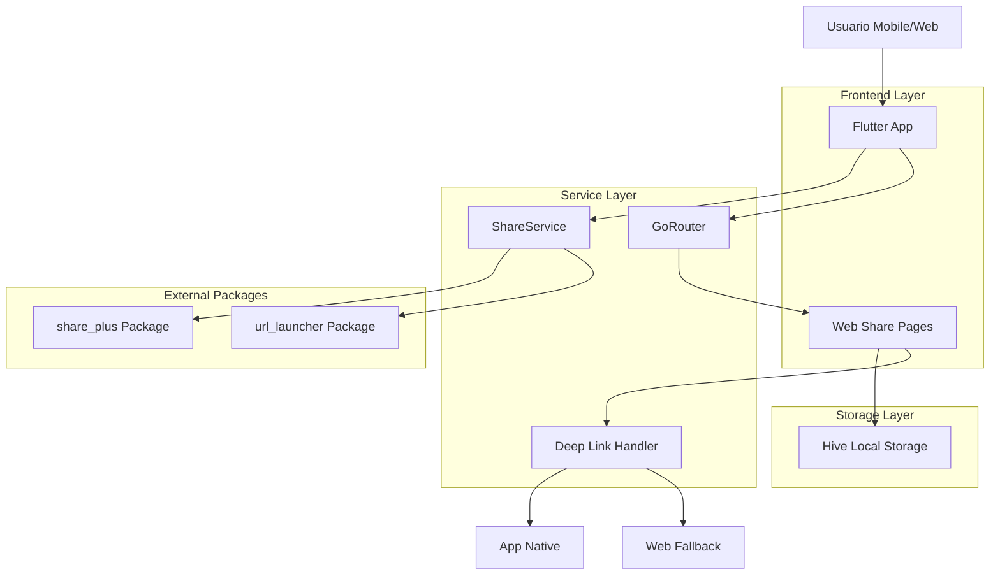
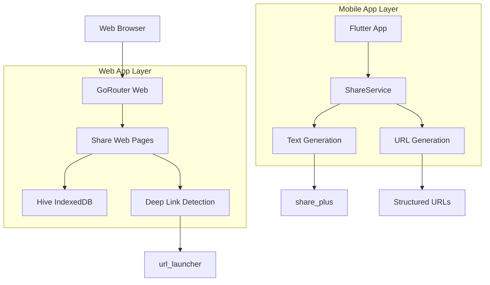
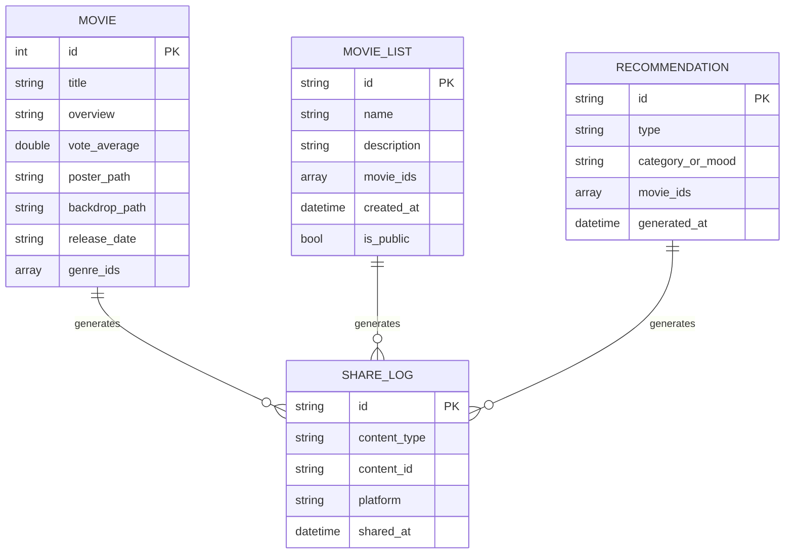

# Arquitectura Técnica - Funcionalidad de Compartir

## 1. Architecture Design



## 2. Technology Description

* **Frontend**: Flutter 3.x + GoRouter + Hive

* **Sharing**: share\_plus ^11.1.0

* **URL Handling**: url\_launcher ^6.3.2

* **Storage**: Hive ^2.2.3 (compatible con web vía IndexedDB)

* **Routing**: go\_router (ya configurado)

* **State Management**: Provider/Riverpod (existente)

## 3. Route Definitions

| Route                            | Purpose                                       |
| -------------------------------- | --------------------------------------------- |
| /movie/:id/share                 | Página web para compartir película individual |
| /list/:listId/share              | Página web para compartir lista de películas  |
| /recommendations/:type/:id/share | Página web para compartir recomendaciones     |
| /home/movie/:id                  | Ruta existente para deep link a película      |
| /lists/:listId                   | Ruta existente para deep link a lista         |

## 4. API Definitions

### 4.1 ShareService Core API

**Compartir Película**

```dart
Future<void> shareMovie(Movie movie)
```

Parametros:

| Param Name | Param Type | isRequired | Description                                  |
| ---------- | ---------- | ---------- | -------------------------------------------- |
| movie      | Movie      | true       | Objeto película con id, título, rating, etc. |

Funcionalidad:

* Genera URL estructurada: `https://peliculas.creapolis.dev/movie/{id}/share`

* Crea texto atractivo con emojis y hashtags

* Invoca share\_plus para mostrar selector nativo

**Compartir Lista**

```dart
Future<void> shareList(MovieList list)
```

Parametros:

| Param Name | Param Type | isRequired | Description                                  |
| ---------- | ---------- | ---------- | -------------------------------------------- |
| list       | MovieList  | true       | Objeto lista con id, nombre, películas, etc. |

Funcionalidad:

* Genera URL: `https://peliculas.creapolis.dev/list/{id}/share`

* Incluye preview de primeras películas en texto

* Maneja listas públicas vs privadas

**Compartir Recomendaciones**

```dart
Future<void> shareRecommendations(String type, String id, List<Movie> movies)
```

Parametros:

| Param Name | Param Type  | isRequired | Description                     |
| ---------- | ----------- | ---------- | ------------------------------- |
| type       | String      | true       | Tipo: 'category' o 'mood'       |
| id         | String      | true       | ID de categoría o mood          |
| movies     | List<Movie> | true       | Lista de películas recomendadas |

### 4.2 Deep Link Handler API

**Detectar y Manejar Deep Links**

```dart
Future<bool> handleDeepLink(String url)
```

Parametros:

| Param Name | Param Type | isRequired | Description                |
| ---------- | ---------- | ---------- | -------------------------- |
| url        | String     | true       | URL completa del deep link |

Response:

| Param Name | Param Type | Description                                               |
| ---------- | ---------- | --------------------------------------------------------- |
| handled    | bool       | true si se manejó el deep link, false si debe mostrar web |

## 5. Server Architecture Diagram

No se requiere servidor backend. La arquitectura es completamente client-side:



## 6. Data Model

### 6.1 Data Model Definition



### 6.2 Data Definition Language

**Hive Boxes para Web Storage**

```dart
// Box para logs de compartir (opcional, para analytics)
@HiveType(typeId: 10)
class ShareLog {
  @HiveField(0)
  final String id;
  
  @HiveField(1)
  final String contentType; // 'movie', 'list', 'recommendation'
  
  @HiveField(2)
  final String contentId;
  
  @HiveField(3)
  final String platform; // 'whatsapp', 'facebook', 'twitter', etc.
  
  @HiveField(4)
  final DateTime sharedAt;
  
  ShareLog({
    required this.id,
    required this.contentType,
    required this.contentId,
    required this.platform,
    required this.sharedAt,
  });
}

// Registro de Hive Adapters
void registerHiveAdapters() {
  Hive.registerAdapter(ShareLogAdapter());
}

// Inicialización de boxes
Future<void> initializeShareBoxes() async {
  await Hive.openBox<ShareLog>('share_logs');
}
```

**Estructuras de Datos para Compartir**

```dart
// Modelo para contenido compartible
class ShareableContent {
  final String type; // 'movie', 'list', 'recommendation'
  final String id;
  final String title;
  final String description;
  final String? imageUrl;
  final Map<String, dynamic> metadata;
  
  ShareableContent({
    required this.type,
    required this.id,
    required this.title,
    required this.description,
    this.imageUrl,
    required this.metadata,
  });
  
  String generateShareUrl() {
    const baseUrl = 'https://peliculas.creapolis.dev';
    switch (type) {
      case 'movie':
        return '$baseUrl/movie/$id/share';
      case 'list':
        return '$baseUrl/list/$id/share';
      case 'recommendation':
        return '$baseUrl/recommendations/${metadata['type']}/$id/share';
      default:
        return baseUrl;
    }
  }
  
  String generateShareText() {
    switch (type) {
      case 'movie':
        final rating = metadata['rating'] ?? 0.0;
        final year = metadata['year'] ?? '';
        return '🎬 ¡Mira "$title" ($year)!\n'
               '⭐ Rating: $rating/10\n'
               '📱 Descarga la app para más recomendaciones\n'
               '${generateShareUrl()}\n'
               '#Películas #Cine #Recomendaciones';
      case 'list':
        final count = metadata['movieCount'] ?? 0;
        return '🎭 Lista: "$title"\n'
               '🎬 $count películas seleccionadas\n'
               '$description\n'
               '📱 Ve la lista completa en la app\n'
               '${generateShareUrl()}\n'
               '#ListasDePelículas #Cine';
      case 'recommendation':
        final category = metadata['category'] ?? 'Personalizadas';
        return '🎯 Recomendaciones: $category\n'
               '🎬 Películas perfectas para ti\n'
               '📱 Descubre más en la app\n'
               '${generateShareUrl()}\n'
               '#Recomendaciones #Cine #IA';
      default:
        return 'Descubre películas increíbles en nuestra app\n${generateShareUrl()}';
    }
  }
}
```

**Configuración de GoRouter para Web**

```dart
// Nuevas rutas para páginas de compartir
GoRoute(
  path: '/movie/:id/share',
  builder: (context, state) {
    final movieId = int.parse(state.pathParameters['id']!);
    return MovieShareWebView(movieId: movieId);
  },
),
GoRoute(
  path: '/list/:listId/share',
  builder: (context, state) {
    final listId = state.pathParameters['listId']!;
    return ListShareWebView(listId: listId);
  },
),
GoRoute(
  path: '/recommendations/:type/:id/share',
  builder: (context, state) {
    final type = state.pathParameters['type']!;
    final id = state.pathParameters['id']!;
    return RecommendationShareWebView(type: type, id: id);
  },
),
```

