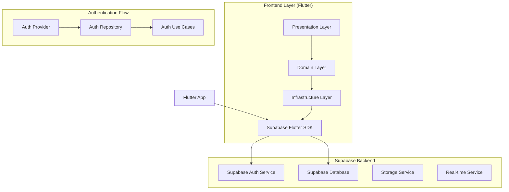
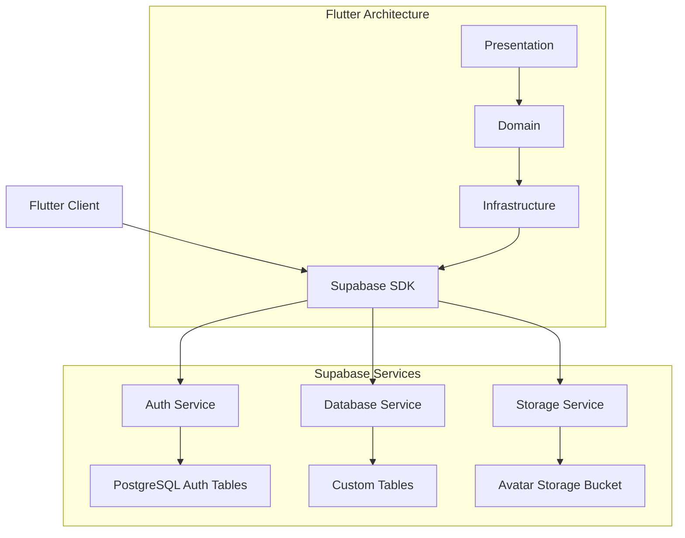
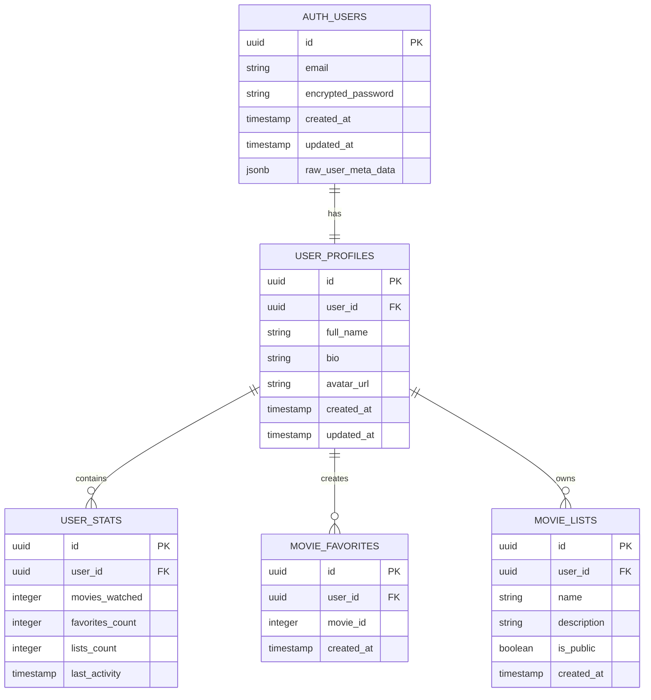

# Arquitectura Técnica - Fase 1: Sistema de Autenticación con Supabase

## 1. Architecture Design



## 2. Technology Description

* **Frontend**: Flutter 3.x + Material 3 + Riverpod 2.x + Go Router 13.x

* **Backend**: Supabase (PostgreSQL + Auth + Storage)

* **State Management**: Riverpod para gestión de estado reactivo

* **Navigation**: Go Router con rutas protegidas por autenticación

* **Local Storage**: Hive para cache y datos offline

* **Image Handling**: Image Picker + Image Cropper para avatares

## 3. Route Definitions

| Route         | Purpose                             | Auth Required                |
| ------------- | ----------------------------------- | ---------------------------- |
| /             | Home page con catálogo de películas | No                           |
| /login        | Pantalla de inicio de sesión        | No (redirect si autenticado) |
| /register     | Pantalla de registro de usuario     | No (redirect si autenticado) |
| /profile      | Perfil del usuario autenticado      | Sí                           |
| /profile/edit | Edición de perfil de usuario        | Sí                           |
| /favorites    | Lista de películas favoritas        | Sí                           |
| /lists        | Listas personalizadas del usuario   | Sí                           |

## 4. API Definitions

### 4.1 Supabase Auth API

**Registro de Usuario**

```typescript
supabase.auth.signUp({
  email: string,
  password: string,
  options: {
    data: {
      full_name: string,
      avatar_url?: string
    }
  }
})
```

**Inicio de Sesión**

```typescript
supabase.auth.signInWithPassword({
  email: string,
  password: string
})
```

**Recuperación de Contraseña**

```typescript
supabase.auth.resetPasswordForEmail(email: string)
```

**Actualización de Perfil**

```typescript
supabase.auth.updateUser({
  data: {
    full_name?: string,
    avatar_url?: string,
    bio?: string
  }
})
```

### 4.2 Custom API Endpoints

**Obtener Perfil Completo**

```
GET /api/profiles/{user_id}
```

Response:

| Param Name  | Param Type | Description              |
| ----------- | ---------- | ------------------------ |
| id          | UUID       | ID único del usuario     |
| email       | string     | Email del usuario        |
| full\_name  | string     | Nombre completo          |
| avatar\_url | string     | URL del avatar           |
| bio         | string     | Biografía del usuario    |
| created\_at | timestamp  | Fecha de registro        |
| updated\_at | timestamp  | Última actualización     |
| stats       | object     | Estadísticas del usuario |

**Actualizar Perfil**

```
PUT /api/profiles/{user_id}
```

Request:

| Param Name  | Param Type | isRequired | Description                    |
| ----------- | ---------- | ---------- | ------------------------------ |
| full\_name  | string     | false      | Nombre completo                |
| bio         | string     | false      | Biografía (máx 500 caracteres) |
| avatar\_url | string     | false      | URL del nuevo avatar           |

## 5. Server Architecture Diagram



## 6. Data Model

### 6.1 Data Model Definition



### 6.2 Data Definition Language

**Tabla de Perfiles de Usuario (user\_profiles)**

```sql
-- Crear tabla de perfiles
CREATE TABLE user_profiles (
    id UUID PRIMARY KEY DEFAULT gen_random_uuid(),
    user_id UUID REFERENCES auth.users(id) ON DELETE CASCADE,
    full_name VARCHAR(100) NOT NULL,
    bio TEXT CHECK (char_length(bio) <= 500),
    avatar_url TEXT,
    created_at TIMESTAMP WITH TIME ZONE DEFAULT NOW(),
    updated_at TIMESTAMP WITH TIME ZONE DEFAULT NOW()
);

-- Crear índices
CREATE UNIQUE INDEX idx_user_profiles_user_id ON user_profiles(user_id);
CREATE INDEX idx_user_profiles_created_at ON user_profiles(created_at DESC);

-- Habilitar RLS (Row Level Security)
ALTER TABLE user_profiles ENABLE ROW LEVEL SECURITY;

-- Políticas de seguridad
CREATE POLICY "Users can view their own profile" ON user_profiles
    FOR SELECT USING (auth.uid() = user_id);

CREATE POLICY "Users can update their own profile" ON user_profiles
    FOR UPDATE USING (auth.uid() = user_id);

CREATE POLICY "Users can insert their own profile" ON user_profiles
    FOR INSERT WITH CHECK (auth.uid() = user_id);

-- Permisos para roles
GRANT SELECT ON user_profiles TO anon;
GRANT ALL PRIVILEGES ON user_profiles TO authenticated;
```

**Tabla de Estadísticas de Usuario (user\_stats)**

```sql
-- Crear tabla de estadísticas
CREATE TABLE user_stats (
    id UUID PRIMARY KEY DEFAULT gen_random_uuid(),
    user_id UUID REFERENCES auth.users(id) ON DELETE CASCADE,
    movies_watched INTEGER DEFAULT 0,
    favorites_count INTEGER DEFAULT 0,
    lists_count INTEGER DEFAULT 0,
    last_activity TIMESTAMP WITH TIME ZONE DEFAULT NOW(),
    created_at TIMESTAMP WITH TIME ZONE DEFAULT NOW(),
    updated_at TIMESTAMP WITH TIME ZONE DEFAULT NOW()
);

-- Crear índices
CREATE UNIQUE INDEX idx_user_stats_user_id ON user_stats(user_id);
CREATE INDEX idx_user_stats_last_activity ON user_stats(last_activity DESC);

-- Habilitar RLS
ALTER TABLE user_stats ENABLE ROW LEVEL SECURITY;

-- Políticas de seguridad
CREATE POLICY "Users can view their own stats" ON user_stats
    FOR SELECT USING (auth.uid() = user_id);

CREATE POLICY "Users can update their own stats" ON user_stats
    FOR UPDATE USING (auth.uid() = user_id);

-- Permisos
GRANT SELECT ON user_stats TO anon;
GRANT ALL PRIVILEGES ON user_stats TO authenticated;
```

**Función para crear perfil automáticamente**

```sql
-- Función que se ejecuta cuando se crea un nuevo usuario
CREATE OR REPLACE FUNCTION public.handle_new_user()
RETURNS TRIGGER AS $$
BEGIN
    INSERT INTO public.user_profiles (user_id, full_name, avatar_url)
    VALUES (
        NEW.id,
        COALESCE(NEW.raw_user_meta_data->>'full_name', 'Usuario'),
        COALESCE(NEW.raw_user_meta_data->>'avatar_url', '')
    );
    
    INSERT INTO public.user_stats (user_id)
    VALUES (NEW.id);
    
    RETURN NEW;
END;
$$ LANGUAGE plpgsql SECURITY DEFINER;

-- Trigger que ejecuta la función
CREATE TRIGGER on_auth_user_created
    AFTER INSERT ON auth.users
    FOR EACH ROW EXECUTE FUNCTION public.handle_new_user();
```

**Configuración de Storage para Avatares**

```sql
-- Crear bucket para avatares
INSERT INTO storage.buckets (id, name, public)
VALUES ('avatars', 'avatars', true);

-- Política para subir avatares
CREATE POLICY "Users can upload their own avatar" ON storage.objects
    FOR INSERT WITH CHECK (
        bucket_id = 'avatars' AND 
        auth.uid()::text = (storage.foldername(name))[1]
    );

-- Política para actualizar avatares
CREATE POLICY "Users can update their own avatar" ON storage.objects
    FOR UPDATE USING (
        bucket_id = 'avatars' AND 
        auth.uid()::text = (storage.foldername(name))[1]
    );

-- Política para ver avatares (público)
CREATE POLICY "Anyone can view avatars" ON storage.objects
    FOR SELECT USING (bucket_id = 'avatars');
```

## 7. Flutter Implementation Structure

### 7.1 Folder Structure

```
lib/
├── presentation/
│   ├── providers/
│   │   ├── auth_provider.dart
│   │   └── user_profile_provider.dart
│   ├── screens/
│   │   ├── auth/
│   │   │   ├── login_screen.dart
│   │   │   └── register_screen.dart
│   │   └── profile/
│   │       ├── profile_screen.dart
│   │       └── edit_profile_screen.dart
│   └── widgets/
│       ├── custom_drawer.dart
│       ├── auth_form.dart
│       └── profile_avatar.dart
├── domain/
│   ├── entities/
│   │   ├── user.dart
│   │   └── user_profile.dart
│   ├── repositories/
│   │   └── auth_repository.dart
│   └── services/
│       └── auth_service.dart
└── infrastructure/
    ├── datasources/
    │   └── supabase_auth_datasource.dart
    ├── repositories/
    │   └── auth_repository_impl.dart
    └── models/
        ├── user_model.dart
        └── user_profile_model.dart
```

### 7.2 Key Dependencies

```yaml
dependencies:
  supabase_flutter: ^2.0.0
  riverpod: ^2.4.0
  flutter_riverpod: ^2.4.0
  go_router: ^13.0.0
  image_picker: ^1.0.0
  image_cropper: ^5.0.0
  cached_network_image: ^3.3.0
```

