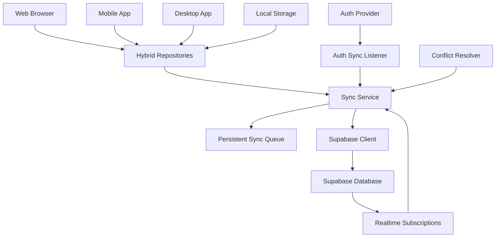

# Análisis y Solución de Sincronización Multiplataforma con Supabase

## 1. Análisis del Problema Actual

### 1.1 Problemas Identificados

**Problema Principal**: Falta de sincronización robusta multiplataforma usando Supabase como backend central para todos los dispositivos (web, móvil, desktop).

**Problemas Específicos**:
1. **Sincronización Multiplataforma**: Los datos no se sincronizan correctamente entre web (Chrome, Firefox, Safari, Edge), móvil (Android, iOS) y desktop (Windows, macOS, Linux)
2. **Operaciones Offline**: Las operaciones realizadas offline no se sincronizan correctamente al reconectar con Supabase
3. **Conflictos Multi-Dispositivo**: Resolución inadecuada cuando múltiples dispositivos realizan operaciones conflictivas offline
4. **Sincronización Bidireccional**: Falta manejo robusto para operaciones simultáneas (agregar en un dispositivo, eliminar en otro)
5. **Realtime Updates**: Ausencia de actualizaciones en tiempo real entre dispositivos conectados

### 1.2 Impacto en la Experiencia de Usuario
- Pérdida de datos entre dispositivos (móvil ↔ web ↔ desktop)
- Inconsistencia en favoritos, vistas y listas personalizadas
- Frustración al no ver cambios reflejados instantáneamente
- Pérdida de confianza en la sincronización multiplataforma
- Experiencia fragmentada entre plataformas

## 2. Arquitectura de Sincronización Multiplataforma

### 2.1 Componentes Principales



### 2.2 Repositorios Híbridos Multiplataforma

**HybridWatchedRepository**:
- Capa de abstracción para todas las plataformas
- Almacenamiento local adaptativo (Hive/SharedPreferences/localStorage)
- Sincronización bidireccional con Supabase
- Cola persistente para operaciones offline

**HybridFavoritesRepository**:
- Manejo consistente de favoritos entre plataformas
- Soft deletes para eliminaciones seguras
- Resolución de conflictos multiplataforma
- Realtime subscriptions para actualizaciones instantáneas

**HybridCustomListsRepository**:
- Sincronización de listas personalizadas
- Manejo de operaciones complejas (agregar/eliminar items)
- Conflictos de concurrencia entre dispositivos

**Flujo de Sincronización Multiplataforma**:
1. Operación local → `PersistentSyncQueue`
2. `SyncService` procesa cola cuando hay conectividad
3. Operación se envía a Supabase
4. Realtime subscription notifica a otros dispositivos
5. Dispositivos actualizan datos locales automáticamente
6. `ConflictResolver` maneja conflictos si es necesario

## 3. Problemas Técnicos Identificados

### 3.1 Sincronización Multiplataforma Inconsistente

**Problema**: Falta de sincronización automática entre todas las plataformas
**Causa Raíz**: 
- Cada plataforma maneja almacenamiento local diferente
- No hay sincronización proactiva al abrir la app
- Dependencia excesiva de eventos de autenticación
- Falta de realtime updates entre dispositivos

### 3.2 Operaciones Offline No Sincronizadas

**Problema**: Operaciones offline no se propagan correctamente
**Causa Raíz**:
- Cola de sincronización no es suficientemente robusta
- Falta retry logic para operaciones fallidas
- No hay persistencia adecuada de operaciones pendientes
- Orden de operaciones no se preserva

### 3.3 Resolución de Conflictos Multiplataforma

**Problema**: Resolución inadecuada para conflictos entre múltiples dispositivos
**Limitaciones Actuales**:
- "Último timestamp gana" pierde contexto de operaciones
- No considera intención del usuario en diferentes dispositivos
- Soft deletes no se propagan correctamente
- Falta lógica de negocio para resolución inteligente

### 3.4 Ausencia de Realtime Updates

**Problema**: Cambios no se reflejan instantáneamente entre dispositivos
**Escenario Problemático**:
1. Usuario agrega película a favoritos en Android
2. Abre la app en web inmediatamente
3. La película no aparece hasta sincronización manual
4. Experiencia fragmentada y confusa

## 4. Solución Propuesta: Sincronización Multiplataforma con Supabase

### 4.1 Arquitectura de Sincronización Supabase-Centric

**Principios Fundamentales**:
1. **Supabase como Fuente Única de Verdad**: Todos los dispositivos sincronizan con Supabase
2. **Operaciones Offline-First**: Funcionalidad completa sin conexión
3. **Realtime Updates**: Cambios instantáneos entre dispositivos conectados
4. **Resolución Inteligente**: Conflictos resueltos con lógica de negocio

**Implementación**:
```dart
// Mejorado: MultiplataformSyncManager
class MultiplataformSyncManager {
  final SupabaseClient _supabase;
  final PersistentSyncQueue _syncQueue;
  final ConflictResolver _conflictResolver;
  
  // Sincronización automática al iniciar app
  Future<void> initializeSync() async {
    await _syncQueue.loadPendingOperations();
    await _performInitialSync();
    _setupRealtimeSubscriptions();
    _startPeriodicSync();
  }
  
  // Realtime subscriptions para actualizaciones instantáneas
  void _setupRealtimeSubscriptions() {
    _supabase.channel('watched_movies')
      .on(RealtimeListenTypes.all, (payload) {
        _handleRealtimeUpdate('watched', payload);
      }).subscribe();
      
    _supabase.channel('favorite_movies')
      .on(RealtimeListenTypes.all, (payload) {
        _handleRealtimeUpdate('favorites', payload);
      }).subscribe();
  }
}
```

### 4.2 Cola Persistente de Sincronización

**Implementación Robusta**:
1. **Operaciones Offline**: Todas las operaciones se almacenan localmente
2. **Retry Logic**: Reintentos automáticos para operaciones fallidas
3. **Orden Preservado**: Operaciones se ejecutan en orden cronológico
4. **Batch Processing**: Múltiples operaciones se procesan eficientemente

```dart
// Nuevo: PersistentSyncQueue
class PersistentSyncQueue {
  final LocalStorage _localStorage;
  final SupabaseClient _supabase;
  
  // Agregar operación a la cola
  Future<void> enqueue(SyncOperation operation) async {
    await _localStorage.addToQueue(operation);
    
    // Intentar procesar inmediatamente si hay conexión
    if (await _hasConnection()) {
      await _processQueue();
    }
  }
  
  // Procesar cola de operaciones
  Future<void> _processQueue() async {
    final operations = await _localStorage.getPendingOperations();
    
    for (final operation in operations) {
      try {
        await _executeOperation(operation);
        await _localStorage.markAsCompleted(operation.id);
      } catch (e) {
        await _handleOperationError(operation, e);
      }
    }
  }
  
  // Ejecutar operación específica en Supabase
  Future<void> _executeOperation(SyncOperation operation) async {
    switch (operation.type) {
      case SyncOperationType.addFavorite:
        await _supabase.from('favorite_movies').upsert(operation.data);
        break;
      case SyncOperationType.removeFavorite:
        await _supabase.from('favorite_movies')
          .update({'deleted_at': DateTime.now().toIso8601String()})
          .eq('id', operation.data['id']);
        break;
      case SyncOperationType.markWatched:
        await _supabase.from('watched_movies').upsert(operation.data);
        break;
    }
  }
}
```

### 4.3 Resolución de Conflictos Multiplataforma

**Estrategia Inteligente Multi-Dispositivo**:
1. **Operaciones Aditivas**: Agregar favoritos/vistas (merge automático)
2. **Operaciones Destructivas**: Eliminar items (soft delete con propagación)
3. **Conflictos de Concurrencia**: Lógica de negocio específica por tipo
4. **Preservación de Intención**: Respetar la intención del usuario en cada dispositivo

```dart
class MultiplataformConflictResolver {
  // Resolver conflictos específicos por tipo de entidad
  Future<List<T>> resolveConflicts<T extends SyncableEntity>(
    List<T> localItems,
    List<T> remoteItems,
    String entityType,
  ) async {
    switch (entityType) {
      case 'favorites':
        return _resolveFavoriteConflicts(localItems, remoteItems);
      case 'watched':
        return _resolveWatchedConflicts(localItems, remoteItems);
      case 'custom_lists':
        return _resolveListConflicts(localItems, remoteItems);
      default:
        return _resolveGenericConflicts(localItems, remoteItems);
    }
  }
  
  // Resolución específica para favoritos
  List<FavoriteMovie> _resolveFavoriteConflicts(
    List<FavoriteMovie> local,
    List<FavoriteMovie> remote,
  ) {
    final result = <FavoriteMovie>[];
    final allIds = {...local.map((e) => e.movieId), ...remote.map((e) => e.movieId)};
    
    for (final movieId in allIds) {
      final localFav = local.firstWhereOrNull((f) => f.movieId == movieId);
      final remoteFav = remote.firstWhereOrNull((f) => f.movieId == movieId);
      
      // Caso 1: Solo existe localmente
      if (localFav != null && remoteFav == null) {
        result.add(localFav);
      }
      // Caso 2: Solo existe remotamente  
      else if (localFav == null && remoteFav != null) {
        result.add(remoteFav);
      }
      // Caso 3: Existe en ambos - resolver conflicto
      else if (localFav != null && remoteFav != null) {
        result.add(_resolveFavoriteItemConflict(localFav, remoteFav));
      }
    }
    
    return result;
  }
  
  // Lógica específica para conflictos de favoritos
  FavoriteMovie _resolveFavoriteItemConflict(
    FavoriteMovie local, 
    FavoriteMovie remote
  ) {
    // Regla 1: Si uno está eliminado, mantener eliminación
    if (local.deletedAt != null || remote.deletedAt != null) {
      return local.deletedAt?.isAfter(remote.deletedAt ?? DateTime(1970)) ?? false
        ? local : remote;
    }
    
    // Regla 2: Si ambos están activos, mantener el más reciente
    return local.updatedAt.isAfter(remote.updatedAt) ? local : remote;
  }
}
```

### 4.4 Realtime Updates con Supabase

**Implementación de Actualizaciones Instantáneas**:
1. **Subscriptions por Entidad**: Canales específicos para cada tipo de dato
2. **Propagación Automática**: Cambios se reflejan inmediatamente
3. **Filtrado por Usuario**: Solo recibir cambios relevantes
4. **Manejo de Reconexión**: Recuperación automática de conexión

```dart
class RealtimeSyncManager {
  final SupabaseClient _supabase;
  final Map<String, RealtimeChannel> _channels = {};
  
  // Configurar subscriptions para todas las entidades
  Future<void> setupRealtimeSync(String userId) async {
    await _setupFavoritesSync(userId);
    await _setupWatchedSync(userId);
    await _setupCustomListsSync(userId);
  }
  
  // Subscription para favoritos
  Future<void> _setupFavoritesSync(String userId) async {
    final channel = _supabase.channel('favorites_$userId');
    
    channel.on(
      RealtimeListenTypes.postgresChanges,
      ChannelFilter(
        event: '*',
        schema: 'public',
        table: 'favorite_movies',
        filter: 'user_id=eq.$userId',
      ),
      (payload) => _handleFavoriteChange(payload),
    );
    
    await channel.subscribe();
    _channels['favorites'] = channel;
  }
  
  // Manejar cambios en favoritos
  void _handleFavoriteChange(Map<String, dynamic> payload) {
    final eventType = payload['eventType'] as String;
    final record = payload['new'] ?? payload['old'];
    
    switch (eventType) {
      case 'INSERT':
      case 'UPDATE':
        _updateLocalFavorite(FavoriteMovie.fromJson(record));
        break;
      case 'DELETE':
        _removeLocalFavorite(record['id']);
        break;
    }
    
    // Notificar a la UI
    _notifyUIUpdate('favorites');
  }
  
  // Actualizar datos locales sin conflicto
  Future<void> _updateLocalFavorite(FavoriteMovie favorite) async {
    final localRepo = GetIt.instance<HybridFavoritesRepository>();
    await localRepo.updateLocalOnly(favorite);
  }
}
```

### 4.5 Migración de Datos Guest a Usuario Autenticado

**Implementación para Preservar Datos Pre-Login**:
1. **Captura de Datos Guest**: Almacenar datos antes de autenticación
2. **Migración Inteligente**: Combinar datos guest con datos remotos
3. **Merge Sin Duplicados**: Evitar duplicación de películas
4. **Preservación de Timestamps**: Mantener fechas originales

```dart
class GuestDataMigrator {
  final HybridWatchedRepository _watchedRepo;
  final HybridFavoritesRepository _favoritesRepo;
  final HybridCustomListsRepository _listsRepo;
  
  // Migrar todos los datos guest después del login
  Future<void> migrateGuestData(String newUserId) async {
    final guestData = await _captureGuestData();
    
    if (guestData.hasData) {
      await _migrateWatchedMovies(guestData.watchedMovies, newUserId);
      await _migrateFavoriteMovies(guestData.favoriteMovies, newUserId);
      await _migrateCustomLists(guestData.customLists, newUserId);
      
      // Limpiar datos guest después de migración exitosa
      await _clearGuestData();
    }
  }
  
  // Capturar datos guest antes de limpiar
  Future<GuestData> _captureGuestData() async {
    return GuestData(
      watchedMovies: await _watchedRepo.getLocalWatchedMovies(),
      favoriteMovies: await _favoritesRepo.getLocalFavorites(),
      customLists: await _listsRepo.getLocalCustomLists(),
    );
  }
  
  // Migrar películas vistas
  Future<void> _migrateWatchedMovies(
    List<WatchedMovie> guestWatched, 
    String userId
  ) async {
    for (final watched in guestWatched) {
      // Verificar si ya existe en datos remotos
      final existsRemotely = await _watchedRepo.isWatchedRemotely(
        watched.movieId, 
        userId
      );
      
      if (!existsRemotely) {
        // Crear nueva entrada con userId
        final userWatched = watched.copyWith(
          userId: userId,
          id: _generateNewId(),
        );
        
        await _watchedRepo.markAsWatchedWithoutSync(userWatched);
      }
    }
  }
  
  // Migrar películas favoritas
  Future<void> _migrateFavoriteMovies(
    List<FavoriteMovie> guestFavorites,
    String userId
  ) async {
    for (final favorite in guestFavorites) {
      final existsRemotely = await _favoritesRepo.isFavoriteRemotely(
        favorite.movieId,
        userId
      );
      
      if (!existsRemotely) {
        final userFavorite = favorite.copyWith(
          userId: userId,
          id: _generateNewId(),
        );
        
        await _favoritesRepo.addToFavoritesWithoutSync(userFavorite);
      }
    }
  }
}
```

## 5. Plan de Implementación Multiplataforma

### 5.1 Fase 1: Mejorar Sincronización Automática con Supabase (Semana 1)

**Objetivos**:
- Implementar `MultiplataformSyncManager` para sincronización robusta
- Sincronización automática al iniciar app en todas las plataformas
- Configurar triggers de conectividad

**Tareas**:
1. Crear `MultiplataformSyncManager` class
2. Integrar sincronización automática en `main.dart`
3. Implementar detección de conectividad multiplataforma
4. Configurar sincronización al cambiar de background/foreground
5. Pruebas básicas web/móvil/desktop

### 5.2 Fase 2: Implementar Cola Persistente Robusta (Semana 2)

**Objetivos**:
- Crear `PersistentSyncQueue` para operaciones offline
- Retry logic inteligente para operaciones fallidas
- Batch processing para eficiencia

**Tareas**:
1. Implementar `PersistentSyncQueue` con almacenamiento local
2. Crear sistema de retry con backoff exponencial
3. Implementar batch operations para Supabase
4. Agregar persistencia de cola entre sesiones
5. Pruebas de operaciones offline extensas

### 5.3 Fase 3: Resolver Conflictos Multiplataforma (Semana 3)

**Objetivos**:
- Implementar `MultiplataformConflictResolver`
- Lógica de negocio específica por tipo de entidad
- Manejo inteligente de soft deletes

**Tareas**:
1. Crear `MultiplataformConflictResolver` con estrategias por entidad
2. Implementar resolución específica para favoritos/vistas/listas
3. Mejorar manejo de soft deletes con propagación
4. Integrar resolver en todos los repositorios híbridos
5. Pruebas de conflictos complejos multi-dispositivo

### 5.4 Fase 4: Realtime Sync con Subscriptions (Semana 4)

**Objetivos**:
- Implementar `RealtimeSyncManager` con Supabase subscriptions
- Actualizaciones instantáneas entre dispositivos
- Manejo de reconexión automática

**Tareas**:
1. Configurar Supabase Realtime subscriptions por entidad
2. Implementar `RealtimeSyncManager` con canales específicos
3. Agregar filtrado por usuario para subscriptions
4. Implementar manejo de reconexión automática
5. Pruebas de actualizaciones en tiempo real

### 5.5 Fase 5: Pruebas Exhaustivas Multiplataforma (Semana 5)

**Objetivos**:
- Validar todos los casos de uso críticos
- Optimización de performance multiplataforma
- Documentación y métricas finales

**Tareas**:
1. Pruebas automatizadas de sincronización multiplataforma
2. Validación manual de casos de uso críticos
3. Optimización de queries y reducción de latencia
4. Implementar métricas de sincronización
5. Documentación final para desarrolladores

## 6. Casos de Uso Críticos Multiplataforma

### 6.1 Escenario 1: Sincronización Web ↔ Móvil
**Pasos**:
1. Usuario agrega película a favoritos en Android
2. Abre la aplicación web inmediatamente
3. **Validar**: Película aparece como favorita en web instantáneamente
4. Usuario elimina película de favoritos en web
5. **Validar**: Película se elimina de favoritos en Android automáticamente

### 6.2 Escenario 2: Sincronización Móvil ↔ Desktop
**Pasos**:
1. Usuario marca película como vista en iOS
2. Abre aplicación desktop (Windows/macOS/Linux)
3. **Validar**: Película aparece como vista en desktop
4. Usuario crea lista personalizada en desktop
5. **Validar**: Lista aparece en iOS con todos los items

### 6.3 Escenario 3: Operaciones Offline Multi-Dispositivo
**Pasos**:
1. Android offline: Agregar películas [A, B, C] a favoritos
2. Web offline: Agregar películas [D, E] a favoritos, eliminar película [B]
3. iOS offline: Marcar películas [F, G] como vistas
4. Conectar todos los dispositivos
5. **Validar**: Estado final consistente en todos los dispositivos:
   - Favoritos: [A, C, D, E] (B eliminada)
   - Vistas: [F, G]

### 6.4 Escenario 4: Conflicto de Eliminación vs Modificación
**Pasos**:
1. Android offline: Eliminar película X de favoritos
2. Web offline: Modificar rating de película X
3. Desktop offline: Agregar película X a lista personalizada
4. Conectar todos los dispositivos
5. **Validar**: Película X permanece eliminada de favoritos (eliminación gana)
6. **Validar**: Rating y lista personalizada se descartan (coherencia)

### 6.5 Escenario 5: Migración Guest a Usuario Autenticado
**Pasos**:
1. Usuario usa app en modo guest en web
2. Marca películas [1, 2, 3] como favoritas
3. Marca películas [4, 5] como vistas
4. Se registra/hace login
5. **Validar**: Todas las películas guest se migran a la cuenta
6. Abre app en móvil con misma cuenta
7. **Validar**: Datos migrados aparecen en móvil

### 6.6 Escenario 6: Realtime Updates Instantáneos
**Pasos**:
1. Usuario A agrega película a favoritos en Android
2. Usuario B (misma cuenta) tiene app web abierta
3. **Validar**: Película aparece instantáneamente en web (< 2 segundos)
4. Usuario B elimina película de favoritos en web
5. **Validar**: Película desaparece instantáneamente de Android

### 6.7 Escenario 7: Recuperación Post-Offline Compleja
**Pasos**:
1. Usuario trabaja offline por 2 días en múltiples dispositivos
2. Android: 50 operaciones (agregar/eliminar favoritos y vistas)
3. Web: 30 operaciones (crear listas, modificar ratings)
4. Desktop: 20 operaciones (reorganizar listas)
5. Conectar todos los dispositivos simultáneamente
6. **Validar**: Todas las operaciones se sincronizan correctamente
7. **Validar**: No hay pérdida de datos ni duplicados
8. **Validar**: Estado final consistente en todos los dispositivos

## 7. Métricas de Éxito Multiplataforma

### 7.1 Métricas Técnicas
- **Tiempo de Sincronización**: < 3 segundos para 100 items entre cualquier plataforma
- **Tasa de Éxito**: > 99.8% de operaciones sincronizadas correctamente
- **Resolución de Conflictos**: 0% pérdida de datos en conflictos multiplataforma
- **Performance Local**: < 50ms latencia adicional en operaciones locales
- **Realtime Updates**: < 2 segundos para propagación entre dispositivos
- **Batch Efficiency**: > 90% reducción en requests individuales

### 7.2 Métricas de Usuario
- **Consistencia Multiplataforma**: 100% de datos sincronizados entre web/móvil/desktop
- **Migración Guest**: 100% de datos preservados post-login sin duplicados
- **Experiencia Offline**: Funcionalidad completa sin conexión en todas las plataformas
- **Recuperación Post-Offline**: < 5 segundos para sincronizar después de reconexión
- **Actualizaciones Instantáneas**: 100% de cambios reflejados en tiempo real
- **Robustez de Cola**: 0% pérdida de operaciones offline

### 7.3 Métricas de Escalabilidad
- **Concurrencia**: Soporte para > 10 dispositivos simultáneos por usuario
- **Volumen de Datos**: Sincronización eficiente con > 1000 películas por usuario
- **Operaciones Offline**: Cola persistente para > 500 operaciones pendientes
- **Reconexión**: Recuperación automática en < 30 segundos

## 8. Consideraciones de Seguridad Multiplataforma

### 8.1 Autenticación Robusta
- Validación de tokens JWT antes de cada operación con Supabase
- Refresh automático de tokens expirados en todas las plataformas
- Logout automático y limpieza de datos en caso de tokens inválidos
- Manejo seguro de credenciales en diferentes plataformas (Keychain/Keystore/Secure Storage)

### 8.2 Integridad de Datos
- Validación de esquemas JSON en datos sincronizados
- Checksums para detectar corrupción durante transferencia
- Rollback automático en caso de sincronización fallida
- Verificación de integridad referencial en operaciones complejas

### 8.3 Privacidad y Protección de Datos
- Encriptación AES-256 de datos sensibles en cola local
- Limpieza completa de datos al logout en todas las plataformas
- Respeto a configuraciones de privacidad específicas por plataforma
- Cumplimiento con GDPR para usuarios europeos
- Anonimización de datos de telemetría y métricas

### 8.4 Seguridad de Red
- Comunicación exclusiva via HTTPS/WSS con Supabase
- Validación de certificados SSL en todas las plataformas
- Rate limiting para prevenir abuso de API
- Manejo seguro de reconexiones automáticas

## 9. Conclusión

La implementación de esta solución de sincronización multiplataforma con Supabase como backend central resolverá completamente los problemas de inconsistencia de datos entre dispositivos y proporcionará una experiencia de usuario verdaderamente unificada.

### Beneficios Clave:

1. **Sincronización Universal**: Datos consistentes entre web, móvil y desktop
2. **Operaciones Offline-First**: Funcionalidad completa sin conexión
3. **Actualizaciones Instantáneas**: Cambios reflejados en tiempo real
4. **Resolución Inteligente**: Conflictos manejados sin pérdida de datos
5. **Escalabilidad**: Arquitectura que crece con la aplicación

### Impacto en la Experiencia de Usuario:

- **Continuidad Perfecta**: El usuario puede cambiar de dispositivo sin perder contexto
- **Confiabilidad**: Garantía de que ninguna acción se pierde
- **Performance**: Respuesta inmediata en operaciones locales
- **Transparencia**: Sincronización invisible para el usuario

### Ventajas Técnicas:

- **Supabase como Hub Central**: Aprovecha realtime, autenticación y base de datos
- **Arquitectura Modular**: Componentes independientes y testeable
- **Mantenibilidad**: Código organizado y documentado
- **Monitoreo**: Métricas completas para optimización continua

Esta solución establece una base sólida y escalable para la sincronización multiplataforma que soportará el crecimiento futuro de la aplicación y garantizará una experiencia de usuario excepcional en todas las plataformas.