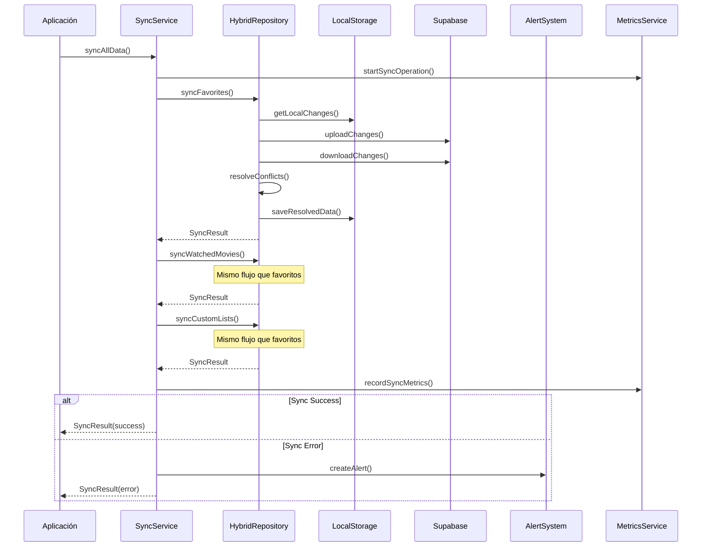
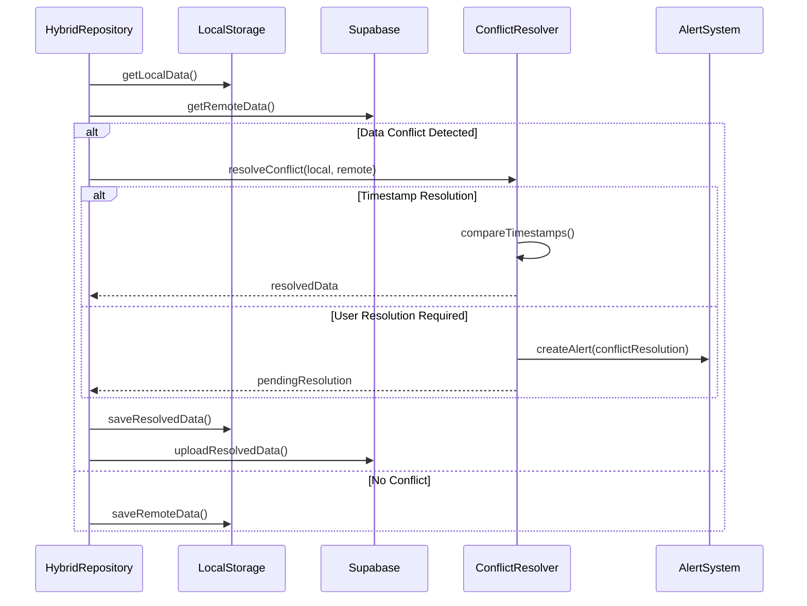
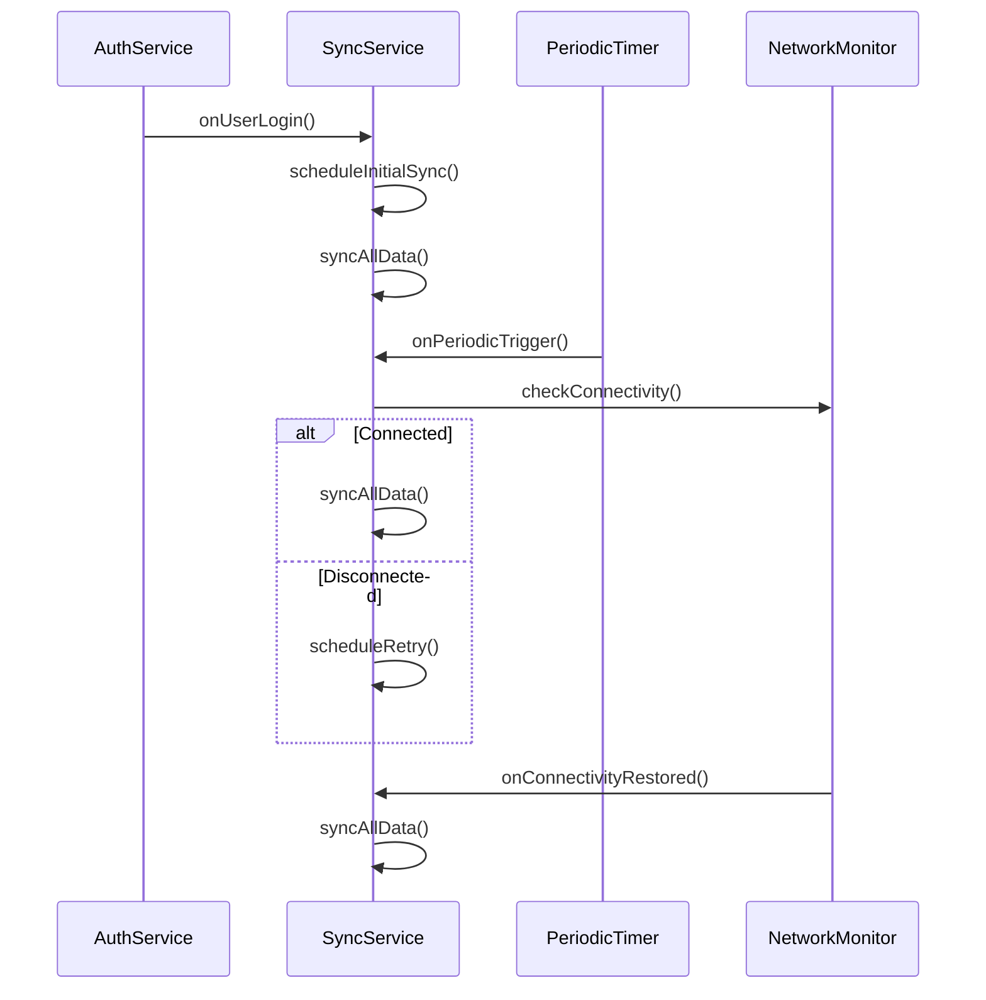

# Documentación de APIs y Flujos de Sincronización

## Índice
1. [Arquitectura General](#arquitectura-general)
2. [APIs de Sincronización](#apis-de-sincronización)
3. [Flujos de Sincronización](#flujos-de-sincronización)
4. [Sistema de Logging](#sistema-de-logging)
5. [Sistema de Métricas](#sistema-de-métricas)
6. [Sistema de Alertas](#sistema-de-alertas)
7. [Manejo de Errores](#manejo-de-errores)
8. [Optimización de Rendimiento](#optimización-de-rendimiento)
9. [Casos de Uso](#casos-de-uso)
10. [Troubleshooting](#troubleshooting)

## Arquitectura General

### Estrategia "Local First"
El sistema implementa una estrategia "Local First" donde:
- Los datos se almacenan primero localmente (Hive)
- La sincronización con Supabase ocurre en segundo plano
- La aplicación funciona offline con sincronización automática al reconectarse

### Componentes Principales
```
┌─────────────────┐    ┌─────────────────┐    ┌─────────────────┐
│   Presentation  │    │  Infrastructure │    │    Supabase     │
│     Layer       │◄──►│     Layer       │◄──►│    Backend      │
└─────────────────┘    └─────────────────┘    └─────────────────┘
        │                       │                       │
        │              ┌─────────────────┐              │
        └─────────────►│  Local Storage  │              │
                       │     (Hive)      │              │
                       └─────────────────┘              │
                                │                       │
                                └───────────────────────┘
```

## APIs de Sincronización

### 1. SyncService - API Principal

#### `syncAllData()`
```dart
Future<SyncResult> syncAllData({
  bool forceSync = false,
  Duration? timeout,
}) async
```

**Descripción**: Sincroniza todos los tipos de datos del usuario.

**Parámetros**:
- `forceSync`: Fuerza la sincronización incluso si no hay cambios
- `timeout`: Tiempo límite para la operación

**Retorna**: `SyncResult` con el estado de la sincronización

**Ejemplo de uso**:
```dart
final syncService = ref.read(syncServiceProvider);
final result = await syncService.syncAllData(forceSync: true);

if (result.isSuccess) {
  print('Sincronización exitosa: ${result.syncedItems} elementos');
} else {
  print('Error en sincronización: ${result.error}');
}
```

#### `syncFavorites()`
```dart
Future<SyncResult> syncFavorites({
  DateTime? since,
  int? limit,
}) async
```

**Descripción**: Sincroniza favoritos del usuario.

**Parámetros**:
- `since`: Sincronizar solo cambios desde esta fecha
- `limit`: Límite de elementos a sincronizar

#### `syncWatchedMovies()`
```dart
Future<SyncResult> syncWatchedMovies({
  DateTime? since,
  int? limit,
}) async
```

**Descripción**: Sincroniza películas vistas del usuario.

#### `syncCustomLists()`
```dart
Future<SyncResult> syncCustomLists({
  DateTime? since,
  int? limit,
}) async
```

**Descripción**: Sincroniza listas personalizadas del usuario.

### 2. HybridFavoritesRepository - API de Favoritos

#### `addFavorite(Movie movie)`
```dart
Future<void> addFavorite(Movie movie) async
```

**Descripción**: Agrega una película a favoritos.

**Flujo**:
1. Guarda localmente en Hive
2. Programa sincronización con Supabase
3. Actualiza estadísticas del usuario

#### `removeFavorite(int movieId)`
```dart
Future<void> removeFavorite(int movieId) async
```

**Descripción**: Remueve una película de favoritos.

#### `getFavorites()`
```dart
Future<List<Movie>> getFavorites() async
```

**Descripción**: Obtiene todas las películas favoritas.

#### `syncWithSupabase()`
```dart
Future<SyncResult> syncWithSupabase() async
```

**Descripción**: Sincroniza favoritos con Supabase usando estrategia bidireccional.

### 3. HybridWatchedRepository - API de Películas Vistas

#### `markAsWatched(Movie movie)`
```dart
Future<void> markAsWatched(Movie movie) async
```

**Descripción**: Marca una película como vista.

#### `markAsUnwatched(int movieId)`
```dart
Future<void> markAsUnwatched(int movieId) async
```

**Descripción**: Marca una película como no vista.

#### `getWatchedMovies()`
```dart
Future<List<Movie>> getWatchedMovies() async
```

**Descripción**: Obtiene todas las películas vistas.

### 4. CustomListsRepository - API de Listas Personalizadas

#### `createList(CustomList list)`
```dart
Future<CustomList> createList(CustomList list) async
```

**Descripción**: Crea una nueva lista personalizada.

#### `updateList(CustomList list)`
```dart
Future<void> updateList(CustomList list) async
```

**Descripción**: Actualiza una lista existente.

#### `deleteList(String listId)`
```dart
Future<void> deleteList(String listId) async
```

**Descripción**: Elimina una lista personalizada.

#### `addMovieToList(String listId, Movie movie)`
```dart
Future<void> addMovieToList(String listId, Movie movie) async
```

**Descripción**: Agrega una película a una lista.

## Flujos de Sincronización

### 1. Flujo de Sincronización Completa



### 2. Flujo de Resolución de Conflictos



### 3. Flujo de Sincronización Automática



## Sistema de Logging

### SyncLogger - API de Logging

#### Niveles de Log
```dart
enum SyncLogLevel {
  debug,    // Información detallada para debugging
  info,     // Información general de operaciones
  warning,  // Advertencias que no impiden la operación
  error,    // Errores que impiden la operación
}
```

#### Tipos de Operación
```dart
enum SyncOperationType {
  upload,     // Subida de datos a Supabase
  download,   // Descarga de datos desde Supabase
  conflict,   // Resolución de conflictos
  cleanup,    // Limpieza de datos
  system,     // Operaciones del sistema
  alert,      // Alertas del sistema
}
```

#### Uso del Logger
```dart
final logger = SyncLogger();

// Log básico
logger.log(
  SyncLogLevel.info,
  SyncOperationType.upload,
  'Subiendo favoritos a Supabase',
);

// Log con metadata
logger.log(
  SyncLogLevel.error,
  SyncOperationType.conflict,
  'Conflicto detectado en favoritos',
  metadata: {
    'localTimestamp': localData.updatedAt,
    'remoteTimestamp': remoteData.updatedAt,
    'movieId': movie.id,
  },
);

// Usando extensiones
await repository.logSyncStart('favorites', 150);
await repository.logSyncSuccess('favorites', 150, duration);
await repository.logSyncError('favorites', error);
```

## Sistema de Métricas

### SyncMetricsService - API de Métricas

#### Métricas de Operación
```dart
class SyncOperationMetrics {
  final String operationType;
  final DateTime startTime;
  final DateTime endTime;
  final bool isSuccess;
  final int itemsProcessed;
  final int conflictsResolved;
  final String? errorMessage;
}
```

#### KPIs de Sincronización
```dart
class SyncKPIs {
  final double averageSyncTime;        // Tiempo promedio de sync
  final double successRate;            // Tasa de éxito (0.0 - 1.0)
  final int totalSyncsToday;          // Total de syncs hoy
  final int totalConflictsToday;      // Total de conflictos hoy
  final int totalErrorsToday;         // Total de errores hoy
  final DateTime lastSuccessfulSync;  // Último sync exitoso
  final Map<String, int> errorsByType; // Errores por tipo
}
```

#### Uso de Métricas
```dart
final metricsService = SyncMetricsService();

// Registrar operación
final metrics = SyncOperationMetrics(
  operationType: 'favorites_sync',
  startTime: DateTime.now(),
  endTime: DateTime.now().add(Duration(seconds: 2)),
  isSuccess: true,
  itemsProcessed: 25,
  conflictsResolved: 1,
);

metricsService.recordOperation(metrics);

// Obtener KPIs
final kpis = await metricsService.getKPIs();
print('Tasa de éxito: ${(kpis.successRate * 100).toStringAsFixed(1)}%');
print('Tiempo promedio: ${kpis.averageSyncTime.toStringAsFixed(2)}s');

// Obtener alertas activas
final alerts = metricsService.getActiveAlerts();
for (final alert in alerts) {
  print('Alerta: ${alert.message}');
}
```

## Sistema de Alertas

### SyncAlertSystem - API de Alertas

#### Tipos de Alerta
```dart
enum AlertType {
  connectionLost,      // Conexión perdida
  syncFailed,         // Fallo de sincronización
  conflictResolution, // Resolución de conflictos
  dataCorruption,     // Corrupción de datos
  performanceDegraded,// Rendimiento degradado
  quotaExceeded,      // Cuota excedida
  authenticationFailed,// Fallo de autenticación
  serverError,        // Error del servidor
}
```

#### Severidades
```dart
enum AlertSeverity {
  info,     // Información
  warning,  // Advertencia
  error,    // Error
  critical, // Crítico
}
```

#### Uso del Sistema de Alertas
```dart
final alertSystem = SyncAlertSystem();

// Configurar sistema
alertSystem.configure(AlertConfig(
  enableInAppNotifications: true,
  enablePushNotifications: false,
  alertThrottleDuration: Duration(minutes: 5),
  maxAlertsPerHour: 20,
));

// Crear alerta
await alertSystem.createAlert(
  type: AlertType.syncFailed,
  title: 'Error de sincronización',
  message: 'No se pudieron sincronizar los favoritos',
  metadata: {'operation': 'favorites_sync', 'error': 'Network timeout'},
);

// Usar extensiones
await this.alertConnectionLost(details: 'Timeout después de 30s');
await this.alertSyncFailed(
  operation: 'favorites_sync',
  error: 'Network error',
  additionalData: {'retryCount': 3},
);

// Escuchar alertas
alertSystem.alertStream.listen((alert) {
  print('Nueva alerta: ${alert.title}');
  if (alert.severity == AlertSeverity.critical) {
    // Manejar alerta crítica
  }
});

// Resolver alerta
await alertSystem.resolveAlert(
  alertId,
  resolutionNote: 'Conexión restaurada',
);
```

## Manejo de Errores

### Tipos de Error

1. **Errores de Red**
   - Timeout de conexión
   - Sin conectividad
   - Errores HTTP (4xx, 5xx)

2. **Errores de Autenticación**
   - Token expirado
   - Permisos insuficientes
   - Usuario no autenticado

3. **Errores de Datos**
   - Datos corruptos
   - Formato inválido
   - Conflictos de sincronización

4. **Errores del Sistema**
   - Espacio insuficiente
   - Permisos de archivo
   - Errores de base de datos

### Estrategias de Recuperación

```dart
class SyncErrorHandler {
  static Future<SyncResult> handleError(
    Exception error,
    String operation,
    {int retryCount = 0, int maxRetries = 3}
  ) async {
    switch (error.runtimeType) {
      case NetworkException:
        return await _handleNetworkError(error, operation, retryCount, maxRetries);
      case AuthException:
        return await _handleAuthError(error, operation);
      case DataException:
        return await _handleDataError(error, operation);
      default:
        return await _handleGenericError(error, operation);
    }
  }

  static Future<SyncResult> _handleNetworkError(
    NetworkException error,
    String operation,
    int retryCount,
    int maxRetries,
  ) async {
    if (retryCount < maxRetries) {
      // Retry con backoff exponencial
      final delay = Duration(seconds: math.pow(2, retryCount).toInt());
      await Future.delayed(delay);
      
      // Reintentar operación
      return await _retryOperation(operation, retryCount + 1, maxRetries);
    } else {
      // Crear alerta y programar retry posterior
      await SyncAlertSystem().alertConnectionLost(
        details: 'Max retries exceeded: $maxRetries',
      );
      
      return SyncResult.failure(
        error: 'Network error after $maxRetries retries',
        canRetry: true,
      );
    }
  }
}
```

## Optimización de Rendimiento

### Índices de Base de Datos

Los siguientes índices han sido creados para optimizar las consultas de sincronización:

```sql
-- Índices para sincronización por usuario y timestamp
CREATE INDEX idx_user_favorites_sync ON user_favorites(user_id, updated_at DESC, movie_id);
CREATE INDEX idx_user_watched_sync ON user_watched_movies(user_id, updated_at DESC, movie_id);
CREATE INDEX idx_user_lists_sync ON user_lists(user_id, updated_at DESC, id);
CREATE INDEX idx_user_list_items_sync ON user_list_items(list_id, updated_at DESC, movie_id);

-- Índices para paginación
CREATE INDEX idx_user_favorites_pagination ON user_favorites(user_id, added_at DESC, id);
CREATE INDEX idx_user_watched_pagination ON user_watched_movies(user_id, watched_at DESC, id);

-- Índices para búsquedas por película
CREATE INDEX idx_user_favorites_movie_search ON user_favorites(movie_id, user_id);
CREATE INDEX idx_user_watched_movie_search ON user_watched_movies(movie_id, user_id);
```

### Funciones Optimizadas

```sql
-- Función para obtener favoritos desde una fecha
CREATE OR REPLACE FUNCTION get_user_favorites_since(
    p_user_id UUID,
    p_since TIMESTAMP WITH TIME ZONE DEFAULT NULL,
    p_limit INTEGER DEFAULT 100
)
RETURNS TABLE (
    movie_id INTEGER,
    movie_title TEXT,
    movie_poster_path TEXT,
    added_at TIMESTAMP WITH TIME ZONE,
    updated_at TIMESTAMP WITH TIME ZONE
) AS $$
BEGIN
    RETURN QUERY
    SELECT 
        f.movie_id,
        f.movie_title,
        f.movie_poster_path,
        f.added_at,
        f.updated_at
    FROM user_favorites f
    WHERE f.user_id = p_user_id
        AND (p_since IS NULL OR f.updated_at > p_since)
    ORDER BY f.updated_at DESC, f.added_at DESC
    LIMIT p_limit;
END;
$$ LANGUAGE plpgsql;
```

### Operaciones por Lotes

```sql
-- Función para insertar/actualizar favoritos por lotes
CREATE OR REPLACE FUNCTION batch_upsert_favorites(
    p_user_id UUID,
    p_favorites JSONB
)
RETURNS INTEGER AS $$
DECLARE
    affected_rows INTEGER;
BEGIN
    INSERT INTO user_favorites (
        user_id, movie_id, movie_title, movie_poster_path,
        movie_release_date, movie_vote_average, added_at, updated_at
    )
    SELECT 
        p_user_id,
        (item->>'movie_id')::INTEGER,
        item->>'movie_title',
        item->>'movie_poster_path',
        (item->>'movie_release_date')::DATE,
        (item->>'movie_vote_average')::DECIMAL(3,1),
        (item->>'added_at')::TIMESTAMP WITH TIME ZONE,
        (item->>'updated_at')::TIMESTAMP WITH TIME ZONE
    FROM jsonb_array_elements(p_favorites) AS item
    ON CONFLICT (user_id, movie_id) 
    DO UPDATE SET
        movie_title = EXCLUDED.movie_title,
        movie_poster_path = EXCLUDED.movie_poster_path,
        movie_release_date = EXCLUDED.movie_release_date,
        movie_vote_average = EXCLUDED.movie_vote_average,
        updated_at = EXCLUDED.updated_at
    WHERE user_favorites.updated_at < EXCLUDED.updated_at;
    
    GET DIAGNOSTICS affected_rows = ROW_COUNT;
    RETURN affected_rows;
END;
$$ LANGUAGE plpgsql;
```

## Casos de Uso

### 1. Usuario Agrega Película a Favoritos

```dart
// En el UI
final favoritesRepository = ref.read(hybridFavoritesRepositoryProvider);

try {
  await favoritesRepository.addFavorite(movie);
  
  // La película se guarda inmediatamente en local
  // La sincronización ocurre en background
  
  ScaffoldMessenger.of(context).showSnackBar(
    SnackBar(content: Text('Película agregada a favoritos')),
  );
} catch (e) {
  ScaffoldMessenger.of(context).showSnackBar(
    SnackBar(content: Text('Error: $e')),
  );
}
```

### 2. Sincronización al Iniciar Sesión

```dart
// En AuthService
class AuthServiceImpl implements AuthService {
  @override
  Future<void> signIn(String email, String password) async {
    await supabase.auth.signInWithPassword(
      email: email,
      password: password,
    );
    
    // Trigger sincronización automática
    final syncService = ref.read(syncServiceProvider);
    unawaited(syncService.syncAllData());
  }
}
```

### 3. Manejo de Conflictos

```dart
// En HybridRepository
Future<Movie> _resolveConflict(Movie local, Movie remote) async {
  // Estrategia: El más reciente gana
  if (local.updatedAt.isAfter(remote.updatedAt)) {
    await this.alertConflictResolution(
      dataType: 'favorite',
      resolution: 'Local data kept (newer)',
    );
    return local;
  } else {
    await this.alertConflictResolution(
      dataType: 'favorite', 
      resolution: 'Remote data kept (newer)',
    );
    return remote;
  }
}
```

### 4. Monitoreo de Rendimiento

```dart
// En SyncService
Future<SyncResult> syncFavorites() async {
  final stopwatch = Stopwatch()..start();
  
  try {
    final result = await _performFavoritesSync();
    
    stopwatch.stop();
    final duration = stopwatch.elapsed;
    
    // Registrar métricas
    final metrics = SyncOperationMetrics(
      operationType: 'favorites_sync',
      startTime: DateTime.now().subtract(duration),
      endTime: DateTime.now(),
      isSuccess: result.isSuccess,
      itemsProcessed: result.syncedItems,
      conflictsResolved: result.conflictsResolved,
    );
    
    _metricsService.recordOperation(metrics);
    
    // Alerta si el rendimiento está degradado
    if (duration > Duration(seconds: 10)) {
      await this.alertPerformanceDegraded(
        operation: 'favorites_sync',
        duration: duration,
        threshold: Duration(seconds: 5),
      );
    }
    
    return result;
  } catch (e) {
    stopwatch.stop();
    await this.alertSyncFailed(
      operation: 'favorites_sync',
      error: e.toString(),
    );
    rethrow;
  }
}
```

## Troubleshooting

### Problemas Comunes

#### 1. Sincronización Lenta

**Síntomas**:
- Operaciones de sync tardan más de 10 segundos
- Alertas de rendimiento degradado

**Diagnóstico**:
```dart
// Verificar métricas
final kpis = await SyncMetricsService().getKPIs();
print('Tiempo promedio de sync: ${kpis.averageSyncTime}s');

// Verificar logs
final logs = await SyncLogger().getRecentLogs(
  level: SyncLogLevel.warning,
  operationType: SyncOperationType.upload,
);
```

**Soluciones**:
- Verificar conectividad de red
- Reducir el tamaño de lotes de sincronización
- Optimizar consultas SQL
- Implementar paginación

#### 2. Conflictos Frecuentes

**Síntomas**:
- Muchas alertas de resolución de conflictos
- Datos inconsistentes entre dispositivos

**Diagnóstico**:
```dart
// Verificar conflictos por tipo
final alerts = SyncAlertSystem().getAlertsByType(AlertType.conflictResolution);
print('Conflictos en las últimas 24h: ${alerts.length}');
```

**Soluciones**:
- Mejorar la granularidad de timestamps
- Implementar resolución de conflictos más sofisticada
- Reducir la frecuencia de sincronización automática

#### 3. Errores de Autenticación

**Síntomas**:
- Errores 401/403 en logs
- Alertas de autenticación fallida

**Diagnóstico**:
```dart
// Verificar estado de autenticación
final user = supabase.auth.currentUser;
if (user == null) {
  print('Usuario no autenticado');
} else {
  print('Token expira: ${user.userMetadata?['exp']}');
}
```

**Soluciones**:
- Renovar token de autenticación
- Verificar permisos RLS en Supabase
- Implementar re-autenticación automática

### Comandos de Diagnóstico

```dart
// Verificar estado general del sistema
class SyncDiagnostics {
  static Future<Map<String, dynamic>> getSystemStatus() async {
    final syncService = SyncService();
    final metricsService = SyncMetricsService();
    final alertSystem = SyncAlertSystem();
    
    return {
      'lastSync': await syncService.getLastSyncTime(),
      'kpis': await metricsService.getKPIs(),
      'activeAlerts': alertSystem.getUnresolvedAlerts().length,
      'connectivity': await _checkConnectivity(),
      'authStatus': supabase.auth.currentUser != null,
      'localDataCount': await _getLocalDataCount(),
    };
  }
  
  static Future<void> runHealthCheck() async {
    print('=== SYNC HEALTH CHECK ===');
    
    final status = await getSystemStatus();
    
    print('Última sincronización: ${status['lastSync']}');
    print('Tasa de éxito: ${(status['kpis'].successRate * 100).toStringAsFixed(1)}%');
    print('Alertas activas: ${status['activeAlerts']}');
    print('Conectividad: ${status['connectivity'] ? "OK" : "ERROR"}');
    print('Autenticación: ${status['authStatus'] ? "OK" : "ERROR"}');
    print('Datos locales: ${status['localDataCount']} elementos');
    
    // Ejecutar sync de prueba
    try {
      final result = await SyncService().syncAllData(timeout: Duration(seconds: 30));
      print('Sync de prueba: ${result.isSuccess ? "OK" : "ERROR"} (${result.syncedItems} elementos)');
    } catch (e) {
      print('Sync de prueba: ERROR - $e');
    }
    
    print('=== FIN HEALTH CHECK ===');
  }
}
```

### Logs de Ejemplo

```
[2024-01-15 10:30:15] INFO [UPLOAD] Iniciando sincronización de favoritos - items: 25
[2024-01-15 10:30:16] DEBUG [UPLOAD] Subiendo lote 1/3 - items: 10
[2024-01-15 10:30:17] WARNING [CONFLICT] Conflicto detectado en favoritos - movieId: 12345, local: 2024-01-15T09:30:00Z, remote: 2024-01-15T09:35:00Z
[2024-01-15 10:30:17] INFO [CONFLICT] Conflicto resuelto - resolution: Remote data kept (newer)
[2024-01-15 10:30:18] INFO [UPLOAD] Sincronización de favoritos completada - duration: 3.2s, synced: 25, conflicts: 1
[2024-01-15 10:30:18] INFO [SYSTEM] Métricas actualizadas - successRate: 98.5%, avgTime: 2.8s
```

---

## Conclusión

Este sistema de sincronización proporciona:

✅ **Sincronización bidireccional robusta** con estrategia "Local First"
✅ **Resolución automática de conflictos** basada en timestamps
✅ **Logging detallado** para debugging y monitoreo
✅ **Métricas y KPIs** para análisis de rendimiento
✅ **Sistema de alertas** para detección proactiva de problemas
✅ **Optimización de rendimiento** con índices y consultas optimizadas
✅ **Manejo robusto de errores** con estrategias de recuperación
✅ **APIs bien documentadas** para fácil integración y mantenimiento

El sistema está diseñado para ser escalable, mantenible y proporcionar una excelente experiencia de usuario tanto online como offline.
