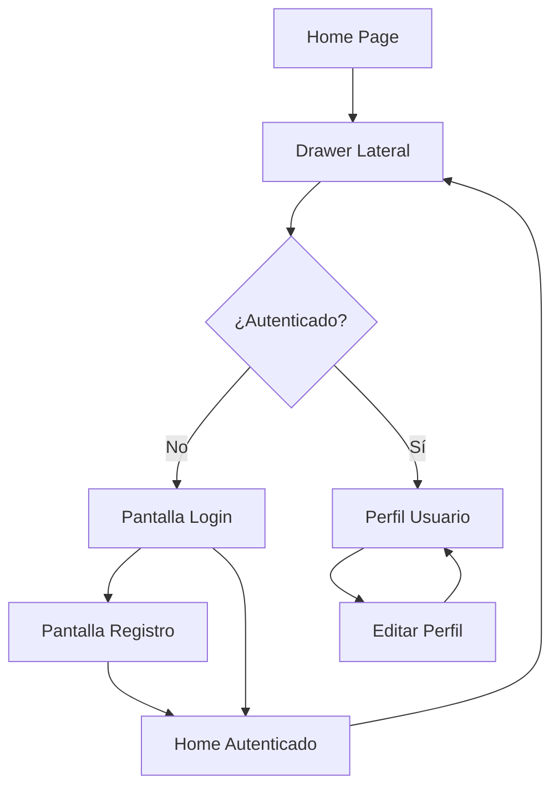

# PRD - Fase 1: Sistema de Autenticación con Supabase

## 1. Product Overview
Implementación del sistema de autenticación completo para la app de películas utilizando Supabase como backend, incluyendo drawer lateral con Material 3 Expressive, pantallas de login/registro y gestión de perfil de usuario.

- Transformar la app actual en una plataforma con usuarios registrados que permita funcionalidades sociales futuras
- Crear una experiencia de usuario fluida y moderna con Material 3 Expressive
- Establecer la base técnica para las fases posteriores del plan estratégico

## 2. Core Features

### 2.1 User Roles
| Role | Registration Method | Core Permissions |
|------|---------------------|------------------|
| Visitante | Sin registro | Navegar catálogo, ver detalles básicos |
| Usuario Registrado | Email + contraseña | Acceso completo, favoritos, listas, perfil personalizado |

### 2.2 Feature Module
Nuestra implementación de autenticación Fase 1 consiste en las siguientes páginas principales:

1. **Drawer Lateral**: header dinámico, navegación principal, opciones de usuario
2. **Pantalla de Login**: formulario de acceso, recuperación de contraseña, navegación a registro
3. **Pantalla de Registro**: formulario de creación de cuenta, validaciones, términos y condiciones
4. **Pantalla de Perfil**: información del usuario, estadísticas básicas, opciones de edición
5. **Pantalla de Editar Perfil**: formulario de edición, cambio de avatar, actualización de datos

### 2.3 Page Details

| Page Name | Module Name | Feature description |
|-----------|-------------|---------------------|
| Drawer Lateral | Header Dinámico | Mostrar avatar, nombre y email cuando esté autenticado. Para visitantes: "Hola visitante" con botón de Login |
| Drawer Lateral | Navegación Principal | Enlaces a Home, Favoritos, Listas, Perfil, Configuración. Opciones condicionadas por estado de autenticación |
| Drawer Lateral | Footer de Usuario | Botón de Logout para usuarios autenticados, versión de la app |
| Login | Formulario de Acceso | Campos email y contraseña, validación en tiempo real, botón de acceso |
| Login | Recuperación de Contraseña | Enlace "¿Olvidaste tu contraseña?" que envía email de recuperación |
| Login | Navegación a Registro | Enlace "¿No tienes cuenta? Regístrate" |
| Registro | Formulario de Creación | Campos: nombre, email, contraseña, confirmar contraseña con validaciones |
| Registro | Validaciones | Email único, contraseña segura (8+ caracteres, mayúscula, número), confirmación coincidente |
| Registro | Términos y Condiciones | Checkbox obligatorio para aceptar términos de uso |
| Perfil | Información Personal | Mostrar avatar, nombre, email, fecha de registro, estadísticas básicas |
| Perfil | Estadísticas de Usuario | Películas vistas, favoritos, listas creadas, tiempo en la app |
| Perfil | Opciones de Cuenta | Botones para editar perfil, cambiar contraseña, configuración de privacidad |
| Editar Perfil | Formulario de Edición | Campos editables: nombre, bio, avatar, preferencias básicas |
| Editar Perfil | Gestión de Avatar | Subir imagen desde galería o cámara, recorte automático, avatar por defecto |
| Editar Perfil | Validación y Guardado | Validar cambios, mostrar loading, confirmación de guardado exitoso |

## 3. Core Process

### Flujo de Usuario No Autenticado
1. Usuario abre la app → Ve contenido básico
2. Abre drawer → Ve "Hola visitante" y botón Login
3. Toca Login → Navega a pantalla de login
4. Puede loguearse o ir a registro
5. Después de autenticarse → Regresa a home con acceso completo

### Flujo de Usuario Autenticado
1. Usuario abre la app → Ve contenido completo
2. Abre drawer → Ve su avatar, nombre y opciones completas
3. Puede navegar a Perfil → Ver/editar información personal
4. Puede hacer logout → Regresa a estado de visitante

### Flujo de Registro
1. Usuario en Login → Toca "Regístrate"
2. Completa formulario → Validaciones en tiempo real
3. Acepta términos → Envía formulario
4. Supabase crea cuenta → Confirmación por email (opcional)
5. Login automático → Regresa a home autenticado

## 4. User Interface Design

### 4.1 Design Style
- **Colores primarios**: Material 3 Dynamic Color con soporte para tema oscuro/claro
- **Colores secundarios**: Tonos complementarios para estados y acciones
- **Estilo de botones**: Material 3 Filled, Outlined y Text buttons con esquinas redondeadas
- **Fuente**: Roboto con tamaños 14sp (body), 16sp (subtitle), 20sp (headline)
- **Layout**: Card-based design con navegación por drawer, espaciado consistente de 16dp
- **Iconos**: Material Icons con estilo Outlined, avatares circulares

### 4.2 Page Design Overview

| Page Name | Module Name | UI Elements |
|-----------|-------------|-------------|
| Drawer Lateral | Header Dinámico | Avatar circular (56dp), nombre en headline6, email en caption. Para visitantes: icono de usuario genérico, texto "Hola visitante" y FilledButton "Iniciar Sesión" |
| Drawer Lateral | Lista de Navegación | ListTiles con iconos leading, texto primary, dividers entre secciones |
| Login | Formulario | Card elevado, TextFields con validation, FilledButton principal, TextButton secundario |
| Registro | Formulario | Similar a login pero más campos, Checkbox para términos, validación visual |
| Perfil | Header de Usuario | Avatar grande (120dp), nombre en headline4, estadísticas en chips |
| Perfil | Información | Cards organizadas por secciones, botones de acción con iconos |
| Editar Perfil | Formulario | TextFields editables, botón de avatar con overlay de edición, FloatingActionButton para guardar |

### 4.3 Responsiveness
Diseño mobile-first con adaptación a tablets. Optimizado para interacción táctil con áreas de toque mínimas de 48dp. Drawer se comporta como modal en móviles y puede ser persistente en tablets grandes.