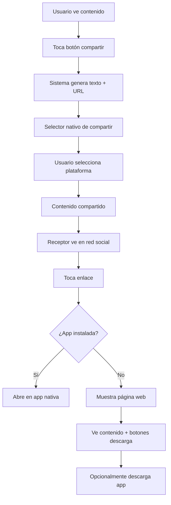

# PRD - Funcionalidad de Compartir Películas

## 1. Product Overview

Implementación de funcionalidad completa de compartir para la app de películas, permitiendo a los usuarios compartir películas individuales, listas personalizadas y recomendaciones a través de redes sociales y mensajería, con páginas web optimizadas como destino.

Esta funcionalidad transformará la app en una verdadera red social de cine, aumentando el engagement y la adquisición orgánica de usuarios a través del marketing viral.

## 2. Core Features

### 2.1 User Roles

No se requiere distinción de roles para esta funcionalidad. Todos los usuarios registrados pueden compartir contenido.

### 2.2 Feature Module

Nuestra funcionalidad de compartir consiste en los siguientes componentes principales:

1. **Botones de Compartir**: Integrados en pantallas existentes para acceso rápido
2. **Servicio de Compartir**: Lógica central para generar contenido y URLs
3. **Páginas Web de Destino**: Landing pages optimizadas para cada tipo de contenido compartido
4. **Deep Links**: Redirección inteligente entre web y app nativa
5. **Optimización SEO**: Meta tags y structured data para redes sociales

### 2.3 Page Details

| Page Name                | Module Name         | Feature description                                                                                                          |
| ------------------------ | ------------------- | ---------------------------------------------------------------------------------------------------------------------------- |
| Movie Screen             | Botón Compartir     | Agregar botón de compartir en app bar. Generar texto atractivo con título, rating y URL. Abrir selector nativo de compartir. |
| List Detail View         | Botón Compartir     | Reemplazar placeholder existente con botón funcional. Incluir nombre de lista, número de películas y preview.                |
| Movie Share Web          | Hero Section        | Mostrar backdrop de película con overlay, título prominente, rating con estrellas, año de lanzamiento.                       |
| Movie Share Web          | Movie Details       | Información detallada: sinopsis, géneros, duración, director principal. Diseño card-based responsive.                        |
| Movie Share Web          | Download Section    | Call-to-action prominente para descargar app. Botones para Google Play y App Store. Beneficios de la app listados.           |
| List Share Web           | List Overview       | Mostrar nombre de lista, descripción, número total de películas, géneros predominantes.                                      |
| List Share Web           | Movies Preview      | Grid de primeras 6 películas con posters. Indicador "y X más" si hay más películas.                                          |
| List Share Web           | Creator Info        | Información del creador de la lista (si es pública). Estadísticas de la lista.                                               |
| Recommendation Share Web | Category Display    | Mostrar categoría o mood de recomendación. Explicación breve del algoritmo.                                                  |
| Recommendation Share Web | Movies Grid         | Mostrar películas recomendadas con ratings. Máximo 8 películas en grid responsive.                                           |
| Share Service            | URL Generation      | Generar URLs estructuradas para cada tipo de contenido. Formato: /movie/{id}/share, /list/{id}/share.                        |
| Share Service            | Text Formatting     | Crear texto atractivo con emojis, hashtags relevantes, call-to-action para descargar app.                                    |
| Deep Link Handler        | URL Detection       | Detectar URLs de compartir en web. Redirigir a app nativa si está instalada, sino mostrar página web.                        |
| Deep Link Handler        | Fallback Management | Manejar casos donde app no está instalada. Mostrar página web optimizada con botones de descarga.                            |

## 3. Core Process

### Flujo Principal de Usuario

1. **Usuario ve contenido interesante** (película, lista, recomendación)
2. **Toca botón de compartir** en la interfaz
3. **Sistema genera texto y URL** automáticamente
4. **Se abre selector nativo** de compartir del dispositivo
5. **Usuario selecciona plataforma** (WhatsApp, Facebook, Twitter, etc.)
6. **Contenido se comparte** con texto pre-formateado y URL

### Flujo de Receptor

1. **Receptor ve contenido compartido** en red social o mensajería
2. **Toca enlace compartido**
3. **Sistema detecta si app está instalada**

   * **Si tiene app**: Abre directamente en la app nativa

   * **Si no tiene app**: Muestra página web optimizada
4. **En página web**: Ve contenido atractivo y botones de descarga
5. **Opcionalmente descarga app** para experiencia completa

## 4. User Interface Design

### 4.1 Design Style

**Colores**:

* Primario: #EEBEB8 (rosa suave existente)

* Secundario: #2C3E50 (azul oscuro para contraste)

* Accent: #E74C3C (rojo para botones de acción)

* Background: #FFFFFF (blanco limpio)

**Botones**:

* Estilo: Rounded corners (8px radius)

* Compartir: Outline style con icono share

* Descarga: Filled style con gradiente sutil

**Tipografía**:

* Títulos: Roboto Bold, 24-32px

* Subtítulos: Roboto Medium, 18-20px

* Cuerpo: Roboto Regular, 14-16px

* Captions: Roboto Light, 12-14px

**Layout**:

* Card-based design para contenido

* Top navigation con logo

* Espaciado consistente (16px, 24px, 32px)

* Grid system responsive

**Iconos**:

* Material Design icons

* Tamaño estándar: 24px

* Color: Hereda del tema o específico por contexto

### 4.2 Page Design Overview

| Page Name        | Module Name      | UI Elements                                                                                                                                                     |
| ---------------- | ---------------- | --------------------------------------------------------------------------------------------------------------------------------------------------------------- |
| Movie Screen     | Botón Compartir  | IconButton con Icons.share, posicionado en AppBar junto a favoritos. Color blanco sobre fondo semi-transparente. Tooltip "Compartir película".                  |
| List Detail View | Botón Compartir  | IconButton reemplazando texto placeholder. Mismo estilo que movie screen. Posición consistente en header.                                                       |
| Movie Share Web  | Hero Section     | Full-width backdrop image (400px height), overlay gradient negro 0.7 opacity, título blanco bold 32px, rating con estrellas amarillas, año en texto secundario. |
| Movie Share Web  | Details Section  | Container blanco con padding 24px, sinopsis en párrafos, géneros como chips, información técnica en grid 2 columnas.                                            |
| Movie Share Web  | Download Section | Background color primario con opacity 0.1, padding 32px, título centrado 24px, lista de beneficios con bullets, botones side-by-side con iconos de plataforma.  |
| List Share Web   | Overview Section | Card con shadow sutil, padding 24px, título de lista bold 28px, descripción en texto secundario, estadísticas en row con iconos.                                |
| List Share Web   | Movies Grid      | Grid responsive 2-3-4 columnas según breakpoint, posters con aspect ratio 2:3, overlay con título en hover, "y X más" como card adicional.                      |
| Share Service    | Text Generation  | No UI visible, genera texto con estructura: emoji + título + detalles + URL + hashtags. Máximo 280 caracteres para Twitter compatibility.                       |

### 4.3 Responsiveness

La funcionalidad es **mobile-first** con adaptación completa a desktop:

**Mobile (320-768px)**:

* Botones de compartir optimizados para touch (44px min)

* Páginas web con layout vertical

* Texto legible sin zoom

* Botones de descarga stack verticalmente

**Tablet (768-1024px)**:

* Grid de películas en 3 columnas

* Botones de descarga side-by-side

* Mayor padding y espaciado

**Desktop (1024px+)**:

* Layout horizontal para secciones principales

* Grid de películas en 4-6 columnas

* Hover effects en botones e imágenes

* Navegación optimizada para mouse

**Touch Optimization**:

* Todos los elementos interactivos mínimo 44px

* Gestos de swipe en grids de películas

* Feedback visual inmediato en taps

* Scroll suave y natural

