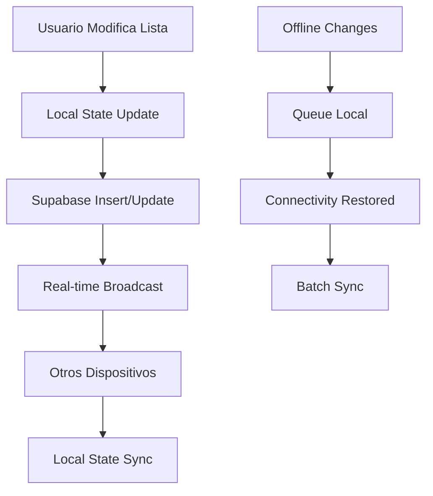

# Plan de Sincronización Real-Time para Listas Personalizadas

## 1. Análisis del Sistema Actual

### 1.1 Estructura de Listas Existente

**Listas por Defecto (8 listas predefinidas):**
- Quiero Ver (🍿)
- Para el Fin de Semana (🎬)
- Clásicos Imperdibles (🎭)
- Acción y Aventura (💥)
- Comedia (😂)
- Drama (🎪)
- Terror y Suspenso (👻)
- Ciencia Ficción (🚀)

**Características actuales:**
- Se crean localmente con IDs fijos (ej: 'quiero-ver', 'accion-y-aventura')
- Almacenadas en SharedPreferences
- No sincronizadas con Supabase
- Cada usuario tiene las mismas 8 listas por defecto

**Listas Personalizadas:**
- Creadas por el usuario con UUID único
- Sincronización parcial implementada
- Almacenadas en tabla `user_lists` de Supabase

### 1.2 Estructura de Base de Datos Supabase

```sql
-- Tabla principal de listas
user_lists (
    id UUID PRIMARY KEY,
    user_id UUID REFERENCES auth.users(id),
    name VARCHAR(100),
    description TEXT,
    color_hex VARCHAR(7),
    is_public BOOLEAN,
    created_at TIMESTAMP,
    updated_at TIMESTAMP
)

-- Elementos de las listas
user_list_items (
    id UUID PRIMARY KEY,
    list_id UUID REFERENCES user_lists(id),
    movie_id INTEGER,
    movie_title VARCHAR(255),
    movie_poster_path TEXT,
    position INTEGER,
    added_at TIMESTAMP,
    updated_at TIMESTAMP
)
```

## 2. Estrategia para Sincronizar las 8 Listas por Defecto

### 2.1 Problema Identificado

**Desafío:** Las listas por defecto usan IDs fijos locales que no son compatibles con UUIDs de Supabase.

**Solución Propuesta:** Sistema de Inicialización Automática de Listas por Defecto

### 2.2 Estrategia de IDs para Listas por Defecto

```dart
// Mapeo de listas por defecto con identificadores únicos
class DefaultListsManager {
  static const Map<String, DefaultListConfig> defaultLists = {
    'default_want_to_watch': DefaultListConfig(
      localId: 'quiero-ver',
      name: 'Quiero Ver',
      emoji: '🍿',
      description: 'Películas que quiero ver próximamente',
      color: 'blue',
    ),
    'default_weekend': DefaultListConfig(
      localId: 'para-el-fin-de-semana',
      name: 'Para el Fin de Semana',
      emoji: '🎬',
      description: 'Películas perfectas para relajarse',
      color: 'green',
    ),
    // ... resto de listas
  };
}
```

### 2.3 Proceso de Inicialización

**Al registrar/autenticar usuario:**

1. **Verificar existencia:** Consultar si el usuario ya tiene listas por defecto en Supabase
2. **Crear si no existen:** Insertar las 8 listas por defecto con UUIDs únicos
3. **Mapear IDs:** Mantener mapeo entre IDs locales y UUIDs de Supabase
4. **Migrar datos locales:** Transferir películas de listas locales a Supabase

```sql
-- Query para verificar listas por defecto existentes
SELECT id, name FROM user_lists 
WHERE user_id = $1 
AND name IN ('Quiero Ver', 'Para el Fin de Semana', ...)
```

### 2.4 Identificación de Listas por Defecto

**Opción 1: Campo `is_default`**
```sql
ALTER TABLE user_lists ADD COLUMN is_default BOOLEAN DEFAULT false;
ALTER TABLE user_lists ADD COLUMN default_type VARCHAR(50);
```

**Opción 2: Convención de nombres**
- Usar prefijo especial: `DEFAULT_WANT_TO_WATCH`
- Mantener nombres amigables para UI

## 3. Diseño del Sync Real-Time

### 3.1 Arquitectura de Sincronización



### 3.2 Eventos de Sincronización

**Listas (`user_lists`):**
- `INSERT`: Nueva lista creada
- `UPDATE`: Lista modificada (nombre, descripción, color)
- `DELETE`: Lista eliminada

**Elementos de Lista (`user_list_items`):**
- `INSERT`: Película agregada a lista
- `UPDATE`: Posición cambiada, metadatos actualizados
- `DELETE`: Película removida de lista

### 3.3 Configuración Real-Time Supabase

```dart
class CustomListsRealtimeManager {
  late RealtimeChannel _listsChannel;
  late RealtimeChannel _listItemsChannel;
  
  Future<void> initialize(String userId) async {
    // Canal para listas
    _listsChannel = supabase
        .channel('user_lists_$userId')
        .onPostgresChanges(
          event: PostgresChangeEvent.all,
          schema: 'public',
          table: 'user_lists',
          filter: PostgresChangeFilter(type: PostgresChangeFilterType.eq, column: 'user_id', value: userId),
          callback: _handleListChange,
        )
        .subscribe();
    
    // Canal para elementos de listas
    _listItemsChannel = supabase
        .channel('user_list_items_$userId')
        .onPostgresChanges(
          event: PostgresChangeEvent.all,
          schema: 'public',
          table: 'user_list_items',
          callback: _handleListItemChange,
        )
        .subscribe();
  }
}
```

## 4. Manejo de Conflictos y Estados Offline

### 4.1 Estrategias de Resolución de Conflictos

**Para Listas:**
- **Last Write Wins**: Usar `updated_at` timestamp
- **Merge Strategy**: Combinar cambios no conflictivos

**Para Elementos de Lista:**
- **Position Conflicts**: Recalcular posiciones automáticamente
- **Duplicate Movies**: Prevenir duplicados por `list_id + movie_id`

### 4.2 Manejo Offline

```dart
class OfflineListsManager {
  final List<PendingListOperation> _pendingOperations = [];
  
  // Encolar operaciones offline
  void queueOperation(PendingListOperation operation) {
    _pendingOperations.add(operation);
    _savePendingOperations();
  }
  
  // Sincronizar cuando vuelve conectividad
  Future<void> syncPendingOperations() async {
    for (final operation in _pendingOperations) {
      try {
        await _executeOperation(operation);
        _pendingOperations.remove(operation);
      } catch (e) {
        // Manejar conflictos
      }
    }
  }
}
```

### 4.3 Tipos de Operaciones Pendientes

```dart
enum ListOperationType {
  createList,
  updateList,
  deleteList,
  addMovieToList,
  removeMovieFromList,
  reorderMoviesInList,
}

class PendingListOperation {
  final String id;
  final ListOperationType type;
  final Map<String, dynamic> data;
  final DateTime timestamp;
  final int retryCount;
}
```

## 5. Migración de Datos Existentes

### 5.1 Proceso de Migración

**Fase 1: Detección de Datos Locales**
```dart
class ListsMigrationService {
  Future<MigrationPlan> analyzeMigrationNeeds(String userId) async {
    final localLists = await _getLocalLists();
    final remoteLists = await _getRemoteLists(userId);
    
    return MigrationPlan(
      listsToCreate: _findListsToCreate(localLists, remoteLists),
      itemsToMigrate: _findItemsToMigrate(localLists, remoteLists),
      conflictsToResolve: _findConflicts(localLists, remoteLists),
    );
  }
}
```

**Fase 2: Migración de Listas por Defecto**
```dart
Future<void> migrateDefaultLists(String userId) async {
  for (final defaultList in DefaultListsManager.defaultLists.values) {
    // Verificar si ya existe en Supabase
    final existingList = await _findExistingDefaultList(userId, defaultList.name);
    
    if (existingList == null) {
      // Crear nueva lista en Supabase
      final supabaseList = await _createDefaultListInSupabase(userId, defaultList);
      
      // Migrar películas locales
      await _migrateLocalMoviesToSupabase(defaultList.localId, supabaseList.id);
    }
  }
}
```

**Fase 3: Migración de Listas Personalizadas**
```dart
Future<void> migrateCustomLists(String userId) async {
  final localCustomLists = await _getLocalCustomLists();
  
  for (final localList in localCustomLists) {
    if (!await _existsInSupabase(localList.id)) {
      await _createListInSupabase(userId, localList);
      await _migrateListItems(localList);
    }
  }
}
```

### 5.2 Manejo de Conflictos en Migración

```dart
class MigrationConflictResolver {
  Future<void> resolveListNameConflict(
    CustomList localList, 
    CustomList remoteList
  ) async {
    // Estrategia: Renombrar lista local con sufijo
    final newName = '${localList.name} (Local)';
    await _updateLocalListName(localList.id, newName);
    await _createListInSupabase(localList.copyWith(name: newName));
  }
  
  Future<void> resolveDuplicateMovies(
    String listId, 
    List<int> duplicateMovieIds
  ) async {
    // Estrategia: Mantener película con timestamp más reciente
    for (final movieId in duplicateMovieIds) {
      final localItem = await _getLocalListItem(listId, movieId);
      final remoteItem = await _getRemoteListItem(listId, movieId);
      
      if (localItem.addedAt.isAfter(remoteItem.addedAt)) {
        await _updateRemoteListItem(remoteItem.copyWith(
          addedAt: localItem.addedAt,
          position: localItem.position,
        ));
      }
    }
  }
}
```

## 6. Plan de Implementación

### 6.1 Fase 1: Preparación de Base de Datos (1-2 días)

**Tareas:**
1. ✅ Verificar tablas `user_lists` y `user_list_items` existentes
2. 🔄 Agregar campos adicionales si necesario:
   ```sql
   ALTER TABLE user_lists ADD COLUMN is_default BOOLEAN DEFAULT false;
   ALTER TABLE user_lists ADD COLUMN default_type VARCHAR(50);
   ALTER TABLE user_lists ADD COLUMN emoji VARCHAR(10);
   ```
3. 🔄 Configurar real-time en Supabase:
   ```sql
   ALTER PUBLICATION supabase_realtime ADD TABLE user_lists;
   ALTER PUBLICATION supabase_realtime ADD TABLE user_list_items;
   ```

### 6.2 Fase 2: Servicios de Migración (2-3 días)

**Tareas:**
1. 🔄 Implementar `DefaultListsManager`
2. 🔄 Crear `ListsMigrationService`
3. 🔄 Desarrollar `MigrationConflictResolver`
4. 🔄 Integrar migración en flujo de autenticación

### 6.3 Fase 3: Real-Time Sync (3-4 días)

**Tareas:**
1. 🔄 Implementar `CustomListsRealtimeManager`
2. 🔄 Extender `RealtimeSyncManager` existente
3. 🔄 Configurar canales de Supabase
4. 🔄 Manejar eventos INSERT/UPDATE/DELETE

### 6.4 Fase 4: Manejo Offline (2-3 días)

**Tareas:**
1. 🔄 Implementar `OfflineListsManager`
2. 🔄 Sistema de cola de operaciones pendientes
3. 🔄 Sincronización al restaurar conectividad
4. 🔄 Resolución de conflictos automática

### 6.5 Fase 5: Integración y Testing (2-3 días)

**Tareas:**
1. 🔄 Integrar con providers existentes
2. 🔄 Actualizar UI para mostrar estado de sync
3. 🔄 Testing de escenarios offline/online
4. 🔄 Testing de migración de datos
5. 🔄 Testing de resolución de conflictos

## 7. Consideraciones Técnicas

### 7.1 Performance

- **Batch Operations**: Agrupar múltiples cambios en una transacción
- **Debouncing**: Evitar sync excesivo en cambios rápidos
- **Pagination**: Cargar listas grandes de forma paginada

### 7.2 Seguridad

- **RLS Policies**: Ya configuradas correctamente
- **Validación**: Verificar permisos antes de modificar listas
- **Sanitización**: Limpiar datos antes de insertar

### 7.3 Monitoreo

```dart
class ListsSyncMetrics {
  static void trackListOperation(String operation, bool success) {
    AnalyticsService.track('lists_sync_operation', {
      'operation': operation,
      'success': success,
      'timestamp': DateTime.now().toIso8601String(),
    });
  }
  
  static void trackMigrationProgress(int totalLists, int migratedLists) {
    AnalyticsService.track('lists_migration_progress', {
      'total_lists': totalLists,
      'migrated_lists': migratedLists,
      'progress_percentage': (migratedLists / totalLists * 100).round(),
    });
  }
}
```

## 8. Casos de Uso Principales

### 8.1 Usuario Nuevo
1. Se registra → Se crean 8 listas por defecto en Supabase
2. Agrega películas → Sync real-time inmediato
3. Crea lista personalizada → Sync automático

### 8.2 Usuario Existente (Migración)
1. Se autentica → Detecta datos locales
2. Ejecuta migración → Transfiere listas y películas
3. Resuelve conflictos → Mantiene integridad de datos
4. Activa sync real-time → Sincronización continua

### 8.3 Uso Multi-Dispositivo
1. Agrega película en móvil → Aparece en web instantáneamente
2. Reordena lista en web → Se actualiza en móvil
3. Elimina lista en tablet → Se sincroniza en todos los dispositivos

### 8.4 Escenario Offline
1. Sin conexión → Cambios se guardan localmente
2. Restaura conexión → Sync automático de cambios pendientes
3. Conflictos detectados → Resolución automática o manual

## 9. Métricas de Éxito

- **Latencia de Sync**: < 2 segundos para cambios simples
- **Tasa de Conflictos**: < 5% de operaciones
- **Éxito de Migración**: > 95% de datos migrados correctamente
- **Disponibilidad Offline**: 100% de funcionalidad básica
- **Satisfacción de Usuario**: Sync transparente e invisible

---

**Próximos Pasos:**
1. Revisar y aprobar este plan
2. Comenzar implementación por fases
3. Configurar entorno de testing
4. Definir criterios de aceptación detallados