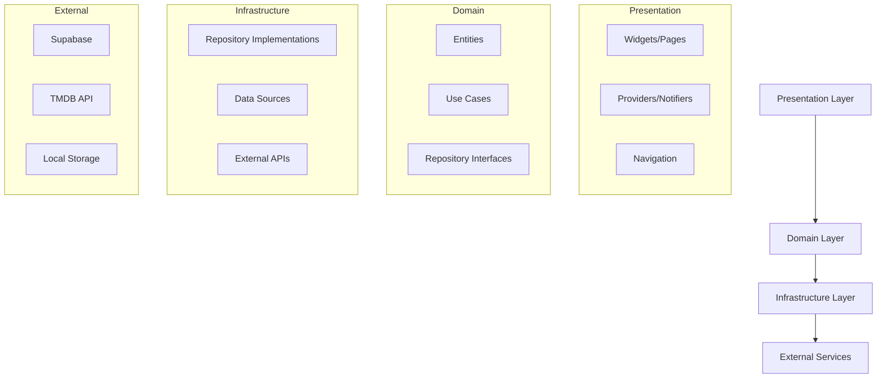
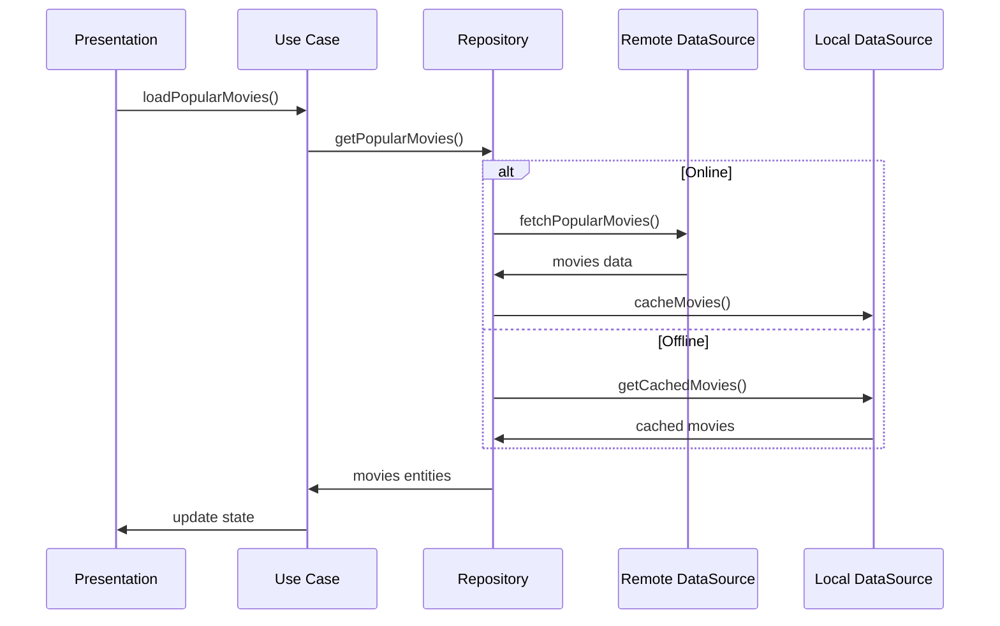
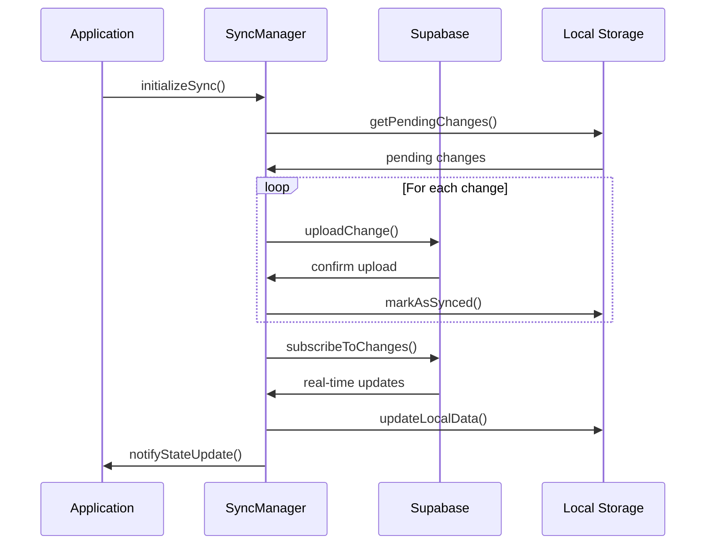

# 🏗️ Arquitectura de la Aplicación Películas

## 📋 Resumen Ejecutivo

La aplicación Películas es una app Flutter multiplataforma que permite explorar, gestionar y compartir información sobre películas. Utiliza una arquitectura de dominio limpio (Clean Architecture) con Supabase como backend y múltiples servicios especializados.

## 🎯 Principios Arquitectónicos

### Domain-Driven Design (DDD)
- **Separación clara de responsabilidades** entre capas
- **Independencia de frameworks** en la lógica de negocio
- **Testabilidad** mejorada a través de inversión de dependencias

### Arquitectura en Capas



## 📁 Estructura del Proyecto

```
lib/
├── config/                 # Configuración global
│   ├── router/             # Configuración de rutas
│   └── theme/              # Temas y estilos
├── core/                   # Funcionalidades transversales
│   ├── gamification/       # Sistema de gamificación
│   ├── error_handling/     # Manejo de errores
│   └── sync/              # Sincronización de datos
├── domain/                 # Lógica de negocio
│   ├── entities/          # Entidades del dominio
│   ├── repositories/      # Interfaces de repositorios
│   └── usecases/          # Casos de uso
├── infrastructure/         # Implementaciones externas
│   ├── datasources/       # Fuentes de datos
│   ├── repositories/      # Implementaciones de repositorios
│   └── models/            # Modelos de datos
├── presentation/           # Interfaz de usuario
│   ├── pages/             # Pantallas
│   ├── widgets/           # Widgets reutilizables
│   └── providers/         # Gestión de estado
└── services/              # Servicios especializados
    ├── analytics/         # Analíticas
    ├── auth/              # Autenticación
    ├── notification/      # Notificaciones
    └── sync/              # Sincronización
```

## 🔧 Stack Tecnológico

### Frontend
- **Flutter** (>=3.0.0): Framework multiplataforma
- **Riverpod** (2.6.1): Gestión de estado
- **GoRouter** (16.1.0): Navegación declarativa
- **Hive** (2.2.3): Storage local rápido
- **Isar** (3.1.0): Base de datos local avanzada

### Backend y Servicios
- **Supabase**: Backend-as-a-Service
  - Autenticación
  - Base de datos PostgreSQL
  - Storage de archivos
  - Real-time subscriptions
- **TMDB API**: Datos de películas
- **Firebase**: Notificaciones push y analytics

### Herramientas de Desarrollo
- **Firebase Crashlytics**: Error reporting
- **Flutter Lints**: Análisis de código
- **Integration Tests**: Pruebas end-to-end

## 🏛️ Capas de la Arquitectura

### 1. Presentation Layer

**Responsabilidades:**
- Gestión de estado con Riverpod
- Navegación entre pantallas
- Interacción con el usuario
- Binding de datos desde domain

**Componentes principales:**
- `MovieProvider`: Estado de películas
- `AuthProvider`: Estado de autenticación  
- `SyncProvider`: Estado de sincronización
- `ThemeProvider`: Configuración de tema

```dart
// Ejemplo de Provider
class MoviesNotifier extends StateNotifier<MoviesState> 
    with ErrorReportingMixin<MoviesState> {
  
  Future<void> loadMovies() async {
    await runWithErrorReporting(
      () async {
        final movies = await _moviesRepository.getPopularMovies();
        state = state.copyWith(movies: movies);
      },
      operationName: 'loadMovies',
    );
  }
}
```

### 2. Domain Layer

**Responsabilidades:**
- Definir entidades de negocio
- Casos de uso de la aplicación
- Interfaces de repositorios
- Reglas de negocio puras

**Entidades principales:**
- `Movie`: Información de película
- `User`: Usuario de la aplicación
- `Watchlist`: Lista de películas por ver
- `UserProfile`: Perfil del usuario

```dart
// Ejemplo de entidad
class Movie extends Equatable {
  final int id;
  final String title;
  final String overview;
  final double voteAverage;
  final String posterPath;
  final DateTime releaseDate;
  
  // Constructor y métodos...
}
```

### 3. Infrastructure Layer

**Responsabilidades:**
- Implementar interfaces del domain
- Comunicación con APIs externas
- Manejo de storage local
- Mapeo de datos externos a entidades

**Datasources:**
- `MovieRemoteDataSource`: TMDB API
- `MovieLocalDataSource`: Hive/Isar storage
- `AuthDataSource`: Supabase Auth
- `UserDataSource`: Supabase Database

## 🔄 Flujos de Datos

### Flujo de Carga de Películas



### Flujo de Sincronización



## 🎮 Sistemas Especializados

### Sistema de Gamificación

**Arquitectura:**
- `GamificationManager`: Coordinador principal
- `AchievementService`: Gestión de logros
- `ProgressTracker`: Seguimiento de progreso
- `RewardSystem`: Sistema de recompensas

**Flujo de logros:**
1. Usuario realiza acción
2. `GamificationManager` detecta evento
3. `AchievementService` evalúa criterios
4. `RewardSystem` otorga recompensas
5. UI se actualiza con notificación

### Sistema de Sincronización

**Componentes:**
- `SyncManager`: Coordinador de sincronización
- `ConflictResolver`: Resolución de conflictos
- `OfflineQueue`: Cola de operaciones offline
- `RealTimeSync`: Sincronización en tiempo real

**Estrategias de resolución:**
- **Last Write Wins**: Para preferencias de usuario
- **Manual Resolution**: Para datos críticos
- **Merge Strategy**: Para listas y colecciones

### Sistema de Notificaciones

**Tipos soportados:**
- **Push Notifications**: Firebase Cloud Messaging
- **Local Notifications**: Recordatorios y eventos
- **In-App Notifications**: Logros y actualizaciones

## 🗄️ Gestión de Datos

### Storage Local

**Hive Boxes:**
- `movies`: Cache de películas
- `watchlists`: Listas de películas
- `user_progress`: Progreso de gamificación
- `app_settings`: Configuraciones

**Isar Collections:**
- `UserProfile`: Perfil completo del usuario
- `MovieDetails`: Información detallada de películas
- `SyncQueue`: Cola de sincronización

### Base de Datos Remota (Supabase)

**Tablas principales:**
```sql
-- Perfiles de usuario
CREATE TABLE user_profiles (
    id UUID PRIMARY KEY REFERENCES auth.users(id),
    username TEXT UNIQUE,
    display_name TEXT,
    avatar_url TEXT,
    created_at TIMESTAMP DEFAULT NOW(),
    updated_at TIMESTAMP DEFAULT NOW()
);

-- Listas de películas
CREATE TABLE watchlists (
    id UUID PRIMARY KEY DEFAULT gen_random_uuid(),
    user_id UUID REFERENCES user_profiles(id),
    name TEXT NOT NULL,
    description TEXT,
    movie_ids INTEGER[],
    is_public BOOLEAN DEFAULT FALSE,
    created_at TIMESTAMP DEFAULT NOW(),
    updated_at TIMESTAMP DEFAULT NOW()
);

-- Progreso de gamificación
CREATE TABLE user_progress (
    id UUID PRIMARY KEY DEFAULT gen_random_uuid(),
    user_id UUID REFERENCES user_profiles(id),
    achievement_id TEXT,
    progress_value INTEGER DEFAULT 0,
    completed_at TIMESTAMP,
    created_at TIMESTAMP DEFAULT NOW()
);
```

### Políticas de Seguridad (RLS)

```sql
-- Solo el usuario puede ver/modificar sus datos
ALTER TABLE user_profiles ENABLE ROW LEVEL SECURITY;
CREATE POLICY "Users can view own profile" ON user_profiles
    FOR SELECT USING (auth.uid() = id);

ALTER TABLE watchlists ENABLE ROW LEVEL SECURITY;
CREATE POLICY "Users can manage own watchlists" ON watchlists
    FOR ALL USING (auth.uid() = user_id);
```

## 🔌 Integraciones Externas

### TMDB API
- **Propósito**: Datos de películas y multimedia
- **Rate Limiting**: 40 requests/10 segundos
- **Caching**: 24 horas para datos estáticos
- **Fallback**: Datos locales en caso de fallo

### Firebase Services
- **Crashlytics**: Error reporting y crash tracking
- **Analytics**: Métricas de uso y comportamiento
- **Cloud Messaging**: Notificaciones push
- **Performance**: Monitoreo de performance

### Supabase Services
- **Auth**: Autenticación con múltiples proveedores
- **Database**: PostgreSQL con subscripciones real-time
- **Storage**: Archivos de usuario (avatars, etc.)
- **Edge Functions**: Funciones serverless

## 📊 Monitoreo y Observabilidad

### Error Reporting
- **Crash tracking**: Firebase Crashlytics
- **Error rates**: <5% para flujos críticos
- **Success criteria**: ≥99.7% crash-free sessions

### Analytics
- **User engagement**: Tiempo de sesión, páginas vistas
- **Feature adoption**: Uso de funcionalidades
- **Performance**: Tiempos de carga, errores de red

### Logging
```dart
// Configuración de logging
Logger.root.level = Level.INFO;
Logger.root.onRecord.listen((record) {
  print('${record.level.name}: ${record.time}: ${record.message}');
  
  if (record.level >= Level.SEVERE) {
    ErrorReportingService.instance.reportError(
      record.error ?? Exception(record.message),
      record.stackTrace,
    );
  }
});
```

## 🔒 Seguridad

### Autenticación
- **Supabase Auth**: JWT tokens con refresh automático
- **Session management**: Persistencia segura local
- **Multi-factor**: Soporte para 2FA (futuro)

### Autorización
- **Row Level Security**: Políticas a nivel de base de datos
- **API Keys**: Protegidas en variables de entorno
- **HTTPS**: Todas las comunicaciones encriptadas

### Datos Sensibles
- **Encryption**: Datos críticos encriptados localmente
- **Key management**: Uso de Flutter Secure Storage
- **No logging**: Datos sensibles no se loggean

## 🚀 Deployment y CI/CD

### Plataformas Soportadas
- ✅ **Android**: Google Play Store
- ✅ **iOS**: Apple App Store  
- ✅ **Web**: Vercel hosting
- ✅ **Desktop**: Windows, macOS, Linux

### Pipeline de CI/CD
```yaml
# .github/workflows/ci.yml
name: CI Pipeline
on: [push, pull_request]
jobs:
  test:
    runs-on: ubuntu-latest
    steps:
      - uses: actions/checkout@v4
      - uses: subosito/flutter-action@v2
      - run: flutter pub get
      - run: flutter analyze
      - run: flutter test --coverage
      - run: flutter build web --release
```

### Quality Gates
- **Formato**: `dart format --set-exit-if-changed`
- **Análisis**: `flutter analyze --fatal-infos`
- **Tests**: 100% de tests pasando
- **Cobertura**: >80% objetivo

## 📈 Performance

### Optimizaciones Implementadas
- **Image caching**: `cached_network_image`
- **List virtualization**: `ListView.builder`
- **State management**: Selectores específicos en Riverpod
- **Bundle splitting**: Lazy loading de funcionalidades

### Métricas Target
- **App startup**: <3 segundos
- **Navigation**: <300ms entre pantallas
- **API calls**: <2 segundos respuesta promedio
- **Memory usage**: <150MB en dispositivos promedio

## 🔄 Mantenimiento y Evolución

### Versionado
- **Semantic versioning**: MAJOR.MINOR.PATCH
- **Migration scripts**: Para cambios de base de datos
- **Feature flags**: Deployment gradual de funcionalidades

### Testing Strategy
- **Unit tests**: Lógica de negocio y servicios
- **Widget tests**: Componentes de UI críticos
- **Integration tests**: Flujos end-to-end
- **Manual testing**: Casos críticos de usuario

### Roadmap Técnico
1. **Q1 2024**: Migración completa a Isar
2. **Q2 2024**: Implementación de offline-first
3. **Q3 2024**: Sistema de recomendaciones con ML
4. **Q4 2024**: Social features y compartir

---

**Última actualización**: 2024-01-01  
**Versión de arquitectura**: 1.0  
**Próxima revisión**: 2024-03-01

Para preguntas sobre la arquitectura, contactar al equipo de desarrollo.