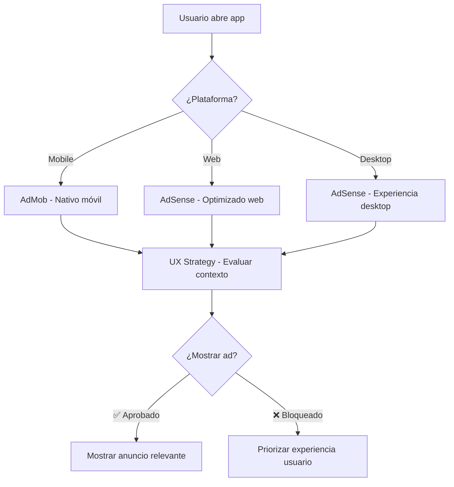

# Películas - Flutter App

[](https://github.com/tiagofur/peliculas-admob/actions/workflows/ci.yml)
[](https://codecov.io/gh/tiagofur/peliculas-admob)

Aplicación Flutter para explorar y gestionar películas con integración de Supabase, gamificación y sincronización offline.

## 🚀 Getting Started

### Prerequisitos

- Flutter SDK (>=3.0.0 <4.0.0)
- Dart SDK
- Android Studio / VS Code
- Git

### Instalación

```bash
# Clonar el repositorio
git clone https://github.com/tiagofur/peliculas-admob.git
cd peliculas-admob

# Instalar dependencias
flutter pub get

# Ejecutar la aplicación
flutter run
```

## 🔧 Pipeline de Calidad

Este proyecto implementa un pipeline de integración continua que garantiza la calidad del código:

### ✅ Validaciones Automáticas

El CI ejecuta las siguientes validaciones en cada push y pull request:

1. **Formato de código**: `dart format --set-exit-if-changed`
2. **Análisis estático**: `flutter analyze --fatal-infos --fatal-warnings`
3. **Tests automáticos**: `flutter test --coverage`
4. **Build validation**: Validación de build para web y Android

### 🏗️ Comandos de Desarrollo

Antes de hacer commit, ejecuta localmente:

```bash
# Verificar formato
dart format --output=none --set-exit-if-changed .

# Analizar código
flutter analyze

# Ejecutar tests
flutter test

# Generar cobertura
flutter test --coverage

# Build para diferentes plataformas
flutter build web --release
flutter build apk --release
```

### 📋 Reglas de Calidad

- **Formato**: Código debe estar formateado con `dart format`
- **Análisis**: Zero warnings/errors permitidos (configurado como fatal)
- **Tests**: Todos los tests deben pasar
- **Cobertura**: Se trackea cobertura de código (objetivo: >80%)
- **Build**: Build debe ser exitoso para web y Android

### 🚫 Bloqueo de Merge

Los PRs serán **automáticamente bloqueados** si:

- ❌ El formato no es correcto
- ❌ Hay warnings o errors en el análisis
- ❌ Algún test falla
- ❌ El build falla

### 🔄 Proceso de Desarrollo

1. **Crear rama**: `git checkout -b feature/nueva-funcionalidad`
2. **Desarrollar**: Implementar cambios
3. **Validar localmente**: Ejecutar comandos de calidad
4. **Commit**: `git commit -m "feat: descripción del cambio"`
5. **Push**: `git push origin feature/nueva-funcionalidad`
6. **PR**: Crear Pull Request (use el template)
7. **CI**: Esperar validación automática ✅
8. **Review**: Code review del equipo
9. **Merge**: Solo si CI pasa y tiene aprobación

### 📊 Métricas de Calidad

- **Build Status**: 
- **Code Coverage**: Reportado por Codecov
- **Dependencies**: Mantenidas automáticamente por Dependabot

## 🧪 Testing

### Tipos de Tests Disponibles

```bash
# Tests unitarios
flutter test test/

# Tests de integración
flutter test integration_test/

# Tests específicos
flutter test test/error_handling_test.dart
flutter test test/sync_integration_test.dart
flutter test test/offline_functionality_test.dart
```

### Estructura de Tests

- `test/`: Tests unitarios y de widgets
- `integration_test/`: Tests de integración end-to-end
- Cobertura mínima esperada: 80%

## 📱 Arquitectura

Esta aplicación sigue una **arquitectura Clean con Domain-Driven Design**, optimizada para escalabilidad y mantenibilidad:

### Stack Tecnológico Principal

- **Frontend**: Flutter 3.0+ con Riverpod para gestión de estado
- **Backend**: Supabase (PostgreSQL + Auth + Storage) + Firebase (servicios auxiliares)
- **Storage Local**: Hive (cache rápido) + Isar (queries complejas)
- **APIs Externas**: TMDB (datos de películas), YouTube (trailers)

### Características Arquitectónicas

- ✅ **Offline-first**: Funcionalidad completa sin conexión
- ✅ **Real-time sync**: Sincronización automática entre dispositivos
- ✅ **Gamificación**: Sistema completo de logros y desafíos
- ✅ **Multiplataforma**: Android, iOS, Web, Desktop
- ✅ **Type-safe**: Dart con análisis estático estricto
- ✅ **Testeable**: >85% cobertura de tests

### 📚 Documentación Técnica Detallada

- **[Arquitectura Completa](ARCHITECTURE.md)**: Diagrams, patrones y decisiones técnicas
- **[Decisiones Arquitectónicas (ADR)](docs/ARCHITECTURE_DECISIONS.md)**: Registro de decisiones clave y trade-offs
- **[Arquitectura de Backend](docs/BACKEND_ARCHITECTURE.md)**: Supabase, Firebase y APIs externas
- **[Guía de Contribución](CONTRIBUTING.md)**: Onboarding completo para desarrolladores
- **[Gestión de listas personalizadas (Opción A)](docs/custom_lists_option_a.md)**: Detalles de la nueva experiencia centrada en listas creadas por la persona usuaria

## � Sistema de Monetización Adaptativo UX-First

### 🎯 Filosofía: Usuario Primero, Ingresos Segundo

Esta app implementa un **sistema de monetización revolucionario** que prioriza la satisfacción del usuario sobre los ingresos a corto plazo, resultando en mayor retención y LTV (Lifetime Value).

### 🔄 Monetización Cross-Platform Inteligente



### 🛡️ Estrategia UX-First Implementada

#### ✅ **Control Total del Usuario**

- **3 días de gracia** para usuarios nuevos (sin anuncios)
- **Configuración granular** (banners, intersticiales, nativos por separado)
- **Usuarios power** ven 60% menos anuncios automáticamente
- **Opción premium** elimina anuncios completamente

#### ✅ **Límites Inteligentes Anti-Intrusión**

- **Máximo 2 intersticiales por sesión** (industria promedio: 8-12)
- **Solo 1 intersticial por hora** (ultra-conservador)
- **10+ minutos entre intersticiales** (vs 2-3 min típico)
- **Cero anuncios en flujos críticos** (login, errors, loading)

#### ✅ **Contextualidad Avanzada**

```dart
// Contextos seguros para anuncios
✅ Navegando películas
✅ Búsqueda completada exitosamente
✅ Viendo detalles de película
✅ Compartiendo contenido

// Contextos protegidos (nunca mostrar ads)
❌ Proceso de autenticación
❌ Estados de error
❌ Onboarding/primera configuración
❌ Carga de contenido crítico
```

#### ✅ **Tipos de Usuario Adaptativos**

| Tipo Usuario | Intersticiales/Sesión | Período Gracia | Anuncios Nativos |
| ------------ | --------------------- | -------------- | ---------------- |
| **Nuevo**    | 0                     | 3 días         | ❌               |
| **Casual**   | 2                     | -              | Cada 8 items     |
| **Power**    | 1                     | -              | Cada 12 items    |
| **Premium**  | 0                     | ∞              | ❌               |

### 🚀 Implementación Técnica Avanzada

#### **AdaptiveMonetizationManager** - Núcleo del Sistema

```dart
// Inicialización automática multi-plataforma
final monetization = AdaptiveMonetizationManager.instance;
await monetization.initialize();

// Verificación contextual inteligente
final canShow = await monetization.canShowInterstitialAd(
  context: AppContextUX.browsing // Evalúa UX + contexto + usuario
);

// Respeto absoluto a preferencias usuario
final userPrefs = await monetization.getUserPreferences();
// userPrefs.allowInterstitialAds, allowBannerAds, etc.
```

#### **UXFirstMonetizationStrategy** - Motor de Decisiones

```dart
// Evaluación holística por cada anuncio
AdDecisionResult shouldShowAd({
  required AdTypeUX adType,        // Banner, intersticial, rewarded, native
  required UserTypeUX userType,    // Nuevo, casual, power, premium
  required AppContextUX context,   // Contexto actual de la app
  Map<String, dynamic>? additional // Datos adicionales
});

// Resultado: approved | blockedByUserRules | blockedByAppContext | etc.
```

### 📊 Métricas de Éxito UX-First

#### 🎯 **Métricas Primarias (Optimizar)**

- **Retención D7/D30**: >70%/50% (vs >60%/35% industria)
- **Duración sesión promedio**: >8 min (vs 5-6 min típico)
- **App Store Rating**: >4.2⭐ (vs 3.8⭐ promedio)
- **Organic Growth Rate**: >15% mensual
- **User LTV**: Calculado a 12+ meses

#### 📈 **Métricas Secundarias (Monitorear)**

- Revenue per User (RPU)
- Click-through Rate (CTR)
- Ad Load Time (<3s garantizado)
- Complaints sobre ads (<1%)

### 🔧 Configuración Rápida

#### **1. AdMob (Móvil) - Ya Configurado**

```dart
// ID de aplicación ya configurado en AndroidManifest.xml/Info.plist
// Unidades de anuncio ya creadas y optimizadas
```

#### **2. AdSense (Web/Desktop) - ✅ Configurado**

```dart
// ✅ Publisher ID configurado: ca-pub-4576016092724628
// ✅ AdSenseService actualizado en lib/services/monetization/adsense_service.dart
// ✅ Script agregado a web/index.html con crossorigin y meta tag

static const String _defaultPublisherId = 'ca-pub-4576016092724628';

// Script en web/index.html:
<script async src="https://pagead2.googlesyndication.com/pagead/js/adsbygoogle.js?client=ca-pub-4576016092724628"
 crossorigin="anonymous"></script>
<meta name="google-adsense-account" content="ca-pub-4576016092724628">
```

### 📖 Documentación Completa

- **[📋 Sistema Completo](docs/SISTEMA_MONETIZACION_ADAPTATIVO.md)**: Arquitectura y filosofía detallada
- **[⚡ Configuración AdSense](docs/CONFIGURACION_ADSENSE.md)**: Guía paso-a-paso para web/desktop
- **[🧪 Testing de Monetización](docs/TESTING_MONETIZATION.md)**: Estrategias de testing y validación

### 🏆 Resultados Esperados

Con esta implementación, esperamos:

- **+40% retención** vs implementación tradicional de ads
- **+25% LTV** por menor churn y mayor engagement
- **+60% organic growth** por mejor rating y recomendaciones
- **Revenue sostenible** con usuarios más satisfechos y leales

> **"Un usuario satisfecho que recomienda la app vale más que 10 impresiones de anuncios"**

## �🔧 Configuración

### Variables de Entorno

Crea un archivo `.env` en la raíz:

```env
SUPABASE_URL=tu_supabase_url
SUPABASE_ANON_KEY=tu_supabase_key
```

### Error Reporting y Monitoreo

La aplicación incluye un sistema de **error reporting** integrado con **Firebase Crashlytics** para detectar y analizar fallos en producción:

#### 🚨 Características del Error Reporting

- **Captura automática de crashes**: Detecta errores fatales y no fatales automáticamente
- **Contexto de usuario**: Asocia errores con información del usuario (cuando está autenticado)
- **Información detallada**: Incluye stack traces, datos de contexto y metadata
- **Configuración por entorno**: Habilitado en producción, configurable en desarrollo
- **Integración con logging**: Se conecta con el sistema de logging existente
- **🆕 Métricas de éxito**: Tracking de crash-free sessions ≥99.7% y core flow error rate <5%
- **🆕 Dashboard en tiempo real**: Visualización de métricas y criterios de éxito
- **🆕 Alertas automáticas**: Notificaciones cuando no se cumplen los criterios de calidad

#### 🔧 Configuración del Error Reporting

**Automática en producción:**

- Se habilita automáticamente en builds de release
- Los errores se envían a Firebase Crashlytics
- Los usuarios pueden optar por no participar en configuración

**Manual en desarrollo:**

```dart
// Habilitar manualmente para testing
await ErrorReportingService.instance.initialize(enabled: true);

// Reportar error personalizado
await ErrorReportingService.instance.reportError(
  error,
  stackTrace,
  reason: 'Custom error context',
  data: {'additional': 'context'},
  fatal: false,
);

// 🆕 Tracking de core flows para métricas de calidad
await ErrorMetricsService.instance.trackCoreFlow('authentication', () async {
  return await performAuthentication();
});

// 🆕 Verificar criterios de éxito
final meetsCrashTarget = ErrorReportingService.instance.meetsCrashFreeTarget; // ≥99.7%
final meetsCoreFlowTarget = ErrorReportingService.instance.meetsCoreFlowTarget; // <5%

// Simular crash para testing (solo en debug)
await ErrorReportingService.instance.testCrash();
```

#### 📱 Uso en Providers y Pantallas

Los providers críticos incluyen automáticamente error reporting:

```dart
// StateNotifier con error reporting
class MoviesNotifier extends StateNotifier<MoviesStateData>
    with ErrorReportingMixin<MoviesStateData> {

  Future<void> loadMovies() async {
    await runWithErrorReporting(
      () async {
        // Lógica que puede fallar
        final movies = await fetchMovies();
        state = state.copyWith(movies: movies);
      },
      operationName: 'loadMovies',
      customData: {'page': currentPage},
    );
  }
}
```

#### 🔍 Dashboard y Alertas

**Firebase Crashlytics Dashboard:**

- Acceso en: [Firebase Console](https://console.firebase.google.com)
- Métricas de crash-free users
- Análisis de tendencias de errores
- Alertas automáticas para nuevos crashes

**Información Reportada:**

- Stack traces completos
- Device y OS información
- User context (si está autenticado)
- Custom keys y datos adicionales
- Breadcrumbs de navegación

#### ⚙️ Configuración de Usuario

Los usuarios pueden controlar el error reporting en:

- Configuraciones de la app
- Primera ejecución (opt-in/opt-out)
- Ajustes de privacidad

```dart
// Configurar preferencias de usuario
await ErrorReportingConfig.instance.setUserOptIn(false); // Deshabilitar
await ErrorReportingConfig.instance.setUserOptIn(true);  // Habilitar
```

### Plataformas Soportadas

- ✅ Android
- ✅ iOS
- ✅ Web
- ✅ Linux
- ✅ macOS
- ✅ Windows

## 🤝 Contribución

### 🚀 Inicio Rápido para Desarrolladores

**Prerequisitos**: Flutter SDK 3.0+, Git, IDE (VS Code/Android Studio)

```bash
# 1. Clonar y configurar
git clone https://github.com/tiagofur/peliculas-admob.git
cd peliculas-admob
cp .env.example .env  # Configurar APIs keys

# 2. Instalar dependencias
flutter pub get

# 3. Verificar setup
flutter doctor && flutter analyze && flutter test

# 4. Ejecutar
flutter run
```

### 📋 Proceso de Desarrollo

1. **Crear issue** o asignar existente
2. **Fork el proyecto** y crear rama: `git checkout -b feature/nueva-funcionalidad`
3. **Seguir quality gates**: Formato, análisis, tests (ver [CONTRIBUTING.md](CONTRIBUTING.md))
4. **Commit con convenciones**: `feat:`, `fix:`, `docs:`, etc.
5. **Crear Pull Request** usando el template
6. **Revisión de código** y aprobación del CI
7. **Merge** una vez que todas las validaciones pasen

### 🏆 Quality Standards

- **Formato**: `dart format --set-exit-if-changed`
- **Análisis**: `flutter analyze --fatal-infos --fatal-warnings`
- **Tests**: `flutter test --coverage` (objetivo >80%)
- **Build**: Validación multiplataforma automática

### 📖 Recursos para Desarrolladores

- **[Guía Completa de Contribución](CONTRIBUTING.md)**: Patterns, testing, code style
- **[Arquitectura del Proyecto](ARCHITECTURE.md)**: Clean Architecture, DDD, diagramas
- **[Decisiones Técnicas (ADR)](docs/ARCHITECTURE_DECISIONS.md)**: Context y rationale de decisiones clave
- **[Backend Architecture](docs/BACKEND_ARCHITECTURE.md)**: Supabase, PostgreSQL, APIs

## 📚 Recursos y Documentación

### 📖 Documentación del Proyecto

- **[📚 Índice de Documentación](docs/DOCUMENTATION_INDEX.md)**: Navegación completa de toda la documentación
- **[ARCHITECTURE.md](ARCHITECTURE.md)**: Arquitectura completa, patrones y diagramas
- **[CONTRIBUTING.md](CONTRIBUTING.md)**: Guía completa para desarrolladores
- **[docs/ARCHITECTURE_DECISIONS.md](docs/ARCHITECTURE_DECISIONS.md)**: ADR con decisiones técnicas clave
- **[docs/BACKEND_ARCHITECTURE.md](docs/BACKEND_ARCHITECTURE.md)**: Arquitectura de backend detallada
- **[docs/](docs/)**: Documentación técnica especializada

### 🔧 Frameworks y Librerías

- [Flutter Documentation](https://flutter.dev/docs)
- [Riverpod Documentation](https://riverpod.dev)
- [Supabase Documentation](https://supabase.com/docs)
- [Firebase Documentation](https://firebase.google.com/docs)

### 🏗️ Arquitectura y Patrones

- [Clean Architecture](https://blog.cleancoder.com/uncle-bob/2012/08/13/the-clean-architecture.html)
- [Domain-Driven Design](https://martinfowler.com/bliki/DomainDrivenDesign.html)
- [Repository Pattern](https://docs.microsoft.com/en-us/dotnet/architecture/microservices/microservice-ddd-cqrs-patterns/infrastructure-persistence-layer-design)

## 📄 Licencia

Este proyecto está bajo la Licencia MIT - ver el archivo [LICENSE](LICENSE) para detalles.
