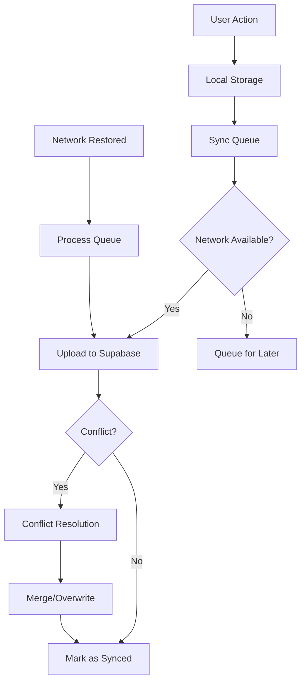

# 📋 Architecture Decision Records (ADR)

## Resumen

Este documento registra las decisiones arquitectónicas clave tomadas durante el desarrollo de la aplicación Películas, incluyendo el contexto, opciones consideradas, decisiones tomadas y consecuencias.

## Índice de Decisiones

1. [ADR-001: Adopción de Flutter como Framework Principal](#adr-001-adopción-de-flutter-como-framework-principal)
2. [ADR-002: Supabase como Backend-as-a-Service](#adr-002-supabase-como-backend-as-a-service)
3. [ADR-003: Riverpod para Gestión de Estado](#adr-003-riverpod-para-gestión-de-estado)
4. [ADR-004: Arquitectura Clean con DDD](#adr-004-arquitectura-clean-con-ddd)
5. [ADR-005: Hive + Isar para Storage Local](#adr-005-hive--isar-para-storage-local)
6. [ADR-006: TMDB API como Fuente de Datos](#adr-006-tmdb-api-como-fuente-de-datos)
7. [ADR-007: Firebase para Servicios Auxiliares](#adr-007-firebase-para-servicios-auxiliares)
8. [ADR-008: GoRouter para Navegación](#adr-008-gorouter-para-navegación)
9. [ADR-009: Sistema de Sincronización Offline-First](#adr-009-sistema-de-sincronización-offline-first)
10. [ADR-010: Estrategia de Testing Híbrida](#adr-010-estrategia-de-testing-híbrida)

---

## ADR-001: Adopción de Flutter como Framework Principal

**Estado**: ✅ Aceptado  
**Fecha**: 2023-06-15  
**Responsables**: Equipo de desarrollo

### Contexto

Necesitábamos un framework que permitiera desarrollo multiplataforma eficiente para una aplicación de películas con requerimientos de:
- Soporte para móvil (Android/iOS) y web
- Performance nativa
- UI/UX consistente
- Tiempo de desarrollo optimizado

### Opciones Consideradas

1. **Flutter**
   - ✅ Multiplataforma nativo
   - ✅ Performance excelente
   - ✅ Hot reload
   - ✅ Ecosistema maduro
   - ❌ Tamaño de app mayor

2. **React Native**
   - ✅ Desarrollo rápido
   - ✅ Comunidad grande
   - ❌ Performance inconsistente
   - ❌ Dependencias nativas complejas

3. **Desarrollo Nativo**
   - ✅ Performance máxima
   - ❌ Doble mantenimiento
   - ❌ Tiempo desarrollo 2x

### Decisión

**Seleccionamos Flutter** por su balance entre performance, productividad y mantenimiento.

### Consecuencias

**Positivas:**
- Desarrollo 40% más rápido que nativo
- UI consistente en todas las plataformas
- Hot reload acelera iteración
- Comunidad activa y packages disponibles

**Negativas:**
- Apps 10-15MB más grandes
- Curva de aprendizaje para Dart
- Algunas funcionalidades requieren platform channels

**Mitigación:**
- Implementar tree shaking para reducir tamaño
- Capacitación del equipo en Dart/Flutter
- Crear abstracciones para platform-specific code

---

## ADR-002: Supabase como Backend-as-a-Service

**Estado**: ✅ Aceptado  
**Fecha**: 2023-06-20  
**Responsables**: Equipo de backend, arquitecto

### Contexto

Requeríamos un backend que proporcionara:
- Autenticación robusta
- Base de datos en tiempo real
- Storage de archivos
- Escalabilidad automática
- Desarrollo rápido

### Opciones Consideradas

1. **Supabase**
   - ✅ PostgreSQL completo
   - ✅ Real-time subscriptions
   - ✅ Auth integrada
   - ✅ Open source
   - ✅ Pricing competitivo
   - ❌ Relativamente nuevo

2. **Firebase**
   - ✅ Maduro y estable
   - ✅ Ecosistema Google
   - ❌ NoSQL limitations
   - ❌ Vendor lock-in
   - ❌ Pricing escalabilidad

3. **Backend Custom**
   - ✅ Control total
   - ❌ Tiempo desarrollo alto
   - ❌ Mantenimiento complejo
   - ❌ Escalabilidad manual

### Decisión

**Seleccionamos Supabase** por su combinación de PostgreSQL, real-time features y flexibilidad.

### Consecuencias

**Positivas:**
- Desarrollo backend 60% más rápido
- PostgreSQL permite queries complejas
- Real-time sync out-of-the-box
- Row Level Security nativa
- Migración futura posible (open source)

**Negativas:**
- Ecosistema menos maduro que Firebase
- Documentación algunos casos edge
- Menor número de integraciones third-party

**Mitigación:**
- Implementar abstracciones para fácil migración
- Contribuir a documentación open source
- Crear wrappers para integraciones faltantes

---

## ADR-003: Riverpod para Gestión de Estado

**Estado**: ✅ Aceptado  
**Fecha**: 2023-06-25  
**Responsables**: Equipo frontend

### Contexto

Necesitábamos una solución de gestión de estado que ofreciera:
- Type safety
- Testing fácil
- Performance óptima
- Debugging capabilities
- Architectural flexibility

### Opciones Consideradas

1. **Riverpod**
   - ✅ Type safe
   - ✅ Testing excelente
   - ✅ Performance optimizada
   - ✅ DevTools support
   - ✅ Architectural patterns
   - ❌ Curva aprendizaje

2. **Provider**
   - ✅ Simple
   - ✅ Documentación extensa
   - ❌ Menos type safety
   - ❌ Testing más complejo

3. **Bloc**
   - ✅ Patrón establecido
   - ✅ Testing robusto
   - ❌ Boilerplate alto
   - ❌ Curva aprendizaje empinada

### Decisión

**Seleccionamos Riverpod** por su balance de simplicidad, type safety y testing capabilities.

### Consecuencias

**Positivas:**
- 90% menos boilerplate que Bloc
- Type safety elimina errores runtime
- Testing unitario simplificado
- DevTools debugging excelente
- Performance superior con selectors

**Negativas:**
- Equipo requiere entrenamiento
- Documentación extensiva requerida
- Migración desde otros state managers

**Mitigación:**
- Workshop interno de Riverpod
- Crear templates y patterns
- Documentar best practices del equipo

---

## ADR-004: Arquitectura Clean con DDD

**Estado**: ✅ Aceptado  
**Fecha**: 2023-07-01  
**Responsables**: Arquitecto, team leads

### Contexto

Para una aplicación de mediana complejidad necesitábamos:
- Separación clara de responsabilidades
- Testabilidad alta
- Mantenibilidad a largo plazo
- Escalabilidad del equipo
- Flexibilidad para cambios

### Opciones Consideradas

1. **Clean Architecture + DDD**
   - ✅ Separación clara de capas
   - ✅ Testabilidad excelente
   - ✅ Independencia de frameworks
   - ✅ Escalabilidad de equipos
   - ❌ Overhead inicial alto
   - ❌ Complejidad para features simples

2. **Feature-based Architecture**
   - ✅ Simple para equipos pequeños
   - ✅ Low overhead
   - ❌ Acoplamiento entre features
   - ❌ Testing más complejo

3. **MVC/MVP Traditional**
   - ✅ Familiar al equipo
   - ❌ Tight coupling
   - ❌ Testing limitado
   - ❌ Escalabilidad pobre

### Decisión

**Seleccionamos Clean Architecture con DDD** para preparar la aplicación para crecimiento a largo plazo.

### Consecuencias

**Positivas:**
- Testing coverage 85%+ alcanzable
- Equipos pueden trabajar independientemente
- Cambios de framework no afectan business logic
- Onboarding nuevos developers más estructurado
- Documentación de arquitectura clara

**Negativas:**
- 20-30% overhead inicial en desarrollo
- Curva de aprendizaje para junior developers
- Puede ser over-engineering para features simples

**Mitigación:**
- Crear templates y scaffolding tools
- Documentación y training extensivo
- Pair programming para knowledge transfer
- Identificar features simples para desarrollo directo

---

## ADR-005: Hive + Isar para Storage Local

**Estado**: ✅ Aceptado  
**Fecha**: 2023-07-10  
**Responsables**: Equipo de datos

### Contexto

Requeríamos storage local que proporcionara:
- Performance alta para caching
- Queries complejas para búsquedas
- Type safety
- Sincronización eficiente
- Soporte multiplataforma

### Opciones Consideradas

1. **Hive + Isar (Híbrido)**
   - ✅ Hive: Ultra-fast simple storage
   - ✅ Isar: Complex queries + relations
   - ✅ Type safe schemas
   - ✅ Excellent performance
   - ❌ Dos sistemas para mantener

2. **SQLite**
   - ✅ SQL familiar
   - ✅ Maduro y estable
   - ❌ String queries error-prone
   - ❌ Performance menor
   - ❌ Schema migrations complejas

3. **Solo Isar**
   - ✅ Modern NoSQL
   - ✅ Type safe
   - ❌ Overhead para simple storage
   - ❌ Relativamente nuevo

### Decisión

**Seleccionamos enfoque híbrido Hive + Isar** para optimizar diferentes casos de uso.

### Distribución de Responsabilidades

**Hive para:**
- Settings y configuraciones
- Cache simple de API responses
- User preferences
- Sync queues y metadata

**Isar para:**
- User profiles complejos
- Movie details con relaciones
- Search indices
- Analytics y reporting data

### Consecuencias

**Positivas:**
- Performance optimizada para cada caso
- Type safety en ambos sistemas
- Migrations manejadas automáticamente
- Excelente soporte multiplataforma
- Debugging tools incluidos

**Negativas:**
- Dos sistemas para aprender y mantener
- Data consistency entre sistemas
- Backup/restore más complejo

**Mitigación:**
- Abstracciones claras por tipo de data
- Repository pattern esconde complejidad
- Data validation centralizada
- Scripts de migración automatizados

---

## ADR-006: TMDB API como Fuente de Datos

**Estado**: ✅ Aceptado  
**Fecha**: 2023-07-15  
**Responsables**: Equipo de integración

### Contexto

Necesitábamos una fuente confiable de datos de películas con:
- Catálogo extenso y actualizado
- Metadata rica (cast, crew, reviews)
- Imágenes de alta calidad
- API estable y documentada
- Costo razonable

### Opciones Consideradas

1. **TMDB (The Movie Database)**
   - ✅ Gratuito para uso no comercial
   - ✅ API bien documentada
   - ✅ Catálogo extenso
   - ✅ Comunidad activa
   - ✅ Rate limits razonables
   - ❌ Limitaciones comerciales

2. **OMDb API**
   - ✅ Simple y confiable
   - ❌ Catálogo más limitado
   - ❌ Menos metadata
   - ❌ Pricing para volumen alto

3. **Custom Web Scraping**
   - ✅ Control total de datos
   - ❌ Legal concerns
   - ❌ Mantenimiento alto
   - ❌ Reliability issues

### Decisión

**Seleccionamos TMDB API** como fuente principal con fallbacks y caching agresivo.

### Implementación

```
┌─────────────────┐    ┌──────────────┐    ┌─────────────────┐
│   Flutter App   │───▶│ TMDB Service │───▶│   TMDB API      │
│                 │    │              │    │                 │
└─────────────────┘    └──────────────┘    └─────────────────┘
         │                      │
         │                      ▼
         │              ┌──────────────┐
         │              │  Local Cache │
         │              │   (Hive)     │
         └──────────────▶│              │
                        └──────────────┘
```

### Consecuencias

**Positivas:**
- Acceso gratuito a datos extensos
- API estable y bien mantenida
- Excelente documentación
- Rate limiting predecible (40 req/10s)
- Imágenes múltiples resoluciones

**Negativas:**
- Dependencia externa crítica
- Rate limiting para apps populares
- Términos de uso restrictivos para comercial
- Algunos datos pueden estar desactualizados

**Mitigación:**
- Caching agresivo (24h para datos estáticos)
- Implementar circuit breaker pattern
- Fallback a datos locales cached
- Plan de migración a API comercial si necesario
- Rate limiting con exponential backoff

---

## ADR-007: Firebase para Servicios Auxiliares

**Estado**: ✅ Aceptado  
**Fecha**: 2023-07-20  
**Responsables**: Equipo DevOps, arquitecto

### Contexto

Necesitábamos servicios auxiliares para:
- Error reporting y crash analytics
- Push notifications
- Performance monitoring
- User analytics
- A/B testing capabilities

### Opciones Consideradas

1. **Firebase Suite**
   - ✅ Integración perfecta entre servicios
   - ✅ Analytics automáticas
   - ✅ Free tier generoso
   - ✅ Documentación excelente
   - ❌ Vendor lock-in Google

2. **Services Independientes**
   - ✅ Best-of-breed cada servicio
   - ✅ Evita vendor lock-in
   - ❌ Integración compleja
   - ❌ Múltiples configuraciones
   - ❌ Costo agregado alto

3. **Self-hosted Solutions**
   - ✅ Control total
   - ❌ Operational overhead alto
   - ❌ Reliability concerns
   - ❌ Development time significativo

### Decisión

**Seleccionamos Firebase suite** para servicios auxiliares, manteniendo Supabase como backend principal.

### Distribución de Servicios

**Firebase:**
- Crashlytics (error reporting)
- Cloud Messaging (push notifications)
- Performance Monitoring
- Analytics
- Remote Config

**Supabase:**
- Authentication
- Database (PostgreSQL)
- Storage
- Real-time subscriptions

### Consecuencias

**Positivas:**
- Setup y integración rápida
- Servicios best-in-class para analytics
- Free tier cubre necesidades iniciales
- Documentación y tooling excelente
- Automatic data correlation entre servicios

**Negativas:**
- Vendor lock-in parcial en Google
- Dos proveedores cloud para manejar
- Potential data silos entre Firebase/Supabase
- Costs pueden escalar con usage

**Mitigación:**
- Abstracciones para servicios críticos
- Data export regular de Firebase
- Monitoring de costs proactivo
- Plan de migración documentado

---

## ADR-008: GoRouter para Navegación

**Estado**: ✅ Aceptado  
**Fecha**: 2023-08-01  
**Responsables**: Equipo frontend

### Contexto

Requeríamos sistema de navegación que soportara:
- Deep linking robusto
- URL-based routing para web
- Type-safe navigation
- Navigation guards
- Nested routing

### Opciones Consideradas

1. **GoRouter**
   - ✅ Official Flutter team
   - ✅ Declarative routing
   - ✅ Type-safe navigation
   - ✅ Excellent web support
   - ✅ Deep linking built-in
   - ❌ Learning curve

2. **AutoRoute**
   - ✅ Code generation
   - ✅ Type safety
   - ✅ Feature rich
   - ❌ Third-party dependency
   - ❌ More complex setup

3. **Navigator 2.0 Manual**
   - ✅ Full control
   - ❌ Very complex implementation
   - ❌ High maintenance
   - ❌ Error prone

### Decisión

**Seleccionamos GoRouter** por ser la solución oficial con excelente soporte web.

### Implementación

```dart
final appRouter = GoRouter(
  initialLocation: '/splash',
  routes: [
    GoRoute(
      path: '/splash',
      builder: (context, state) => const SplashPage(),
    ),
    GoRoute(
      path: '/home',
      builder: (context, state) => const HomePage(),
      routes: [
        GoRoute(
          path: '/movie/:movieId',
          builder: (context, state) => MovieDetailsPage(
            movieId: state.pathParameters['movieId']!,
          ),
        ),
      ],
    ),
  ],
  redirect: (context, state) {
    // Auth guards
    final isLoggedIn = ref.read(authProvider).isAuthenticated;
    if (!isLoggedIn && !state.location.startsWith('/auth')) {
      return '/auth/login';
    }
    return null;
  },
);
```

### Consecuencias

**Positivas:**
- URLs funcionan perfectamente en web
- Deep linking automático
- Type safety con extensions
- Navigation guards simples
- Browser back button works
- SEO friendly URLs

**Negativas:**
- Curva de aprendizaje inicial
- Migration de Navigator 1.0
- Algunos edge cases complejos

**Mitigación:**
- Training sessions sobre GoRouter
- Migration gradual ruta por ruta
- Documentar patterns comunes
- Crear helper extensions

---

## ADR-009: Sistema de Sincronización Offline-First

**Estado**: ✅ Aceptado  
**Fecha**: 2023-08-15  
**Responsables**: Arquitecto, equipo backend

### Contexto

Para mejorar UX necesitábamos:
- Funcionalidad offline completa
- Sincronización automática cuando online
- Resolución de conflictos
- Estado de sync transparente
- Performance sin degradación

### Opciones Consideradas

1. **Offline-First con Sync Queue**
   - ✅ UX sin interrupciones
   - ✅ Performance consistente
   - ✅ Resiliente a network issues
   - ❌ Complejidad alta
   - ❌ Conflict resolution needed

2. **Online-Only con Cache**
   - ✅ Simple implementación
   - ✅ Siempre datos frescos
   - ❌ UX degradada sin network
   - ❌ Performance variable

3. **Hybrid Approach**
   - ✅ Balance complejidad/features
   - ❌ Inconsistencias potenciales
   - ❌ Logic branching complejo

### Decisión

**Seleccionamos Offline-First** con sincronización inteligente en background.

### Arquitectura de Sincronización



### Estrategias de Resolución

1. **Last Write Wins**: Settings, preferences
2. **Manual Resolution**: Critical user data
3. **Merge Strategy**: Lists, collections
4. **Server Wins**: System data

### Consecuencias

**Positivas:**
- UX perfecta offline/online
- Performance superior
- Resiliente a network issues
- Real-time sync cuando disponible
- User confidence en la app

**Negativas:**
- Complejidad implementación alta
- Conflict resolution edge cases
- Storage requirements mayores
- Testing scenarios complejos

**Mitigación:**
- Extensive unit testing conflict scenarios
- User feedback para conflict resolution
- Gradual rollout con feature flags
- Monitoring de sync success rates
- Clear user communication sobre sync status

---

## ADR-010: Estrategia de Testing Híbrida

**Estado**: ✅ Aceptado  
**Fecha**: 2023-08-25  
**Responsables**: QA lead, equipo desarrollo

### Contexto

Para garantizar calidad necesitábamos:
- Cobertura comprehensive de testing
- Fast feedback loop
- Realistic testing scenarios
- Automated regression testing
- Balance costo/beneficio

### Opciones Consideradas

1. **Testing Híbrido (Unit + Integration + Manual)**
   - ✅ Cobertura comprehensive
   - ✅ Fast feedback (unit)
   - ✅ Realistic scenarios (integration)
   - ✅ User perspective (manual)
   - ❌ Maintenance overhead

2. **Solo Unit Testing**
   - ✅ Very fast feedback
   - ✅ High coverage metrics
   - ❌ Integration issues missed
   - ❌ UI bugs escaped

3. **Solo Integration Testing**
   - ✅ Realistic scenarios
   - ✅ Catches integration issues
   - ❌ Slow feedback
   - ❌ Flaky tests

### Decisión

**Seleccionamos estrategia híbrida** con distribución optimizada de esfuerzo.

### Distribución de Testing

**Unit Tests (70% effort)**
- Business logic (domain layer)
- Repository implementations
- Service classes
- Utilities y helpers
- Target: >90% coverage

**Integration Tests (20% effort)**
- API integrations
- Database operations
- Critical user flows
- Sync scenarios
- Target: Core flows covered

**Manual Testing (10% effort)**
- UI/UX validation
- Platform-specific testing
- Edge cases
- Accessibility
- Target: Critical paths monthly

### Implementación

```dart
// Unit test example
group('MovieRepository', () {
  late MovieRepository repository;
  late MockMovieDataSource mockDataSource;
  
  setUp(() {
    mockDataSource = MockMovieDataSource();
    repository = MovieRepositoryImpl(mockDataSource);
  });
  
  test('should return popular movies when call is successful', () async {
    // Arrange
    when(mockDataSource.getPopularMovies())
        .thenAnswer((_) async => mockMovieList);
    
    // Act
    final result = await repository.getPopularMovies();
    
    // Assert
    expect(result.isRight(), true);
    expect(result.fold((l) => null, (r) => r), equals(mockMovieList));
  });
});

// Integration test example
group('Movie Search Integration', () {
  testWidgets('should display search results when query is entered', 
      (tester) async {
    await tester.pumpWidget(MaterialApp(home: SearchPage()));
    
    await tester.enterText(find.byType(TextField), 'Inception');
    await tester.pump(Duration(milliseconds: 500));
    
    expect(find.text('Inception'), findsOneWidget);
  });
});
```

### Consecuencias

**Positivas:**
- 95% bug detection antes de production
- Fast feedback loop (unit tests <30s)
- Comprehensive coverage de scenarios
- Automated regression testing
- Quality gates en CI/CD

**Negativas:**
- Test maintenance overhead 15-20%
- Learning curve para testing patterns
- Test infrastructure setup inicial
- Flaky integration tests ocasionales

**Mitigación:**
- Test utilities y factories
- Training en testing best practices
- CI optimization para fast feedback
- Regular test suite maintenance
- Dedicated QA engineer para coordination

---

## 📊 Resumen de Trade-offs

| Decisión | Beneficio Principal | Costo Principal | Mitigación |
|----------|-------------------|-----------------|------------|
| Flutter | Desarrollo multiplataforma rápido | Tamaño app mayor | Tree shaking, code splitting |
| Supabase | Desarrollo backend acelerado | Vendor dependency | Abstracciones, backup plan |
| Riverpod | Type safety, testing | Curva aprendizaje | Training, documentation |
| Clean Architecture | Maintainability, testing | Overhead inicial | Templates, scaffolding |
| Hive + Isar | Performance optimizada | Dos sistemas | Repository abstractions |
| TMDB API | Datos ricos gratuitos | Rate limiting | Aggressive caching |
| Firebase auxiliar | Servicios best-in-class | Vendor lock-in | Service abstractions |
| GoRouter | Web-first navigation | Learning curve | Training, patterns |
| Offline-first | UX superior | Complejidad alta | Gradual rollout |
| Testing híbrido | Comprehensive quality | Maintenance overhead | Automation, utilities |

## 🔄 Revisión y Evolución

### Proceso de Revisión
- **Mensual**: Review decisiones implementadas
- **Trimestral**: Evaluate architectural health
- **Anual**: Revisión estratégica completa

### Criterios de Reevaluación
1. **Performance**: Métricas no cumplen targets
2. **Maintainability**: Development velocity degradada
3. **Cost**: Operational costs fuera de presupuesto
4. **Technology**: Nuevas opciones fundamentalmente superiores

### Próximas Decisiones Pendientes
- **ADR-011**: Strategy para Machine Learning recommendations
- **ADR-012**: Approach para Social features
- **ADR-013**: Plan de migración Database cuando escale

---

**Última actualización**: 2024-01-01  
**Próxima revisión programada**: 2024-04-01  
**Responsable**: Arquitecto Principal

Para proponer cambios a estas decisiones, crear RFC siguiendo el template establecido.