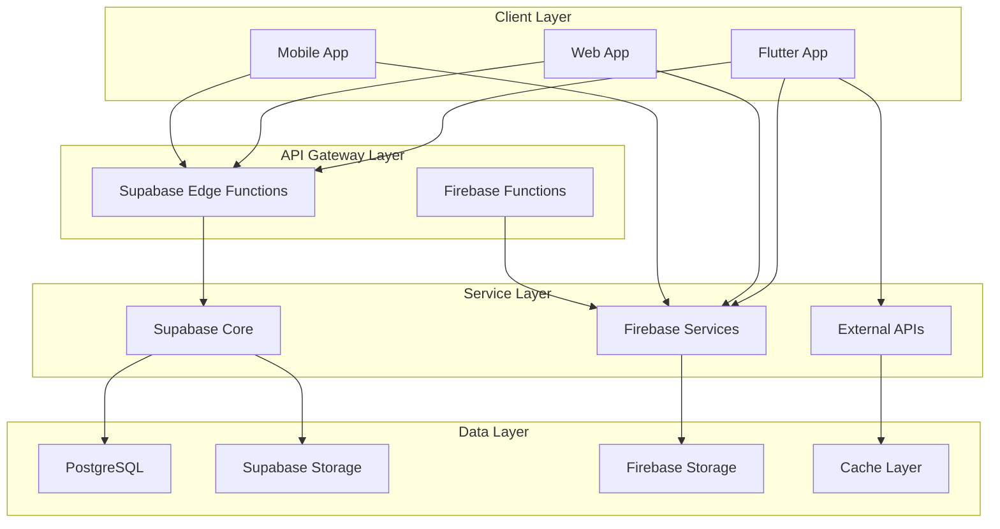

# 🏗️ Arquitectura de Backend - Aplicación Películas

## 📋 Resumen Ejecutivo

La aplicación Películas utiliza una arquitectura de backend híbrida que combina **Supabase** como Backend-as-a-Service principal con **Firebase** para servicios auxiliares y **TMDB API** como fuente de datos de películas. Esta estrategia proporciona escalabilidad, performance y funcionalidades ricas manteniendo la complejidad manejable.

## 🏛️ Arquitectura General



## 🎯 Distribución de Responsabilidades

### Supabase (Backend Principal)
- **Autenticación y autorización**
- **Base de datos principal (PostgreSQL)**
- **Storage de archivos de usuario**
- **Real-time subscriptions**
- **Row Level Security (RLS)**

### Firebase (Servicios Auxiliares)
- **Crashlytics** (error reporting)
- **Cloud Messaging** (push notifications)
- **Performance Monitoring**
- **Analytics**
- **Remote Config**

### APIs Externas
- **TMDB API** (datos de películas)
- **YouTube API** (trailers y videos)

## 🗄️ Arquitectura de Base de Datos

### Esquema Principal (PostgreSQL)

```sql
-- Extensiones requeridas
CREATE EXTENSION IF NOT EXISTS "uuid-ossp";
CREATE EXTENSION IF NOT EXISTS "pg_stat_statements";

-- Perfiles de usuario
CREATE TABLE user_profiles (
    id UUID PRIMARY KEY REFERENCES auth.users(id) ON DELETE CASCADE,
    username TEXT UNIQUE,
    display_name TEXT,
    avatar_url TEXT,
    bio TEXT,
    location TEXT,
    website TEXT,
    birth_date DATE,
    is_public BOOLEAN DEFAULT TRUE,
    created_at TIMESTAMP WITH TIME ZONE DEFAULT NOW(),
    updated_at TIMESTAMP WITH TIME ZONE DEFAULT NOW()
);

-- Listas de películas
CREATE TABLE watchlists (
    id UUID PRIMARY KEY DEFAULT uuid_generate_v4(),
    user_id UUID REFERENCES user_profiles(id) ON DELETE CASCADE,
    name TEXT NOT NULL,
    description TEXT,
    movie_ids INTEGER[],
    is_public BOOLEAN DEFAULT FALSE,
    is_collaborative BOOLEAN DEFAULT FALSE,
    tags TEXT[],
    created_at TIMESTAMP WITH TIME ZONE DEFAULT NOW(),
    updated_at TIMESTAMP WITH TIME ZONE DEFAULT NOW()
);

-- Favoritos de películas
CREATE TABLE user_favorites (
    id UUID PRIMARY KEY DEFAULT uuid_generate_v4(),
    user_id UUID REFERENCES user_profiles(id) ON DELETE CASCADE,
    movie_id INTEGER NOT NULL,
    added_at TIMESTAMP WITH TIME ZONE DEFAULT NOW(),
    UNIQUE(user_id, movie_id)
);

-- Calificaciones de películas
CREATE TABLE user_ratings (
    id UUID PRIMARY KEY DEFAULT uuid_generate_v4(),
    user_id UUID REFERENCES user_profiles(id) ON DELETE CASCADE,
    movie_id INTEGER NOT NULL,
    rating DECIMAL(2,1) CHECK (rating >= 0 AND rating <= 10),
    review TEXT,
    created_at TIMESTAMP WITH TIME ZONE DEFAULT NOW(),
    updated_at TIMESTAMP WITH TIME ZONE DEFAULT NOW(),
    UNIQUE(user_id, movie_id)
);

-- Progreso de gamificación
CREATE TABLE user_progress (
    id UUID PRIMARY KEY DEFAULT uuid_generate_v4(),
    user_id UUID REFERENCES user_profiles(id) ON DELETE CASCADE,
    achievement_id TEXT NOT NULL,
    progress_value INTEGER DEFAULT 0,
    max_value INTEGER NOT NULL,
    completed_at TIMESTAMP WITH TIME ZONE,
    created_at TIMESTAMP WITH TIME ZONE DEFAULT NOW(),
    UNIQUE(user_id, achievement_id)
);

-- Logros desbloqueados
CREATE TABLE user_achievements (
    id UUID PRIMARY KEY DEFAULT uuid_generate_v4(),
    user_id UUID REFERENCES user_profiles(id) ON DELETE CASCADE,
    achievement_id TEXT NOT NULL,
    unlocked_at TIMESTAMP WITH TIME ZONE DEFAULT NOW(),
    UNIQUE(user_id, achievement_id)
);

-- Notificaciones
CREATE TABLE notifications (
    id UUID PRIMARY KEY DEFAULT uuid_generate_v4(),
    user_id UUID REFERENCES user_profiles(id) ON DELETE CASCADE,
    type TEXT NOT NULL,
    title TEXT NOT NULL,
    message TEXT NOT NULL,
    data JSONB,
    read_at TIMESTAMP WITH TIME ZONE,
    expires_at TIMESTAMP WITH TIME ZONE,
    created_at TIMESTAMP WITH TIME ZONE DEFAULT NOW()
);

-- Actividad de usuario (para analytics)
CREATE TABLE user_activity (
    id UUID PRIMARY KEY DEFAULT uuid_generate_v4(),
    user_id UUID REFERENCES user_profiles(id) ON DELETE CASCADE,
    event_type TEXT NOT NULL,
    event_data JSONB,
    ip_address INET,
    user_agent TEXT,
    created_at TIMESTAMP WITH TIME ZONE DEFAULT NOW()
);

-- Compartir contenido
CREATE TABLE shared_content (
    id UUID PRIMARY KEY DEFAULT uuid_generate_v4(),
    user_id UUID REFERENCES user_profiles(id) ON DELETE CASCADE,
    content_type TEXT NOT NULL, -- 'movie', 'watchlist', 'review'
    content_id TEXT NOT NULL,
    platform TEXT NOT NULL, -- 'twitter', 'facebook', 'whatsapp', etc.
    shared_at TIMESTAMP WITH TIME ZONE DEFAULT NOW()
);
```

### Índices de Performance

```sql
-- Índices para queries frecuentes
CREATE INDEX idx_user_profiles_username ON user_profiles(username);
CREATE INDEX idx_watchlists_user_id ON watchlists(user_id);
CREATE INDEX idx_watchlists_public ON watchlists(is_public) WHERE is_public = true;
CREATE INDEX idx_user_favorites_user_id ON user_favorites(user_id);
CREATE INDEX idx_user_favorites_movie_id ON user_favorites(movie_id);
CREATE INDEX idx_user_ratings_user_id ON user_ratings(user_id);
CREATE INDEX idx_user_ratings_movie_id ON user_ratings(movie_id);
CREATE INDEX idx_user_progress_user_id ON user_progress(user_id);
CREATE INDEX idx_user_achievements_user_id ON user_achievements(user_id);
CREATE INDEX idx_notifications_user_id_unread ON notifications(user_id, created_at) WHERE read_at IS NULL;
CREATE INDEX idx_user_activity_user_id_created ON user_activity(user_id, created_at);
CREATE INDEX idx_shared_content_user_id ON shared_content(user_id);

-- Índices compuestos para queries complejas
CREATE INDEX idx_user_ratings_rating_created ON user_ratings(rating DESC, created_at DESC);
CREATE INDEX idx_user_activity_type_created ON user_activity(event_type, created_at DESC);
```

### Triggers para Auditoría

```sql
-- Function para actualizar timestamp
CREATE OR REPLACE FUNCTION update_updated_at_column()
RETURNS TRIGGER AS $$
BEGIN
    NEW.updated_at = NOW();
    RETURN NEW;
END;
$$ language 'plpgsql';

-- Triggers para actualización automática
CREATE TRIGGER update_user_profiles_updated_at BEFORE UPDATE ON user_profiles 
    FOR EACH ROW EXECUTE FUNCTION update_updated_at_column();

CREATE TRIGGER update_watchlists_updated_at BEFORE UPDATE ON watchlists 
    FOR EACH ROW EXECUTE FUNCTION update_updated_at_column();

CREATE TRIGGER update_user_ratings_updated_at BEFORE UPDATE ON user_ratings 
    FOR EACH ROW EXECUTE FUNCTION update_updated_at_column();
```

## 🔒 Seguridad y Row Level Security (RLS)

### Políticas de Seguridad

```sql
-- Habilitar RLS en todas las tablas
ALTER TABLE user_profiles ENABLE ROW LEVEL SECURITY;
ALTER TABLE watchlists ENABLE ROW LEVEL SECURITY;
ALTER TABLE user_favorites ENABLE ROW LEVEL SECURITY;
ALTER TABLE user_ratings ENABLE ROW LEVEL SECURITY;
ALTER TABLE user_progress ENABLE ROW LEVEL SECURITY;
ALTER TABLE user_achievements ENABLE ROW LEVEL SECURITY;
ALTER TABLE notifications ENABLE ROW LEVEL SECURITY;
ALTER TABLE user_activity ENABLE ROW LEVEL SECURITY;
ALTER TABLE shared_content ENABLE ROW LEVEL SECURITY;

-- Políticas para user_profiles
CREATE POLICY "Users can view public profiles" ON user_profiles
    FOR SELECT USING (is_public = true OR auth.uid() = id);

CREATE POLICY "Users can update own profile" ON user_profiles
    FOR UPDATE USING (auth.uid() = id);

CREATE POLICY "Users can insert own profile" ON user_profiles
    FOR INSERT WITH CHECK (auth.uid() = id);

-- Políticas para watchlists
CREATE POLICY "Users can view public watchlists" ON watchlists
    FOR SELECT USING (is_public = true OR auth.uid() = user_id);

CREATE POLICY "Users can manage own watchlists" ON watchlists
    FOR ALL USING (auth.uid() = user_id);

-- Políticas para favorites
CREATE POLICY "Users can manage own favorites" ON user_favorites
    FOR ALL USING (auth.uid() = user_id);

-- Políticas para ratings
CREATE POLICY "Users can view all ratings" ON user_ratings
    FOR SELECT USING (true);

CREATE POLICY "Users can manage own ratings" ON user_ratings
    FOR INSERT WITH CHECK (auth.uid() = user_id);

CREATE POLICY "Users can update own ratings" ON user_ratings
    FOR UPDATE USING (auth.uid() = user_id);

CREATE POLICY "Users can delete own ratings" ON user_ratings
    FOR DELETE USING (auth.uid() = user_id);

-- Políticas para gamificación
CREATE POLICY "Users can view own progress" ON user_progress
    FOR SELECT USING (auth.uid() = user_id);

CREATE POLICY "System can update progress" ON user_progress
    FOR ALL USING (auth.uid() = user_id);

CREATE POLICY "Users can view own achievements" ON user_achievements
    FOR SELECT USING (auth.uid() = user_id);

-- Políticas para notificaciones
CREATE POLICY "Users can view own notifications" ON notifications
    FOR SELECT USING (auth.uid() = user_id);

CREATE POLICY "Users can update own notifications" ON notifications
    FOR UPDATE USING (auth.uid() = user_id);

-- Políticas para actividad
CREATE POLICY "Users can view own activity" ON user_activity
    FOR SELECT USING (auth.uid() = user_id);

-- Políticas para contenido compartido
CREATE POLICY "Users can manage own shared content" ON shared_content
    FOR ALL USING (auth.uid() = user_id);
```

### Funciones de Seguridad

```sql
-- Función para verificar permisos de administrador
CREATE OR REPLACE FUNCTION is_admin()
RETURNS BOOLEAN AS $$
BEGIN
    RETURN (
        SELECT raw_user_meta_data->>'role' = 'admin'
        FROM auth.users
        WHERE id = auth.uid()
    );
END;
$$ LANGUAGE plpgsql SECURITY DEFINER;

-- Función para verificar ownership de watchlist
CREATE OR REPLACE FUNCTION can_access_watchlist(watchlist_id UUID)
RETURNS BOOLEAN AS $$
DECLARE
    watchlist_user_id UUID;
    is_public BOOLEAN;
BEGIN
    SELECT user_id, watchlists.is_public 
    INTO watchlist_user_id, is_public
    FROM watchlists 
    WHERE id = watchlist_id;
    
    RETURN (
        watchlist_user_id = auth.uid() OR 
        is_public = true OR 
        is_admin()
    );
END;
$$ LANGUAGE plpgsql SECURITY DEFINER;
```

## 🔧 Supabase Edge Functions

### Function de Gamificación

```typescript
// supabase/functions/update-user-progress/index.ts
import { serve } from "https://deno.land/std@0.168.0/http/server.ts"
import { createClient } from 'https://esm.sh/@supabase/supabase-js@2'

interface ProgressUpdate {
  userId: string
  achievementId: string
  progressValue: number
}

serve(async (req) => {
  try {
    const { userId, achievementId, progressValue }: ProgressUpdate = await req.json()
    
    const supabase = createClient(
      Deno.env.get('SUPABASE_URL') ?? '',
      Deno.env.get('SUPABASE_SERVICE_ROLE_KEY') ?? ''
    )

    // Update user progress
    const { data: progress, error: progressError } = await supabase
      .from('user_progress')
      .upsert({
        user_id: userId,
        achievement_id: achievementId,
        progress_value: progressValue,
      })
      .select()
      .single()

    if (progressError) throw progressError

    // Check if achievement is completed
    if (progress.progress_value >= progress.max_value && !progress.completed_at) {
      // Mark as completed
      await supabase
        .from('user_progress')
        .update({ completed_at: new Date().toISOString() })
        .eq('id', progress.id)

      // Add to achievements
      await supabase
        .from('user_achievements')
        .insert({
          user_id: userId,
          achievement_id: achievementId,
        })

      // Send notification
      await supabase
        .from('notifications')
        .insert({
          user_id: userId,
          type: 'achievement_unlocked',
          title: 'Achievement Unlocked!',
          message: `You've unlocked the ${achievementId} achievement!`,
          data: { achievement_id: achievementId },
        })
    }

    return new Response(JSON.stringify({ success: true, progress }), {
      headers: { 'Content-Type': 'application/json' },
    })
  } catch (error) {
    return new Response(JSON.stringify({ error: error.message }), {
      status: 400,
      headers: { 'Content-Type': 'application/json' },
    })
  }
})
```

### Function de Recomendaciones

```typescript
// supabase/functions/get-recommendations/index.ts
import { serve } from "https://deno.land/std@0.168.0/http/server.ts"
import { createClient } from 'https://esm.sh/@supabase/supabase-js@2'

serve(async (req) => {
  try {
    const { userId } = await req.json()
    
    const supabase = createClient(
      Deno.env.get('SUPABASE_URL') ?? '',
      Deno.env.get('SUPABASE_SERVICE_ROLE_KEY') ?? ''
    )

    // Get user ratings
    const { data: userRatings } = await supabase
      .from('user_ratings')
      .select('movie_id, rating')
      .eq('user_id', userId)
      .gte('rating', 7.0)

    // Get user favorites
    const { data: userFavorites } = await supabase
      .from('user_favorites')
      .select('movie_id')
      .eq('user_id', userId)

    // Simple collaborative filtering
    const { data: similarUsers } = await supabase
      .from('user_ratings')
      .select('user_id, movie_id, rating')
      .in('movie_id', userRatings?.map(r => r.movie_id) || [])
      .neq('user_id', userId)
      .gte('rating', 7.0)

    // Calculate recommendations based on similar users
    const recommendations = calculateRecommendations(
      userRatings,
      userFavorites,
      similarUsers
    )

    return new Response(JSON.stringify({ recommendations }), {
      headers: { 'Content-Type': 'application/json' },
    })
  } catch (error) {
    return new Response(JSON.stringify({ error: error.message }), {
      status: 400,
      headers: { 'Content-Type': 'application/json' },
    })
  }
})

function calculateRecommendations(userRatings: any[], userFavorites: any[], similarUsers: any[]) {
  // Simple recommendation algorithm
  const movieScores = new Map<number, number>()
  
  similarUsers.forEach(rating => {
    const current = movieScores.get(rating.movie_id) || 0
    movieScores.set(rating.movie_id, current + rating.rating)
  })
  
  return Array.from(movieScores.entries())
    .sort((a, b) => b[1] - a[1])
    .slice(0, 20)
    .map(([movieId]) => movieId)
}
```

## 🔥 Firebase Services Integration

### Cloud Messaging Setup

```typescript
// Firebase Cloud Function for notifications
import { onRequest } from 'firebase-functions/v2/https'
import { getMessaging } from 'firebase-admin/messaging'
import { initializeApp } from 'firebase-admin/app'

initializeApp()

export const sendNotification = onRequest(async (req, res) => {
  try {
    const { userId, title, body, data } = req.body

    // Get user FCM token from Supabase
    const userToken = await getUserFCMToken(userId)
    
    if (!userToken) {
      res.status(404).json({ error: 'User token not found' })
      return
    }

    const message = {
      token: userToken,
      notification: {
        title,
        body,
      },
      data: data || {},
      android: {
        notification: {
          icon: 'ic_notification',
          color: '#FF6B6B',
        },
      },
      apns: {
        payload: {
          aps: {
            badge: 1,
          },
        },
      },
    }

    const response = await getMessaging().send(message)
    res.json({ success: true, messageId: response })
  } catch (error) {
    res.status(500).json({ error: error.message })
  }
})

async function getUserFCMToken(userId: string): Promise<string | null> {
  // Implementation to get FCM token from Supabase
  // This would typically involve calling Supabase API
  return null
}
```

### Analytics Events

```typescript
// Custom analytics events
export const logCustomEvent = onRequest(async (req, res) => {
  try {
    const { userId, eventName, eventData } = req.body

    // Log to Supabase for detailed analytics
    await logToSupabase(userId, eventName, eventData)

    // Log to Firebase Analytics for aggregated data
    await logToFirebaseAnalytics(eventName, eventData)

    res.json({ success: true })
  } catch (error) {
    res.status(500).json({ error: error.message })
  }
})
```

## 🌐 External API Integration

### TMDB API Service

```typescript
// TMDB API wrapper with caching
class TMDBService {
  private readonly baseURL = 'https://api.themoviedb.org/3'
  private readonly apiKey = process.env.TMDB_API_KEY
  private readonly cache = new Map<string, any>()

  async getPopularMovies(page: number = 1): Promise<any> {
    const cacheKey = `popular_movies_${page}`
    
    if (this.cache.has(cacheKey)) {
      return this.cache.get(cacheKey)
    }

    const response = await fetch(
      `${this.baseURL}/movie/popular?api_key=${this.apiKey}&page=${page}`
    )
    
    if (!response.ok) {
      throw new Error('Failed to fetch movies')
    }

    const data = await response.json()
    
    // Cache for 1 hour
    this.cache.set(cacheKey, data)
    setTimeout(() => this.cache.delete(cacheKey), 3600000)
    
    return data
  }

  async getMovieDetails(movieId: number): Promise<any> {
    const cacheKey = `movie_details_${movieId}`
    
    if (this.cache.has(cacheKey)) {
      return this.cache.get(cacheKey)
    }

    const response = await fetch(
      `${this.baseURL}/movie/${movieId}?api_key=${this.apiKey}&append_to_response=credits,videos`
    )
    
    if (!response.ok) {
      throw new Error('Failed to fetch movie details')
    }

    const data = await response.json()
    
    // Cache for 24 hours
    this.cache.set(cacheKey, data)
    setTimeout(() => this.cache.delete(cacheKey), 86400000)
    
    return data
  }

  async searchMovies(query: string, page: number = 1): Promise<any> {
    const response = await fetch(
      `${this.baseURL}/search/movie?api_key=${this.apiKey}&query=${encodeURIComponent(query)}&page=${page}`
    )
    
    if (!response.ok) {
      throw new Error('Failed to search movies')
    }

    return response.json()
  }
}
```

### Rate Limiting and Circuit Breaker

```typescript
class RateLimitedTMDBService extends TMDBService {
  private requestQueue: Array<() => Promise<any>> = []
  private processing = false
  private readonly maxRequestsPerSecond = 4

  async makeRequest<T>(requestFn: () => Promise<T>): Promise<T> {
    return new Promise((resolve, reject) => {
      this.requestQueue.push(async () => {
        try {
          const result = await requestFn()
          resolve(result)
        } catch (error) {
          reject(error)
        }
      })

      this.processQueue()
    })
  }

  private async processQueue() {
    if (this.processing || this.requestQueue.length === 0) {
      return
    }

    this.processing = true

    while (this.requestQueue.length > 0) {
      const request = this.requestQueue.shift()!
      await request()
      
      // Wait to respect rate limit
      await new Promise(resolve => setTimeout(resolve, 1000 / this.maxRequestsPerSecond))
    }

    this.processing = false
  }
}
```

## 📊 Monitoring y Observabilidad

### Health Checks

```sql
-- Health check function
CREATE OR REPLACE FUNCTION system_health_check()
RETURNS JSON AS $$
DECLARE
    result JSON;
    db_size BIGINT;
    active_connections INTEGER;
    slow_queries INTEGER;
BEGIN
    -- Get database size
    SELECT pg_database_size(current_database()) INTO db_size;
    
    -- Get active connections
    SELECT count(*) INTO active_connections
    FROM pg_stat_activity
    WHERE state = 'active';
    
    -- Get slow queries count (last hour)
    SELECT count(*) INTO slow_queries
    FROM pg_stat_statements
    WHERE calls > 0 AND mean_exec_time > 1000;
    
    result := json_build_object(
        'timestamp', NOW(),
        'database_size_bytes', db_size,
        'active_connections', active_connections,
        'slow_queries_last_hour', slow_queries,
        'status', 'healthy'
    );
    
    RETURN result;
END;
$$ LANGUAGE plpgsql;
```

### Performance Metrics

```sql
-- Query performance monitoring
CREATE VIEW performance_metrics AS
SELECT 
    query,
    calls,
    total_exec_time,
    mean_exec_time,
    stddev_exec_time,
    rows,
    100.0 * shared_blks_hit / nullif(shared_blks_hit + shared_blks_read, 0) AS hit_percent
FROM pg_stat_statements
ORDER BY total_exec_time DESC;

-- Table usage statistics
CREATE VIEW table_stats AS
SELECT 
    schemaname,
    tablename,
    n_tup_ins as inserts,
    n_tup_upd as updates,
    n_tup_del as deletes,
    n_live_tup as live_tuples,
    n_dead_tup as dead_tuples,
    last_vacuum,
    last_autovacuum,
    last_analyze,
    last_autoanalyze
FROM pg_stat_user_tables
ORDER BY n_live_tup DESC;
```

## 🔄 Backup y Disaster Recovery

### Backup Strategy

```bash
# Automated backup script
#!/bin/bash
BACKUP_DIR="/backups/supabase"
DATE=$(date +%Y%m%d_%H%M%S)
DB_NAME="postgres"

# Create backup directory
mkdir -p $BACKUP_DIR

# Full database backup
pg_dump -h $SUPABASE_HOST -U $SUPABASE_USER -d $DB_NAME \
  --no-password --format=custom --compress=9 \
  --file="$BACKUP_DIR/full_backup_$DATE.dump"

# Schema-only backup
pg_dump -h $SUPABASE_HOST -U $SUPABASE_USER -d $DB_NAME \
  --no-password --schema-only \
  --file="$BACKUP_DIR/schema_backup_$DATE.sql"

# Data-only backup for critical tables
pg_dump -h $SUPABASE_HOST -U $SUPABASE_USER -d $DB_NAME \
  --no-password --data-only \
  --table=user_profiles --table=watchlists --table=user_favorites \
  --file="$BACKUP_DIR/data_backup_$DATE.sql"

# Upload to cloud storage
aws s3 cp $BACKUP_DIR/ s3://peliculas-backups/$DATE/ --recursive

# Clean old backups (keep last 30 days)
find $BACKUP_DIR -name "*.dump" -mtime +30 -delete
```

### Restore Procedures

```bash
# Restore from backup
#!/bin/bash
BACKUP_FILE=$1
DB_NAME="postgres"

if [ -z "$BACKUP_FILE" ]; then
    echo "Usage: $0 <backup_file>"
    exit 1
fi

# Restore database
pg_restore -h $SUPABASE_HOST -U $SUPABASE_USER -d $DB_NAME \
  --no-password --clean --if-exists \
  --format=custom $BACKUP_FILE

echo "Restore completed from $BACKUP_FILE"
```

## 🚀 Deployment y CI/CD

### Environment Configuration

```yaml
# .github/workflows/deploy-backend.yml
name: Deploy Backend
on:
  push:
    branches: [main]
    paths: ['supabase/**']

jobs:
  deploy:
    runs-on: ubuntu-latest
    steps:
      - uses: actions/checkout@v4
      
      - name: Setup Supabase CLI
        uses: supabase/setup-cli@v1
        
      - name: Deploy migrations
        run: |
          supabase db push --db-url ${{ secrets.SUPABASE_DB_URL }}
          
      - name: Deploy Edge Functions
        run: |
          supabase functions deploy --project-ref ${{ secrets.SUPABASE_PROJECT_REF }}
          
      - name: Run health checks
        run: |
          curl -f ${{ secrets.SUPABASE_URL }}/rest/v1/rpc/system_health_check \
            -H "apikey: ${{ secrets.SUPABASE_ANON_KEY }}"
```

### Migration Management

```sql
-- Migration versioning
CREATE TABLE IF NOT EXISTS schema_migrations (
    version TEXT PRIMARY KEY,
    applied_at TIMESTAMP WITH TIME ZONE DEFAULT NOW(),
    description TEXT
);

-- Migration tracking function
CREATE OR REPLACE FUNCTION apply_migration(
    migration_version TEXT,
    migration_description TEXT DEFAULT NULL
)
RETURNS VOID AS $$
BEGIN
    INSERT INTO schema_migrations (version, description)
    VALUES (migration_version, migration_description)
    ON CONFLICT (version) DO NOTHING;
END;
$$ LANGUAGE plpgsql;
```

## 📈 Escalabilidad y Optimización

### Query Optimization

```sql
-- Materialized views for expensive queries
CREATE MATERIALIZED VIEW popular_movies_cache AS
SELECT 
    movie_id,
    COUNT(*) as favorite_count,
    AVG(rating) as avg_rating,
    COUNT(DISTINCT user_id) as unique_users
FROM user_favorites uf
LEFT JOIN user_ratings ur ON uf.movie_id = ur.movie_id
GROUP BY movie_id
HAVING COUNT(*) >= 10
ORDER BY favorite_count DESC, avg_rating DESC
LIMIT 100;

-- Refresh materialized view hourly
CREATE OR REPLACE FUNCTION refresh_popular_movies_cache()
RETURNS VOID AS $$
BEGIN
    REFRESH MATERIALIZED VIEW popular_movies_cache;
END;
$$ LANGUAGE plpgsql;

-- Schedule refresh
SELECT cron.schedule('refresh-popular-movies', '0 * * * *', 'SELECT refresh_popular_movies_cache();');
```

### Connection Pooling

```typescript
// Supabase client with connection pooling
const supabase = createClient(
  process.env.SUPABASE_URL!,
  process.env.SUPABASE_SERVICE_ROLE_KEY!,
  {
    db: {
      schema: 'public',
    },
    auth: {
      autoRefreshToken: true,
      persistSession: true,
    },
    global: {
      headers: {
        'x-application-name': 'peliculas-app',
      },
    },
  }
)
```

## 🔐 Security Best Practices

### API Security

```sql
-- Rate limiting function
CREATE OR REPLACE FUNCTION check_rate_limit(
    user_id UUID,
    endpoint TEXT,
    requests_per_minute INTEGER DEFAULT 60
)
RETURNS BOOLEAN AS $$
DECLARE
    request_count INTEGER;
BEGIN
    -- Count requests in the last minute
    SELECT COUNT(*)
    INTO request_count
    FROM user_activity
    WHERE user_id = check_rate_limit.user_id
      AND event_type = endpoint
      AND created_at > NOW() - INTERVAL '1 minute';
    
    -- Log this request
    INSERT INTO user_activity (user_id, event_type, event_data)
    VALUES (user_id, endpoint, json_build_object('timestamp', NOW()));
    
    RETURN request_count < requests_per_minute;
END;
$$ LANGUAGE plpgsql SECURITY DEFINER;
```

### Data Encryption

```sql
-- Encrypt sensitive data
CREATE EXTENSION IF NOT EXISTS pgcrypto;

-- Function to encrypt data
CREATE OR REPLACE FUNCTION encrypt_pii(data TEXT)
RETURNS TEXT AS $$
BEGIN
    RETURN pgp_sym_encrypt(data, current_setting('app.encryption_key'));
END;
$$ LANGUAGE plpgsql SECURITY DEFINER;

-- Function to decrypt data
CREATE OR REPLACE FUNCTION decrypt_pii(encrypted_data TEXT)
RETURNS TEXT AS $$
BEGIN
    RETURN pgp_sym_decrypt(encrypted_data, current_setting('app.encryption_key'));
END;
$$ LANGUAGE plpgsql SECURITY DEFINER;
```

---

**Última actualización**: 2024-01-01  
**Versión de documentación**: 1.0  
**Próxima revisión**: 2024-03-01

Para preguntas sobre la arquitectura de backend, contactar al equipo de DevOps.