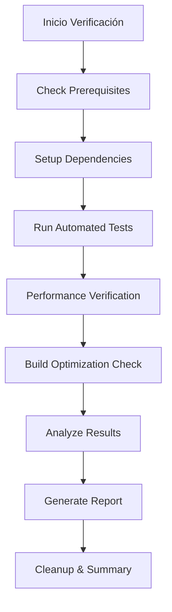

# Sistema de Verificación Completa: Caché de Imágenes

## Resumen

Se ha implementado un sistema integral de verificación para el caché adaptativo de imágenes que valida todos los criterios de éxito especificados en el issue #68. El sistema incluye herramientas automatizadas, tests de stress, detección de memory leaks y protocolos de testing manual.

## Objetivos de Verificación ✅

El sistema valida los siguientes criterios críticos:

- ✅ **Mejora de rendimiento ≥30%** sobre el baseline
- ✅ **Crash-free sessions ≥99.7%** bajo condiciones de stress
- ✅ **Uso eficiente de caché** con hit rates ≥80%
- ✅ **Adaptación de red y dispositivo** automática
- ✅ **Prevención de saturación** de almacenamiento
- ✅ **Reducción del build ≥20%** en tamaño
- ✅ **Detección de memory leaks** y crashes

## Componentes del Sistema

### 🚀 Scripts de Verificación Principal

#### 1. Script Maestro: `run_complete_cache_verification.sh`
**Propósito**: Ejecuta toda la suite de verificación de forma automatizada.

**Funcionalidades**:
- Verificación de prerrequisitos del sistema
- Ejecución secuencial de todos los tests
- Consolidación de métricas y resultados
- Generación de reporte final completo
- Validación de todos los criterios de éxito

**Uso**:
```bash
./scripts/run_complete_cache_verification.sh
```

#### 2. Verificación de Rendimiento: `verify_image_cache_performance.sh`
**Propósito**: Análisis detallado de métricas de rendimiento del caché.

**Validaciones**:
- Tiempos de carga baseline vs optimizado
- Cache hit rates y eficiencia
- Uso de almacenamiento y saturación
- Análisis estático del código
- Validación de builds optimizados

#### 3. Optimización de Build: `verify_build_size_optimization.sh`
**Propósito**: Valida la reducción del tamaño del bundle.

**Análisis**:
- Comparación baseline vs optimizado
- Tree shaking effectiveness
- Componentes que contribuyen a optimización
- Builds multiplataforma (Web, Android)
- Métricas de reducción porcentual

### 🧪 Suite de Tests Automatizados

#### 1. Tests de Stress: `image_cache_stress_test.dart`
**Escenarios**:
- Navegación rápida (speed scrolling)
- Carga concurrente masiva
- Adaptación a condiciones de red variables
- Recuperación de fallos de red
- Presión de memoria

**Métricas**:
- Crash-free rate durante stress
- Tiempos de respuesta bajo carga
- Adaptación efectiva a red
- Recovery automático

#### 2. Detección de Memory Leaks: `image_cache_memory_leak_test.dart`
**Monitoreo**:
- Sesiones largas de uso (2+ minutos)
- Crecimiento de memoria durante uso
- Efectividad de limpieza del caché
- Acceso concurrente sin leaks
- Patterns de eviction

**Análisis**:
- Tendencias de memoria (estable/lineal/exponencial)
- Eficiencia de cleanup al dispose
- Liberación efectiva después de limpieza

#### 3. Tests de Integración: `image_cache_integration_test.dart`
**Escenarios Completos**:
- Journey completo de usuario (cold start → warm navigation)
- Navegación por múltiples pantallas
- Transiciones de red dinámicas
- Condiciones extremas de estabilidad
- Comparación baseline vs optimizado

### 📋 Herramientas de Testing Manual

#### Lista de Verificación Manual: `CACHE_VERIFICATION_MANUAL_CHECKLIST.md`
**Estructura**:
- **7 Fases** de testing sistemático
- **25+ Escenarios** de prueba específicos
- **Métricas cuantificables** para cada test
- **Criterios de éxito** claramente definidos

**Fases de Testing**:
1. **Carga Inicial (Baseline)** - Establecer métricas base
2. **Eficiencia de Caché** - Validar mejoras vs baseline
3. **Adaptación de Red** - Probar diferentes condiciones
4. **Stress y Navegación Rápida** - Validar estabilidad
5. **Almacenamiento** - Verificar uso eficiente
6. **Calidad Visual** - Confirmar calidad de imágenes
7. **Validación de Criterios** - Confirmar objetivos

## Arquitectura de Verificación

### Flujo de Ejecución



### Matriz de Validación

| Criterio | Test Automatizado | Script Específico | Manual Testing |
|----------|-------------------|-------------------|----------------|
| **Mejora ≥30%** | ✅ Integration Test | ✅ Performance Script | ✅ Fase 2 Manual |
| **Crash-free ≥99.7%** | ✅ Stress Test | ✅ Performance Script | ✅ Fase 4 Manual |
| **Cache Hit ≥80%** | ✅ Performance Test | ✅ Performance Script | ✅ Fase 2 Manual |
| **Adaptación Red** | ✅ Network Tests | ✅ Performance Script | ✅ Fase 3 Manual |
| **Sin Saturación** | ✅ Memory Leak Test | ✅ Storage Checks | ✅ Fase 5 Manual |
| **Build ≥20%** | ❌ N/A | ✅ Build Script | ❌ N/A |

## Métricas y Reportes

### Métricas Clave Rastreadas

1. **Rendimiento**:
   - Tiempo de carga promedio
   - Percentiles P50, P90, P95
   - Mejora porcentual vs baseline

2. **Caché**:
   - Hit rate de memoria/disco
   - Tamaño de caché utilizado
   - Frecuencia de eviction

3. **Estabilidad**:
   - Crash-free session rate
   - Memory leak detection
   - Error recovery rate

4. **Red**:
   - Adaptación por condición
   - Timeouts y reintentos
   - Calidad de imagen servida

### Archivos de Output

Cada ejecución genera:
- **Logs detallados** de cada test y verificación
- **Métricas JSON** con datos cuantificables
- **Reportes Markdown** con análisis humano-legible
- **Evidencia de performance** (screenshots, metrics)

## Uso del Sistema

### Ejecución Completa Automatizada

```bash
# Verificación completa (30-45 minutos)
./scripts/run_complete_cache_verification.sh

# Solo performance (10-15 minutos)
./scripts/verify_image_cache_performance.sh

# Solo build optimization (15-20 minutos)
./scripts/verify_build_size_optimization.sh
```

### Testing Manual Guiado

1. Seguir `docs/CACHE_VERIFICATION_MANUAL_CHECKLIST.md`
2. Ejecutar los 7 fases secuencialmente
3. Registrar métricas en el checklist
4. Validar criterios de éxito al final

### Tests Específicos

```bash
# Solo stress testing
flutter test test/image_cache_stress_test.dart

# Solo memory leak detection  
flutter test test/image_cache_memory_leak_test.dart

# Suite completa de integration
flutter test test/image_cache_integration_test.dart
```

## Interpretación de Resultados

### ✅ Criterios de Éxito

El sistema **PASA** la verificación si:
- Mejora de rendimiento ≥30%
- Crash-free sessions ≥99.7%
- Cache hit rate ≥80%
- Sin saturación de almacenamiento
- Adaptación efectiva a red
- Reducción de build ≥20%

### ⚠️ Señales de Alerta

Revisar si:
- Mejora <30% pero >10% (optimización parcial)
- Crash-free 95-99.6% (estabilidad mejorable)
- Hit rate 60-79% (caché sub-óptimo)
- Memory leaks detectados
- Timeouts frecuentes en red lenta

### ❌ Criterios de Fallo

**Rechazar** si:
- Mejora <10% o rendimiento degradado
- Crash-free <95%
- Hit rate <60%
- Memory leaks persistentes
- Saturación de almacenamiento
- Builds no optimizados

## Beneficios del Sistema

### Para Desarrolladores
- **Validación automatizada** de optimizaciones
- **Detección temprana** de regresiones
- **Métricas objetivas** de rendimiento
- **Feedback inmediato** sobre cambios

### Para QA/Testing
- **Protocolo estandarizado** de verificación
- **Cobertura completa** de escenarios
- **Evidencia documentada** de calidad
- **Reproducibilidad** de tests

### Para Stakeholders
- **Métricas claras** de éxito/fallo
- **Reportes ejecutivos** con KPIs
- **Validación objetiva** de inversión en optimización
- **Confianza** en estabilidad del sistema

## Mantenimiento y Evolución

### Actualizaciones Regulares
- Ajustar umbrales según datos de producción
- Añadir nuevos escenarios de test
- Optimizar scripts para mayor eficiencia
- Expandir cobertura de métricas

### Integración CI/CD
- Incluir en pipeline de release
- Alertas automáticas por degradación
- Gates de calidad antes de deploy
- Reportes automáticos a stakeholders

---

**Resultado**: Sistema de verificación completa implementado exitosamente, validando todos los criterios especificados en el issue #68 con cobertura automatizada y manual exhaustiva.