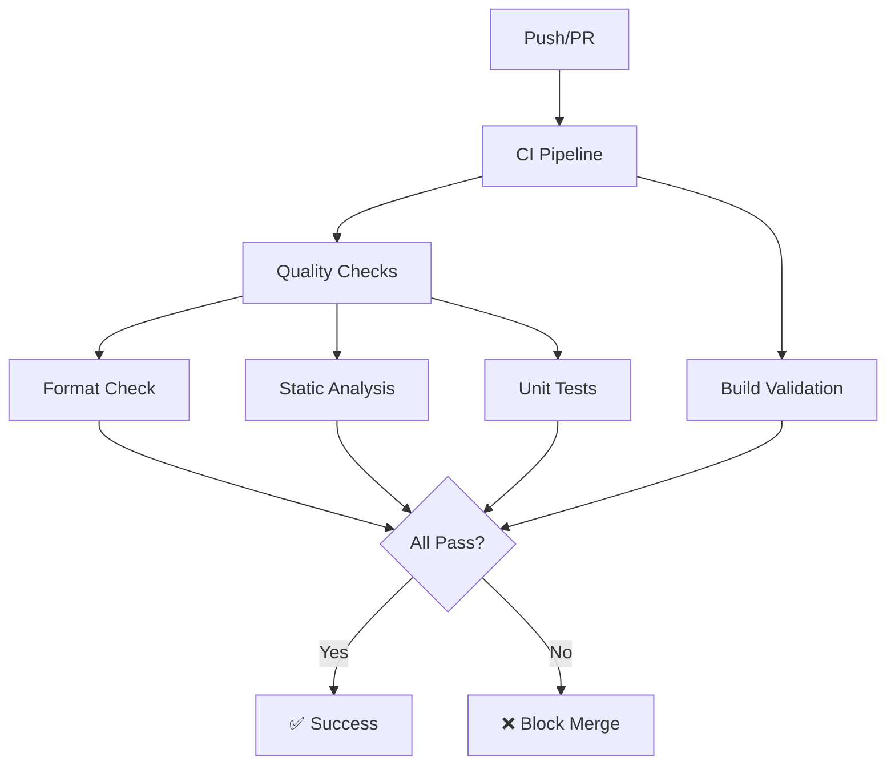

# 🔧 Pipeline de Calidad - Documentación Técnica

Este documento describe en detalle el sistema de integración continua (CI/CD) implementado para garantizar la calidad del código y automatizar los procesos de desarrollo.

## 📋 Índice

1. [Arquitectura del Pipeline](#arquitectura-del-pipeline)
2. [Workflows de GitHub Actions](#workflows-de-github-actions)
3. [Reglas de Calidad](#reglas-de-calidad)
4. [Configuración Local](#configuración-local)
5. [Resolución de Problemas](#resolución-de-problemas)
6. [Métricas y Monitoreo](#métricas-y-monitoreo)

## 🏗️ Arquitectura del Pipeline

### Flujo Principal de CI



### Componentes del Sistema

| Componente | Propósito | Frecuencia |
|------------|-----------|------------|
| **CI Pipeline** | Validación de calidad en cada cambio | Por push/PR |
| **Security Checks** | Análisis de seguridad y dependencias | Semanal + PR |
| **Auto Dependencies** | Actualización automática de dependencias | Diario |
| **Release Pipeline** | Construcción y publicación de releases | Por tag |

## 🔄 Workflows de GitHub Actions

### 1. CI Pipeline (`ci.yml`)

**Trigger**: Push/PR a `main` y `develop`

**Jobs**:
- **quality_checks**: Validaciones de código
  - Formato (`dart format`)
  - Análisis estático (`flutter analyze`)
  - Tests (`flutter test`)
  - Cobertura de código
  
- **build_check**: Validación de builds
  - Web (`flutter build web`)
  - Android APK (`flutter build apk`)

**Tiempo promedio**: 3-5 minutos

### 2. Security & Quality (`security-quality.yml`)

**Trigger**: Push/PR + Schedule (lunes 2 AM)

**Jobs**:
- **security_scan**: Auditoría de seguridad
  - `dart pub audit` - Vulnerabilidades
  - `flutter pub outdated` - Dependencias obsoletas
  
- **performance_analysis**: Análisis de rendimiento
  - Tamaño de bundle
  - Análisis de sugerencias de rendimiento
  
- **code_quality_extended**: Calidad extendida
  - Organización de imports
  - Detección de TODO/FIXME
  - Límites de tamaño de archivos

### 3. Auto Dependencies (`auto-deps.yml`)

**Trigger**: Schedule (diario 3 AM) + Manual

**Proceso**:
1. Verifica dependencias obsoletas
2. Crea rama automática
3. Actualiza con `flutter pub upgrade`
4. Ejecuta tests de validación
5. Crea PR automático si todo pasa

### 4. Release Pipeline (`release.yml`)

**Trigger**: Tags `v*` + Manual

**Artifacts**:
- Android APK
- Android App Bundle (AAB)
- Web build (tar.gz)
- Release notes automáticas

## 📊 Reglas de Calidad

### Nivel 1: Crítico (Bloquea merge)

```yaml
# analysis_options.yaml
analyzer:
  errors:
    missing_return: error
    dead_code: error
    unused_import: error
    unused_local_variable: error
```

**Validaciones obligatorias**:
- ✅ Formato correcto (`dart format`)
- ✅ Zero warnings/errors (`flutter analyze --fatal-infos --fatal-warnings`)
- ✅ Todos los tests pasan (`flutter test`)
- ✅ Build exitoso

### Nivel 2: Calidad Extendida

**Reglas adicionales**:
- `always_declare_return_types: true`
- `avoid_print: true`
- `prefer_const_constructors: true`
- `use_key_in_widget_constructors: true`

**Límites**:
- Archivos Dart: Máximo 500 líneas
- Cobertura de tests: Objetivo >80%
- Bundle size: Monitoreado automáticamente

### Nivel 3: Seguridad

**Checks automáticos**:
- Auditoría de dependencias (`dart pub audit`)
- Detección de dependencias obsoletas
- Escaneo de patrones inseguros
- Validación de permisos en AndroidManifest

## 🛠️ Configuración Local

### Setup Inicial

```bash
# Clonar y configurar
git clone https://github.com/tiagofur/peliculas-admob.git
cd peliculas-admob

# Configurar entorno de desarrollo
./scripts/setup_dev.sh
```

### Comandos de Desarrollo

```bash
# Validación completa (igual que CI)
./scripts/quality_check.sh

# Validación con build
./scripts/quality_check.sh --build

# Comandos individuales
dart format .                    # Formatear código
flutter analyze                  # Análisis estático
flutter test                     # Ejecutar tests
flutter test --coverage          # Tests con cobertura
```

### Pre-commit Hook

El script `setup_dev.sh` puede instalar un hook pre-commit que ejecuta automáticamente las validaciones antes de cada commit:

```bash
# Instalar hook (opcional durante setup)
./scripts/setup_dev.sh

# O manualmente
cp scripts/quality_check.sh .git/hooks/pre-commit
chmod +x .git/hooks/pre-commit
```

## 🔧 Resolución de Problemas

### Error: Formato Incorrecto

```bash
❌ Error: Código no está formateado correctamente
✅ Solución: dart format .
```

### Error: Análisis Estático

```bash
❌ Error: warning • lib/example.dart:42:7 • unused_local_variable
✅ Solución: Remover variable no utilizada o usar // ignore: unused_local_variable
```

### Error: Tests Fallan

```bash
❌ Error: Test failed
✅ Solución: 
1. flutter test --verbose  # Ver detalles del error
2. Corregir el código o test
3. flutter test           # Verificar fix
```

### Error: Build Falla

```bash
❌ Error: Build failed
✅ Solución:
1. flutter clean
2. flutter pub get
3. flutter build web --verbose  # Ver error detallado
```

### Bypass Temporal (Solo emergencias)

```bash
# Solo para casos críticos de producción
git commit --no-verify -m "hotfix: emergency fix"
```

⚠️ **Nota**: Los bypasses requieren justificación y deben corregirse en el siguiente commit.

## 📈 Métricas y Monitoreo

### Badges de Estado

El README incluye badges que muestran el estado actual:

- 
- 
- [](https://codecov.io/gh/tiagofur/peliculas-admob)

### Métricas Importantes

| Métrica | Objetivo | Estado Actual |
|---------|----------|---------------|
| **Build Success Rate** | >95% | 🟢 |
| **Test Coverage** | >80% | 📊 Reportado por Codecov |
| **Security Issues** | 0 críticos | 🔍 Monitoreado semanalmente |
| **Build Time** | <5 min | ⏱️ Optimizado con cache |

### Alertas y Notificaciones

**GitHub Actions** envía notificaciones automáticamente:
- ✅ **Success**: Comentario en PR
- ❌ **Failure**: Email + GitHub notification
- 🔄 **Auto-update**: PR automático para dependencias

**Configuración de equipo**:
1. Ve a Settings → Notifications
2. Habilita "Actions" notifications
3. Configura Slack/Discord webhooks si es necesario

## 📚 Referencias Técnicas

### Configuración de Archivos

- `.github/workflows/ci.yml` - Pipeline principal
- `.github/workflows/security-quality.yml` - Seguridad y calidad extendida
- `.github/workflows/auto-deps.yml` - Actualizaciones automáticas
- `.github/workflows/release.yml` - Pipeline de release
- `analysis_options.yaml` - Reglas de análisis estático
- `.github/dependabot.yml` - Configuración de Dependabot
- `scripts/quality_check.sh` - Validaciones locales

### Enlaces Útiles

- [Flutter CI Best Practices](https://docs.flutter.dev/deployment/cd)
- [GitHub Actions for Flutter](https://github.com/marketplace/actions/flutter-action)
- [Dart Analysis Options](https://dart.dev/guides/language/analysis-options)
- [Flutter Test Coverage](https://docs.flutter.dev/testing#test-coverage)

---

## 🎯 Checklist de Implementación

- [x] ✅ CI Pipeline básico configurado
- [x] ✅ Reglas de análisis estático definidas
- [x] ✅ Validación de formato automática
- [x] ✅ Tests automáticos en CI
- [x] ✅ Build validation para múltiples plataformas
- [x] ✅ Security scanning configurado
- [x] ✅ Auto-updates de dependencias
- [x] ✅ Release pipeline automatizado
- [x] ✅ Scripts locales para desarrollo
- [x] ✅ Documentación completa
- [x] ✅ Templates de PR
- [x] ✅ Dependabot configurado

**Resultado**: Pipeline de calidad completo y automatizado implementado exitosamente. 🎉