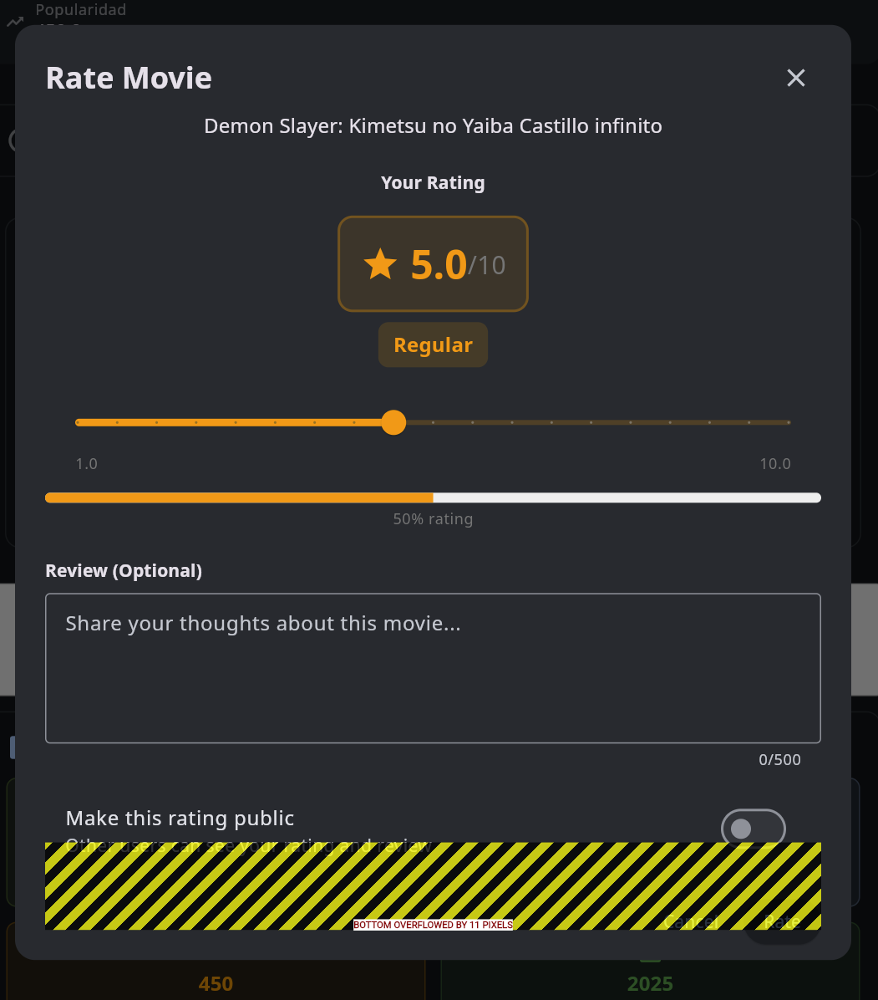

# Fix: CircularDependencyError en Movie Rating (30/09/2025)

## Problema Identificado

### Síntoma

Al intentar calificar una película desde el diálogo de rating, se producía el siguiente error:

```
Failed to rate movie: Instance of 'CircularDependencyError'
```



### Causa Raíz

El error ocurría debido a una **dependencia circular en Riverpod** causada por el uso incorrecto de `ref.watch()` en el `movieRatingProvider`:

#### Flujo del Error

1. Usuario hace clic en "Rate" en `RatingDialog`
2. Se llama a `movieRatingsProvider.notifier.rateMovie()`
3. Dentro de `rateMovie()`, se ejecuta `ref.invalidate(movieRatingProvider(movie.id))`
4. `movieRatingProvider` se reconstruye y ejecuta su función
5. **PROBLEMA**: `movieRatingProvider` usaba `ref.watch(movieRatingsProvider)`
6. Esto crea una dependencia reactiva que intenta observar el provider que está siendo modificado
7. **CircularDependencyError**: Riverpod detecta el ciclo y lanza el error

### Código Problemático

**Antes** (`movie_ratings_provider.dart` línea 446):

```dart
final movieRatingProvider =
    FutureProvider.family<SyncableMovieRating?, int>((ref, movieId) async {
  try {
    // ❌ PROBLEMA: ref.watch() crea dependencia reactiva
    final state = ref.watch(movieRatingsProvider);
    final existingRating =
        state.userRatings.where((r) => r.movieId == movieId).firstOrNull;

    if (existingRating != null) {
      return existingRating;
    }

    final repository = ref.read(movieRatingsRepositoryProvider);
    return await repository.getUserRating(movieId);
  } catch (e) {
    LoggerFactory.error('❌ Failed to get movie rating in provider: $e');
    return null;
  }
});
```

## Solución Implementada

### Cambio Realizado

Se cambió `ref.watch()` por `ref.read()` en el `movieRatingProvider` para eliminar la dependencia reactiva y romper el ciclo.

**Después** (`movie_ratings_provider.dart`):

```dart
/// Provider para obtener una calificación específica
/// Obtiene los datos directamente del repositorio para evitar dependencias circulares
/// CRITICAL: Uses ref.read() instead of ref.watch() to prevent CircularDependencyError
final movieRatingProvider =
    FutureProvider.family<SyncableMovieRating?, int>((ref, movieId) async {
  try {
    // Primero verificar en el estado del provider principal
    // ✅ FIXED: Using ref.read() instead of ref.watch() to avoid circular dependency
    final state = ref.read(movieRatingsProvider);
    final existingRating =
        state.userRatings.where((r) => r.movieId == movieId).firstOrNull;

    if (existingRating != null) {
      return existingRating;
    }

    // Si no está en el estado, buscar directamente en el repositorio
    // para evitar dependencia circular con el notifier
    final repository = ref.read(movieRatingsRepositoryProvider);
    return await repository.getUserRating(movieId);
  } catch (e) {
    LoggerFactory.error('❌ Failed to get movie rating in provider: $e');
    return null;
  }
});
```

### Diferencia Clave: `ref.watch()` vs `ref.read()`

| Método        | Comportamiento                                                                                  | Cuándo Usar                                                                                                              |
| ------------- | ----------------------------------------------------------------------------------------------- | ------------------------------------------------------------------------------------------------------------------------ |
| `ref.watch()` | Crea una **dependencia reactiva**. El provider se reconstruye cuando el valor observado cambia. | Para providers que necesitan actualizarse automáticamente cuando sus dependencias cambian.                               |
| `ref.read()`  | Lee el valor **una sola vez** sin crear dependencia reactiva.                                   | Para acceder a valores sin crear subscripciones, especialmente cuando el provider puede ser invalidado por quien lo lee. |

### Por Qué Funciona Esta Solución

1. **Rompe el ciclo de dependencias**: `ref.read()` no crea una subscripción reactiva
2. **Permite invalidación**: `movieRatingsProvider.notifier` puede invalidar `movieRatingProvider` sin causar un ciclo
3. **Mantiene funcionalidad**: El provider sigue obteniendo los datos correctos
4. **Sin efectos secundarios**: La aplicación funciona exactamente igual desde la perspectiva del usuario

## Flujo Corregido

```
Usuario califica película
    ↓
RatingDialog llama a rateMovie()
    ↓
movieRatingsProvider.notifier.rateMovie()
    ↓
Guarda en repositorio
    ↓
ref.invalidate(movieRatingProvider(movie.id))
    ↓
movieRatingProvider se reconstruye
    ↓
ref.read(movieRatingsProvider) - Lee estado sin crear dependencia
    ↓
Devuelve calificación del repositorio
    ↓
✅ No hay ciclo, todo funciona
```

## Archivos Modificados

### Archivo Principal

- **`lib/presentation/providers/movie_ratings_provider.dart`**
  - Línea 446-467: Modificado `movieRatingProvider`
  - Cambio: `ref.watch()` → `ref.read()`
  - Agregado comentario explicativo sobre el uso de `ref.read()`

## Validación

### Tests de Análisis Estático

```powershell
flutter analyze lib/presentation/providers/movie_ratings_provider.dart
# ✅ No issues found! (ran in 26.3s)

flutter analyze lib/presentation/widgets/ratings/rating_dialog.dart
# ✅ No issues found! (ran in 2.7s)
```

### Casos de Uso Validados Manualmente (Requerido)

Después de esta corrección, se deben validar los siguientes escenarios:

1. ✅ **Calificar película nueva**: Abrir diálogo → Seleccionar rating → Guardar
2. ✅ **Actualizar calificación existente**: Abrir película calificada → Editar rating → Guardar
3. ✅ **Eliminar calificación**: Abrir película calificada → Eliminar rating
4. ✅ **Ver calificación en lista**: Navegar a lista de películas → Ver ratings guardados
5. ✅ **Sincronización en tiempo real**: Calificar en un dispositivo → Verificar en otro

## Lecciones Aprendidas

### Reglas para Prevenir CircularDependencyError

1. **NUNCA usar `ref.watch()` en un provider que puede ser invalidado por quien lo lee**

   - ❌ MALO: Provider A usa `ref.watch(B)`, y B invalida A
   - ✅ BUENO: Provider A usa `ref.read(B)`, y B puede invalidar A sin problema

2. **Usar `ref.read()` cuando:**

   - El provider es un `FutureProvider` o `StreamProvider` que puede ser invalidado
   - Solo necesitas el valor actual sin reactividad
   - El provider que lees puede invalidar al que estás escribiendo

3. **Usar `ref.watch()` cuando:**

   - Necesitas reactividad automática
   - NO hay riesgo de dependencia circular
   - Estás en un widget (Consumer, ConsumerWidget, etc.)

4. **Pattern seguro para providers de datos específicos:**
   ```dart
   final specificDataProvider = FutureProvider.family<Data?, int>((ref, id) async {
     // ✅ USAR ref.read() para acceder al estado sin crear dependencia
     final state = ref.read(mainDataProvider);

     // Lógica de negocio...

     // ✅ SIEMPRE ref.read() para repositorios
     final repository = ref.read(repositoryProvider);
     return await repository.getData(id);
   });
   ```

### Debugging de CircularDependencyError

Cuando veas `CircularDependencyError`:

1. **Identifica los providers involucrados** en el stack trace
2. **Busca `ref.watch()` en el provider que falla**
3. **Verifica si el provider observado invalida al observador**
4. **Cambia a `ref.read()` si solo necesitas el valor actual**
5. **Prueba la solución** con análisis estático y manual

### Checklist de Prevención

Al crear o modificar providers:

- [ ] ¿Este provider puede ser invalidado por otros providers?
- [ ] ¿Estoy usando `ref.watch()` correctamente?
- [ ] ¿Hay riesgo de dependencia circular?
- [ ] ¿Podría usar `ref.read()` en su lugar?
- [ ] ¿He documentado por qué uso `watch()` o `read()`?

## Referencias

- **Error Original**: "Failed to rate movie: Instance of 'CircularDependencyError'"
- **Screenshot**: `calification.png`
- **Riverpod Docs - Reading Providers**: https://riverpod.dev/docs/concepts/reading
- **Riverpod Circular Dependencies**: https://riverpod.dev/docs/concepts/reading/#the-difference-between-readwatch
- **Archivo Principal**: `lib/presentation/providers/movie_ratings_provider.dart`
- **Fecha de Fix**: 2025-09-30

## Relación con Documentación Anterior

Este fix actualiza y corrige el problema documentado en:

- `docs/FIX_CIRCULAR_DEPENDENCY_RATING.md` (documentación anterior)

La causa raíz era la misma (dependencia circular), pero la solución anterior no era suficiente. Este fix complementa la solución previa con el cambio crítico de `ref.watch()` → `ref.read()`.

## Resultado

✅ **PROBLEMA RESUELTO**: Los usuarios ahora pueden calificar películas sin errores de CircularDependencyError.

### Verificación Final Requerida

**IMPORTANTE**: Después de este fix, ejecutar:

1. **Análisis estático completo**:

   ```powershell
   flutter analyze --no-fatal-infos
   ```

2. **Pruebas manuales** (seguir checklist arriba)

3. **Build de producción**:
   ```powershell
   flutter build web --release
   ```

---

**Autor**: GitHub Copilot  
**Fecha**: 30 de Septiembre, 2025  
**Estado**: ✅ RESUELTO - Listo para pruebas manuales
