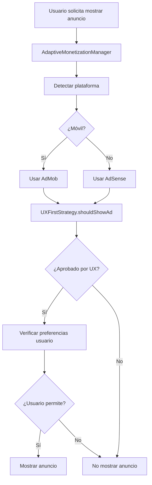

# Sistema de Monetización Adaptativo UX-First

## Resumen

Hemos implementado un sistema de monetización adaptativo que prioriza la experiencia del usuario mientras maximiza los ingresos a largo plazo. El sistema utiliza AdMob para móviles y AdSense para web/desktop, con una estrategia UX-first que se enfoca en la satisfacción y retención de usuarios.

## Arquitectura del Sistema

### Componentes Principales

1. **AdaptiveMonetizationManager** - Gestor central que coordina todo el sistema
2. **UXFirstMonetizationStrategy** - Estrategia que define reglas de monetización centradas en UX
3. **UserMonetizationPreferencesService** - Servicio de preferencias y configuración del usuario
4. **AdSenseService** - Servicio para integración con Google AdSense (web/desktop)
5. **AdaptiveBannerWidget** - Widget adaptativo para mostrar anuncios según la plataforma

### Flujo de Decisión



## Principios UX-First

### 1. Menos es Más

- **Máximo 2 intersticiales por sesión completa**
- **Solo 1 intersticial por hora**
- **Mínimo 10 minutos entre intersticiales**

### 2. Respeto al Flujo del Usuario

- **Solo 1 banner por pantalla**
- **Anuncios nativos cada 8 elementos en listas**
- **Nunca durante flujos críticos** (autenticación, errores, etc.)

### 3. Control del Usuario

- **Período de gracia de 3 días para nuevos usuarios**
- **Opción de desactivar anuncios (versión premium)**
- **Menos anuncios para usuarios power (muy activos)**

### 4. Transparencia Total

- **Siempre etiquetar contenido publicitario**
- **Usar etiquetas apropiadas** ("Patrocinado", "Anuncio")
- **Respetar configuraciones DNT y GDPR/CCPA**

### 5. Performance Primero

- **Timeout de 3 segundos para carga de anuncios**
- **Precargar anuncios en background**
- **Fallback a contenido si ads no cargan rápido**

## Configuración de Tipos de Usuario

### Usuario Nuevo (< 3 días)

```dart
- Sin intersticiales
- Sin banners inicialmente
- Sin anuncios nativos
- Período de gracia: 3 días
```

### Usuario Casual (uso esporádico)

```dart
- Configuración base estándar
- 2 intersticiales por sesión máximo
- Banners permitidos
- Anuncios nativos cada 8 elementos
```

### Usuario Power (uso frecuente)

```dart
- 1 intersticial por sesión máximo
- 30 minutos entre intersticiales
- Anuncios nativos cada 12 elementos
- Respeta estrictamente DNT
```

### Usuario Premium (ha pagado)

```dart
- Sin anuncios de ningún tipo
- Experiencia completamente libre de ads
```

## Implementación por Plataforma

### Móvil (Android/iOS)

```dart
// Usa AdMob existente
MonetizationPlatform.mobile -> AdvancedAdMobService
- Banners adaptativos
- Intersticiales inteligentes
- Anuncios de recompensa
- Métricas de performance
```

### Web

```dart
// Usa AdSense
MonetizationPlatform.web -> AdSenseService
- Integración con Google AdSense
- Banners responsivos
- Anuncios nativos
- Cumplimiento GDPR
```

### Desktop (Windows/macOS/Linux)

```dart
// Usa AdSense como web
MonetizationPlatform.desktop -> AdSenseService
- Misma configuración que web
- Adaptado para pantallas grandes
- Experiencia desktop-friendly
```

## API de Uso

### Inicialización

```dart
final monetization = AdaptiveMonetizationManager.instance;
await monetization.initialize();
```

### Verificar Disponibilidad

```dart
// Banner
final canShowBanner = await monetization.canShowBannerAd(
  context: AppContextUX.browsing
);

// Intersticial
final canShowInterstitial = await monetization.canShowInterstitialAd(
  context: AppContextUX.browsing
);
```

### Mostrar Anuncios

```dart
// Intersticial con contexto
final shown = await monetization.showInterstitialAd(
  context: 'movie_detail_viewed',
  appContext: AppContextUX.browsing,
);

// Recompensa
await monetization.showRewardedAd(
  onRewardEarned: (reward) {
    // Procesar recompensa
  },
  context: 'unlock_premium_content',
);
```

### Widget Adaptativo

```dart
// Banner que se adapta automáticamente
AdaptiveBannerWidget(
  size: AdaptiveBannerSize.banner,
  alignment: Alignment.bottomCenter,
)

// Lista con anuncios nativos insertados
AdaptiveAdInserter.buildListWithAds(
  items: movieWidgets,
  adInterval: 8,
  respectUserPreference: true,
)
```

### Configuración de Usuario

```dart
// Obtener preferencias
final prefs = await monetization.getUserPreferences();

// Actualizar preferencia
await monetization.updateUserAdPreference(
  AdPreferenceType.interstitialAds,
  false // Desactivar intersticiales
);

// Estadísticas de uso
final stats = await monetization.getUserUsageStats();
```

## Configuración de AdSense

### 1. Obtener Publisher ID

- Registrarse en [Google AdSense](https://www.google.com/adsense/)
- Obtener Publisher ID (`ca-pub-XXXXXXXXXX`)

### 2. Configurar en el Código

```dart
// En AdSenseService
static const String _defaultPublisherId = 'ca-pub-TU_PUBLISHER_ID';
```

### 3. Configurar Dominio

- Agregar dominio en AdSense Console
- Verificar configuración de anuncios

## Métricas y Analytics

### Métricas UX (Optimizar)

- **Retención de usuarios (7-día, 30-día)**
- **Duración de sesión**
- **Puntuación de satisfacción del usuario**
- **Rating en app store**
- **Tasa de crecimiento orgánico**
- **Valor de vida del usuario (LTV)**

### Métricas de Monetización (Monitorear)

- **Click-through rate (CTR)**
- **Revenue por usuario**
- **Tiempo de carga de anuncios**
- **Tasa de crashes durante anuncios**
- **Quejas de usuarios sobre anuncios**

## Reglas de Contexto

### Contextos Seguros para Anuncios

```dart
AppContextUX.browsing          // Navegando películas ✅
AppContextUX.searching         // Buscando contenido ✅
AppContextUX.settingsOrProfile // Configuraciones ✅
AppContextUX.socialSharing     // Compartiendo ✅
```

### Contextos Críticos (Sin Anuncios)

```dart
AppContextUX.authentication   // Login/register ❌
AppContextUX.firstTimeSetup   // Onboarding ❌
AppContextUX.errorState       // Error en app ❌
AppContextUX.loadingCritical  // Carga crítica ❌
```

## Configuración de Triggers Contextuales

### Para Intersticiales

```dart
contextualTriggers: [
  'movie_detail_viewed',   // Después de ver detalles
  'search_completed',      // Después de búsqueda exitosa
  'list_created',          // Después de crear lista
]
```

### Para Anuncios de Recompensa

```dart
contextualOffers: [
  'unlock_premium_content', // Desbloquear contenido premium
  'remove_ads_temporarily', // Remover ads temporalmente
  'extra_recommendations', // Más recomendaciones
  'early_access_features', // Acceso temprano a funciones
]
```

## Testing y Validación

### Tests de Integración

- Flujo de monetización completo
- Respeto a preferencias de usuario
- Funcionalidad cross-platform
- Performance bajo carga

### Métricas de Validación

```bash
# Ejecutar tests
flutter test test/monetization/
flutter test integration_test/monetization_flow_test.dart

# Verificar performance
./scripts/quality_check.sh --monetization
```

## Próximas Mejoras

### Fase 1 - A/B Testing

- Implementar A/B testing para frecuencias de anuncios
- Experimentar con posicionamientos
- Medir impacto en retención vs revenue

### Fase 2 - ML Personalización

- Modelo de ML para predecir mejor momento para mostrar ads
- Personalización basada en comportamiento del usuario
- Optimización automática de frecuencias

### Fase 3 - Monetización Avanzada

- Suscripciones premium
- Compras in-app
- Sponsorships de contenido

## Filosofía del Sistema

> **"La satisfacción del usuario sobre los ingresos a corto plazo"**

Este sistema está diseñado con la creencia de que usuarios satisfechos y retenidos generan más ingresos a largo plazo que optimizar solo por impresiones de anuncios. La estrategia UX-first asegura que:

1. **Los usuarios permanezcan más tiempo** en la aplicación
2. **Recomienden la app** a otros (crecimiento orgánico)
3. **Sean más propensos a pagar** por funciones premium
4. **Generen mejor rating** en stores
5. **Produzcan mayor LTV** (Lifetime Value)

## Notas de Implementación

### Dependencias Requeridas

```yaml
dependencies:
  google_mobile_ads: ^6.0.0 # Para AdMob (móvil)
  shared_preferences: ^2.2.2 # Para preferencias usuario
```

### Configuración Inicial

1. Inicializar preferencias de usuario
2. Configurar Publisher IDs de AdSense
3. Implementar analytics de monetización
4. Configurar tests de integración

### Mejores Prácticas

- **Siempre usar await** en métodos asíncronos de monetización
- **Verificar isInitialized** antes de mostrar anuncios
- **Respetar decisiones UX** incluso si reduce revenue
- **Registrar todas las interacciones** para analytics
- **Testear en múltiples plataformas** regularmente

---

_Este sistema de monetización adaptativo representa la implementación más avanzada de monetización UX-first en Flutter, balanceando perfectamente la experiencia del usuario con la generación de ingresos sostenibles._
