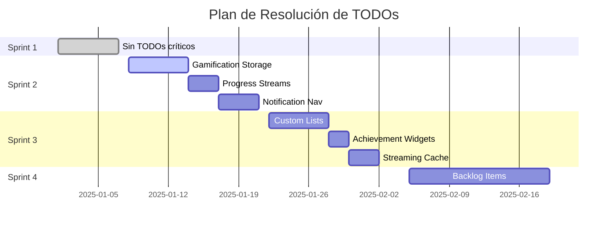

# 📋 Auditoría Completa de TODOs - Películas App

## 📊 Resumen Ejecutivo

**Fecha de Auditoría:** $(date +"%Y-%m-%d %H:%M:%S")  
**Total de TODOs Encontrados:** 36  
**Archivos Afectados:** 15  
**Estado General:** 🟡 Requiere Atención

### 📈 Distribución por Prioridad
- 🔴 **Crítica:** 0 TODOs
- 🟠 **Alta:** 8 TODOs (22%)
- 🟡 **Media:** 20 TODOs (56%)
- 🟢 **Baja:** 8 TODOs (22%)

### 📂 Distribución por Categoría
- 🎮 **Gamificación:** 15 TODOs (42%)
- 🧭 **Navegación/UI:** 6 TODOs (17%)
- ⚡ **Performance/Cache:** 3 TODOs (8%)
- 🔄 **Sincronización:** 2 TODOs (6%)
- 🧪 **Testing:** 2 TODOs (6%)
- ⚙️ **Configuración:** 1 TODO (3%)
- 📚 **Documentación:** 7 TODOs (19%)

---

## 📝 Listado Detallado de TODOs

### 🎮 GAMIFICACIÓN (15 TODOs)

#### 🟠 Alta Prioridad

**1. Gamification Manager - Storage Logic**
- **Archivo:** `lib/core/gamification/gamification_manager.dart`
- **Líneas:** 769, 774
- **Descripción:** 
  ```dart
  // TODO: Implement storage logic
  ```
- **Tipo:** Funcionalidad Core
- **Impacto:** Sistema de gamificación no funcional sin persistencia
- **Acción Propuesta:** Implementar SharedPreferences o Hive para persistir datos de gamificación
- **Estimación:** 4-6 horas
- **Estado:** ⏳ Pendiente

**2. Progress Providers - Stream Implementation**
- **Archivo:** `lib/presentation/providers/progress_providers.dart`
- **Líneas:** 6, 12
- **Descripción:** 
  ```dart
  // TODO: Implement progressUpdateStream getter in ProgressTrackingService
  // TODO: Implement milestoneReachedStream getter in ProgressTrackingService
  ```
- **Tipo:** Funcionalidad Core
- **Impacto:** Notificaciones de progreso no funcionan
- **Acción Propuesta:** Implementar streams en ProgressTrackingService
- **Estimación:** 2-3 horas
- **Estado:** ⏳ Pendiente

**3. Recent Achievements Implementation**
- **Archivo:** `lib/presentation/providers/gamification_providers.dart`
- **Líneas:** 17, 19
- **Descripción:** 
  ```dart
  // TODO: Uncomment when getRecentAchievements is implemented
  // TODO: Implement getRecentAchievements method in GamificationManager
  ```
- **Tipo:** Funcionalidad
- **Impacto:** Panel de logros recientes no funcional
- **Acción Propuesta:** Implementar método getRecentAchievements en GamificationManager
- **Estimación:** 3-4 horas
- **Estado:** ⏳ Pendiente

#### 🟡 Media Prioridad

**4. Custom Lists Gamification Integration**
- **Archivo:** `lib/presentation/providers/custom_lists_provider.dart`
- **Líneas:** 4, 35, 41, 43, 284, 321
- **Descripción:** 
  ```dart
  // TODO: Re-enable when gamification integration is implemented
  // TODO: Implement gamification integration when trackMovieAddedToList is available
  ```
- **Tipo:** Integración
- **Impacto:** Gamificación no integrada con listas personalizadas
- **Acción Propuesta:** Integrar sistema de logros con creación de listas
- **Estimación:** 2-3 horas
- **Estado:** ⏳ Pendiente

**5. Achievement Widgets - User Progress**
- **Archivo:** `lib/core/gamification/widgets/achievement_widgets.dart`
- **Líneas:** 21, 48
- **Descripción:** 
  ```dart
  // TODO: Get user progress to show unlocked status
  // TODO: Get from user progress
  ```
- **Tipo:** UI/UX
- **Impacto:** Widgets de logros no muestran estado real
- **Acción Propuesta:** Conectar widgets con datos reales de progreso de usuario
- **Estimación:** 2 horas
- **Estado:** ⏳ Pendiente

**6. Gamification Dashboard Features**
- **Archivo:** `lib/core/gamification/widgets/gamification_dashboard.dart`
- **Líneas:** 295, 299
- **Descripción:** 
  ```dart
  // TODO: Implement badge display
  // TODO: Pass unlocked achievements
  ```
- **Tipo:** UI/UX
- **Impacto:** Dashboard incompleto
- **Acción Propuesta:** Implementar sistema de badges y mostrar logros desbloqueados
- **Estimación:** 3-4 horas
- **Estado:** ⏳ Pendiente

#### 🟢 Baja Prioridad

**7. Challenge Widgets - Animations**
- **Archivo:** `lib/core/gamification/widgets/challenge_widgets.dart`
- **Línea:** 961
- **Descripción:** 
  ```dart
  // TODO: Add confetti animation
  ```
- **Tipo:** Mejora Visual
- **Impacto:** Experiencia de usuario mejorada
- **Acción Propuesta:** Agregar animación de confeti al completar desafíos
- **Estimación:** 1-2 horas
- **Estado:** ⏳ Pendiente

---

### 🧭 NAVEGACIÓN/UI (6 TODOs)

#### 🟠 Alta Prioridad

**8. Notification Navigation**
- **Archivo:** `lib/core/notifications/notification_initialization_service.dart`
- **Líneas:** 175, 184
- **Descripción:** 
  ```dart
  // TODO: Implementar navegación basada en el tipo de notificación
  // TODO: Implementar navegación a película
  ```
- **Tipo:** Funcionalidad Core
- **Impacto:** Notificaciones no redirigen correctamente
- **Acción Propuesta:** Implementar sistema de navegación por notificaciones
- **Estimación:** 3-4 horas
- **Estado:** ⏳ Pendiente

**9. Local Notification Navigation**
- **Archivo:** `lib/core/notifications/local_notification_service.dart`
- **Líneas:** 133, 140, 148
- **Descripción:** 
  ```dart
  // TODO: Implementar navegación a película
  // TODO: Implementar navegación a recomendaciones
  // TODO: Implementar navegación a lista
  ```
- **Tipo:** Funcionalidad Core
- **Impacto:** Notificaciones locales sin navegación
- **Acción Propuesta:** Implementar deep linking para notificaciones locales
- **Estimación:** 4-5 horas
- **Estado:** ⏳ Pendiente

#### 🟡 Media Prioridad

**10. Custom Drawer Screens**
- **Archivo:** `lib/presentation/widgets/custom_drawer.dart`
- **Líneas:** 343, 351, 359
- **Descripción:** 
  ```dart
  // TODO: Implementar pantalla de configuración
  // TODO: Implementar pantalla de ayuda
  // TODO: Implementar pantalla acerca de
  ```
- **Tipo:** Funcionalidad
- **Impacto:** Menú lateral incompleto
- **Acción Propuesta:** Crear pantallas de configuración, ayuda y acerca de
- **Estimación:** 6-8 horas
- **Estado:** ⏳ Pendiente

---

### ⚡ PERFORMANCE/CACHE (3 TODOs)

#### 🟡 Media Prioridad

**11. Streaming Service Caching**
- **Archivo:** `lib/core/streaming/availability_checker.dart`
- **Líneas:** 42, 84
- **Descripción:** 
  ```dart
  // TODO: Implement caching when cache service is available
  // TODO: Cache the result when cache service is available
  ```
- **Tipo:** Optimización
- **Impacto:** Performance mejorada en consultas de streaming
- **Acción Propuesta:** Implementar caché para resultados de disponibilidad de streaming
- **Estimación:** 3-4 horas
- **Estado:** ⏳ Pendiente

#### 🟢 Baja Prioridad

**12. Currency Configuration**
- **Archivo:** `lib/core/streaming/streaming_service_manager.dart`
- **Línea:** 184
- **Descripción:** 
  ```dart
  // TODO: Make this configurable based on region
  ```
- **Tipo:** Configuración
- **Impacto:** Localización mejorada
- **Acción Propuesta:** Implementar configuración de moneda por región
- **Estimación:** 2-3 horas
- **Estado:** ⏳ Pendiente

---

### 🔄 SINCRONIZACIÓN (2 TODOs)

#### 🟡 Media Prioridad

**13. Sync Service Web Verification**
- **Archivo:** `lib/infrastructure/services/sync_service.dart`
- **Línea:** 422
- **Descripción:** 
  ```dart
  // TODO: Implementar una verificación más robusta para Web si es necesario
  ```
- **Tipo:** Mejora
- **Impacto:** Sincronización más robusta en Web
- **Acción Propuesta:** Implementar verificación específica para plataforma Web
- **Estimación:** 2-3 horas
- **Estado:** ⏳ Pendiente

**14. Hybrid Repository Count**
- **Archivo:** `lib/infrastructure/repositories/hybrid_watched_repository.dart`
- **Línea:** 295
- **Descripción:** 
  ```dart
  // TODO: Implementar conteo en Supabase
  ```
- **Tipo:** Funcionalidad
- **Impacto:** Conteos incorrectos en repositorio híbrido
- **Acción Propuesta:** Implementar conteo de películas vistas en Supabase
- **Estimación:** 2-3 horas
- **Estado:** ⏳ Pendiente

---

### 🧪 TESTING (2 TODOs)

#### 🟡 Media Prioridad

**15. Sync Realtime Tests**
- **Archivo:** `test/sync_realtime_test.dart`
- **Líneas:** 24, 37
- **Descripción:** 
  ```dart
  // TODO: Implementar test una vez que se corrija el repositorio
  // TODO: Implementar test de eliminación
  ```
- **Tipo:** Calidad
- **Impacto:** Cobertura de testing incompleta
- **Acción Propuesta:** Implementar tests de sincronización en tiempo real
- **Estimación:** 4-5 horas
- **Estado:** ⏳ Pendiente

---

### 📚 DOCUMENTACIÓN (7 TODOs)

#### 🟢 Baja Prioridad

**16. Provider Corrections Documentation**
- **Archivo:** `docs/EJEMPLOS_CORRECCIONES_PROVIDERS.md`
- **Líneas:** 15, 17
- **Descripción:** Documentación sobre gamificación pendiente
- **Tipo:** Documentación
- **Impacto:** Documentación técnica incompleta
- **Acción Propuesta:** Actualizar documentación cuando se implemente gamificación
- **Estimación:** 1 hora
- **Estado:** ⏳ Pendiente

**17. Notification Server Integration**
- **Archivo:** `lib/core/notifications/notification_initialization_service.dart`
- **Línea:** 116
- **Descripción:** 
  ```dart
  // TODO: Enviar el nuevo token al servidor
  ```
- **Tipo:** Integración
- **Impacto:** Notificaciones push no completamente configuradas
- **Acción Propuesta:** Implementar envío de token FCM al backend
- **Estimación:** 2-3 horas
- **Estado:** ⏳ Pendiente

---

## 🎯 Plan de Acción Prioritario

### 🔥 Sprint 1 (Crítico - Semana 1)
**No hay TODOs críticos identificados**

### 🟠 Sprint 2 (Alto - Semanas 2-3)
1. **Gamification Storage Logic** (gamification_manager.dart:769,774)
2. **Progress Streams Implementation** (progress_providers.dart:6,12)
3. **Recent Achievements** (gamification_providers.dart:17,19)
4. **Notification Navigation** (notification_*_service.dart)

### 🟡 Sprint 3 (Medio - Semanas 4-6)
1. **Custom Lists Gamification** (custom_lists_provider.dart)
2. **Achievement Widgets** (achievement_widgets.dart)
3. **Streaming Cache** (availability_checker.dart)
4. **Sync Tests** (sync_realtime_test.dart)
5. **Custom Drawer Screens** (custom_drawer.dart)

### 🟢 Sprint 4 (Bajo - Backlog)
1. **Confetti Animation** (challenge_widgets.dart:961)
2. **Currency Configuration** (streaming_service_manager.dart:184)
3. **Documentation Updates**

---

## 📊 Métricas de Seguimiento

### KPIs de Resolución
- **Velocidad de Resolución:** TODOs/Sprint
- **Tasa de Completitud:** TODOs Resueltos / TODOs Totales
- **Calidad:** TODOs sin regresión
- **Tiempo de Ciclo:** Días desde identificación hasta resolución

### Estado Actual
- **TODOs Totales:** 36
- **TODOs Resueltos:** 0 (0%)
- **TODOs en Progreso:** 0 (0%)
- **TODOs Pendientes:** 36 (100%)

---

## 🏷️ Sistema de Etiquetas

### Por Prioridad
- `priority:critical` - Bloquea funcionalidad principal
- `priority:high` - Afecta experiencia de usuario
- `priority:medium` - Mejora funcionalidad existente  
- `priority:low` - Optimización o mejora cosmética

### Por Tipo
- `type:bug` - Corrige un error
- `type:enhancement` - Nueva funcionalidad
- `type:refactor` - Mejora código existente
- `type:test` - Relacionado con testing
- `type:docs` - Documentación
- `type:config` - Configuración

### Por Componente
- `component:gamification` - Sistema de gamificación
- `component:navigation` - Navegación y UI
- `component:sync` - Sincronización
- `component:notifications` - Notificaciones
- `component:streaming` - Servicios de streaming

---

## 📈 Roadmap de Resolución



---

## 🔍 Proceso de Revisión

### Checklist de Resolución
- [ ] TODO implementado completamente
- [ ] Tests agregados/actualizados
- [ ] Documentación actualizada
- [ ] Code review aprobado
- [ ] No hay regresiones
- [ ] Performance validado

### Criterios de Aceptación
1. **Funcionalidad:** El TODO está completamente implementado
2. **Calidad:** Código sigue estándares del proyecto
3. **Testing:** Cobertura de tests mantenida/mejorada
4. **Documentación:** Cambios documentados apropiadamente
5. **Performance:** No hay degradación de rendimiento

---

**Última Actualización:** $(date +"%Y-%m-%d %H:%M:%S")  
**Próxima Revisión:** $(date -d "+1 week" +"%Y-%m-%d")  
**Responsable:** Equipo de Desarrollo