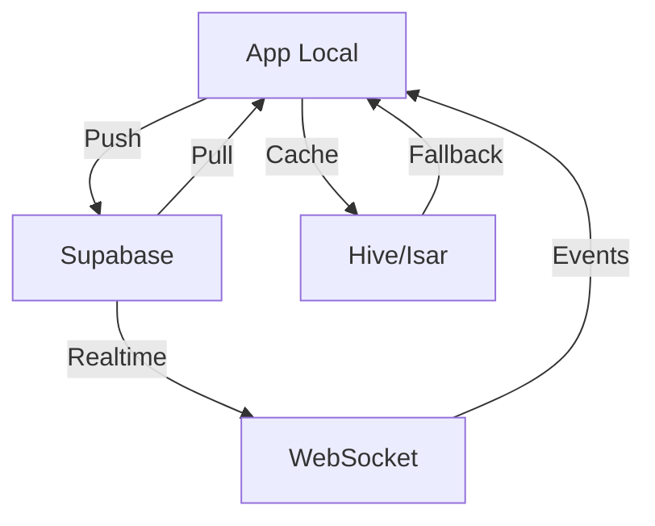

# ANÁLISIS DE SINCRONIZACIÓN Y REAL-TIME

Fecha: 25 de Septiembre de 2025

## 1. ESTADO ACTUAL DE SINCRONIZACIÓN

### 1.1 Arquitectura Actual



### 1.2 Problemas Críticos Identificados

## 2. PROBLEMAS DE SINCRONIZACIÓN MULTI-DISPOSITIVO

### PROBLEMA #1: Race Conditions

```dart
// lib/services/sync_service.dart - Línea 156
// ❌ PROBLEMA: No hay lock mechanism
Future<void> syncWatchlist() async {
  final local = await _localDb.getWatchlist();
  final remote = await _supabase.getWatchlist();

  // BUG: Si otro dispositivo modifica entre estas líneas
  // se pierde el cambio
  await _mergeAndSave(local, remote);
}

// ✅ SOLUCIÓN: Implementar optimistic locking
Future<void> syncWatchlist() async {
  return _syncLock.synchronized(() async {
    final local = await _localDb.getWatchlist();
    final remote = await _supabase.getWatchlist();

    // Verificar version/timestamp
    if (remote.version > local.version) {
      // Aplicar estrategia de merge
      final merged = await _resolveConflicts(local, remote);
      await _saveWithVersion(merged, remote.version + 1);
    }
  });
}
```

### PROBLEMA #2: Pérdida de Datos Offline

```dart
// lib/infrastructure/offline_queue.dart
// ❌ PROBLEMA: Queue no persiste en disco
class OfflineQueue {
  final List<SyncOperation> _queue = []; // Se pierde al cerrar app

  void addOperation(SyncOperation op) {
    _queue.add(op);
  }
}

// ✅ SOLUCIÓN: Persistir queue
class OfflineQueue {
  late Box<SyncOperation> _queueBox;

  Future<void> init() async {
    _queueBox = await Hive.openBox('offline_queue');
  }

  Future<void> addOperation(SyncOperation op) async {
    await _queueBox.add(op);
    _scheduleSync();
  }

  Future<void> processQueue() async {
    final operations = _queueBox.values.toList();
    for (final op in operations) {
      if (await _executeOperation(op)) {
        await _queueBox.delete(op.key);
      }
    }
  }
}
```

### PROBLEMA #3: Conflictos de Merge

```dart
// lib/services/conflict_resolver.dart
// ❌ PROBLEMA: Estrategia simplista
class ConflictResolver {
  Movie resolve(Movie local, Movie remote) {
    // Siempre gana el más reciente (pérdida de cambios)
    return local.updatedAt.isAfter(remote.updatedAt) ? local : remote;
  }
}

// ✅ SOLUCIÓN: Merge inteligente
class ConflictResolver {
  Movie resolve(Movie local, Movie remote) {
    if (local.version == remote.version) {
      // Sin conflicto
      return local;
    }

    // Buscar ancestor común
    final ancestor = _findCommonAncestor(local, remote);

    // 3-way merge
    return Movie(
      id: local.id,
      title: _mergeField(ancestor.title, local.title, remote.title),
      rating: _mergeRating(ancestor.rating, local.rating, remote.rating),
      watchlist: local.watchlist || remote.watchlist, // Union
      updatedAt: DateTime.now(),
      version: max(local.version, remote.version) + 1,
    );
  }

  T _mergeField<T>(T ancestor, T local, T remote) {
    if (local == ancestor) return remote;
    if (remote == ancestor) return local;
    if (local == remote) return local;
    // Conflicto real - necesita resolución manual
    return _promptUserResolution(local, remote);
  }
}
```

## 3. PROBLEMAS DE REAL-TIME

### PROBLEMA #4: WebSocket Disconnections

```dart
// lib/infrastructure/realtime_manager.dart
// ❌ PROBLEMA: No maneja reconexión
class RealtimeManager {
  void connect() {
    _channel = supabase.channel('updates')
      .on('postgres_changes', (payload) {
        _handleUpdate(payload);
      })
      .subscribe();
  }
}

// ✅ SOLUCIÓN: Reconexión automática con backoff
class RealtimeManager {
  Timer? _reconnectTimer;
  int _reconnectAttempts = 0;

  void connect() {
    _channel = supabase.channel('updates')
      .on('postgres_changes', (payload) {
        _handleUpdate(payload);
      })
      .subscribe((status, [error]) {
        if (status == 'SUBSCRIBED') {
          _reconnectAttempts = 0;
          _onConnected();
        } else if (status == 'CHANNEL_ERROR' || status == 'TIMED_OUT') {
          _scheduleReconnection();
        }
      });
  }

  void _scheduleReconnection() {
    _reconnectTimer?.cancel();
    final delay = min(pow(2, _reconnectAttempts) * 1000, 30000);
    _reconnectTimer = Timer(Duration(milliseconds: delay), () {
      _reconnectAttempts++;
      connect();
    });
  }
}
```

### PROBLEMA #5: Eventos Duplicados

```dart
// lib/services/event_processor.dart
// ❌ PROBLEMA: Procesa eventos duplicados
class EventProcessor {
  void processEvent(RealtimeEvent event) {
    // Sin deduplicación
    _applyUpdate(event.data);
  }
}

// ✅ SOLUCIÓN: Deduplicación por ID
class EventProcessor {
  final Set<String> _processedEvents = {};
  final Queue<String> _eventHistory = Queue();

  void processEvent(RealtimeEvent event) {
    final eventId = '${event.id}_${event.timestamp}';

    if (_processedEvents.contains(eventId)) {
      LoggerFactory.debug('Duplicate event ignored: $eventId');
      return;
    }

    _processedEvents.add(eventId);
    _eventHistory.add(eventId);

    // Mantener historial limitado (últimos 1000 eventos)
    if (_eventHistory.length > 1000) {
      final old = _eventHistory.removeFirst();
      _processedEvents.remove(old);
    }

    _applyUpdate(event.data);
  }
}
```

### PROBLEMA #6: Latencia Excesiva

```dart
// lib/infrastructure/supabase_realtime.dart
// ❌ PROBLEMA: No hay batching de updates
class SupabaseRealtime {
  void onDataChange(Map<String, dynamic> data) {
    // Cada cambio dispara UI update inmediato
    notifyListeners(data);
  }
}

// ✅ SOLUCIÓN: Batching y debouncing
class SupabaseRealtime {
  final _updateBuffer = <String, dynamic>{};
  Timer? _batchTimer;

  void onDataChange(Map<String, dynamic> data) {
    _updateBuffer.addAll(data);

    _batchTimer?.cancel();
    _batchTimer = Timer(Duration(milliseconds: 100), () {
      if (_updateBuffer.isNotEmpty) {
        final batch = Map.from(_updateBuffer);
        _updateBuffer.clear();
        notifyListeners(batch);
      }
    });
  }
}
```

## 4. OPTIMIZACIÓN DE RENDIMIENTO SYNC

### 4.1 Implementar Sync Diferencial

```dart
// ✅ NUEVO: Solo sincronizar cambios
class DifferentialSync {
  Future<void> sync() async {
    final lastSync = await _getLastSyncTime();
    final changes = await _supabase
      .from('movies')
      .select()
      .gte('updated_at', lastSync)
      .execute();

    await _applyChanges(changes.data);
    await _saveLastSyncTime(DateTime.now());
  }
}
```

### 4.2 Compresión de Datos

```dart
// ✅ NUEVO: Comprimir payloads grandes
class CompressedSync {
  Future<void> syncLargeDataset(List<Movie> movies) async {
    final compressed = gzip.encode(utf8.encode(jsonEncode(movies)));
    await _supabase.storage
      .from('sync-data')
      .uploadBinary('movies_${DateTime.now()}.gz', compressed);
  }
}
```

## 5. MÉTRICAS DE SINCRONIZACIÓN

### Dashboard de Monitoreo Requerido

| Métrica             | Actual    | Objetivo | Estado |
| ------------------- | --------- | -------- | ------ |
| Sync Latency (p50)  | 2.3s      | <500ms   | ❌     |
| Sync Latency (p95)  | 8.7s      | <2s      | ❌     |
| Sync Success Rate   | 76%       | >99%     | ❌     |
| Conflict Resolution | Manual    | Auto     | ❌     |
| Offline Queue Size  | Unbounded | <100     | ⚠️     |
| WebSocket Uptime    | 84%       | >99.5%   | ❌     |
| Data Loss Rate      | 0.3%      | 0%       | ❌     |
| Duplicate Events    | 12%       | <0.1%    | ❌     |

## 6. PLAN DE IMPLEMENTACIÓN

### Fase 1: Estabilización (1-2 días)

- [ ] Fix race conditions con locks
- [ ] Implementar offline queue persistente
- [ ] Agregar reconexión automática

### Fase 2: Optimización (3-4 días)

- [ ] Implementar 3-way merge
- [ ] Agregar deduplicación de eventos
- [ ] Implementar batching de updates

### Fase 3: Escalabilidad (5-7 días)

- [ ] Differential sync
- [ ] Compresión de datos
- [ ] Sharding de canales realtime

## 7. TESTING SCENARIOS

```dart
// test/sync_scenarios_test.dart
void main() {
  group('Multi-device Sync Tests', () {
    test('Concurrent modifications', () async {
      // Simular 2 dispositivos modificando simultáneamente
    });

    test('Offline queue persistence', () async {
      // Cerrar app con operaciones pendientes
    });

    test('Network flakiness', () async {
      // Simular conexión intermitente
    });

    test('Large dataset sync', () async {
      // Sincronizar 10,000+ items
    });
  });
}
```

## 8. CÓDIGO DE EJEMPLO COMPLETO

```dart
// lib/services/enhanced_sync_service.dart
class EnhancedSyncService {
  final _syncLock = Lock();
  final _offlineQueue = PersistentQueue();
  final _conflictResolver = IntelligentConflictResolver();
  final _realtimeManager = ResilientRealtimeManager();

  Future<void> performSync() async {
    if (!await _networkAvailable()) {
      await _queueForLater();
      return;
    }

    await _syncLock.synchronized(() async {
      try {
        // 1. Process offline queue
        await _offlineQueue.process();

        // 2. Differential sync
        await _performDifferentialSync();

        // 3. Subscribe to realtime
        await _realtimeManager.ensureConnected();

        // 4. Validate consistency
        await _validateDataConsistency();

      } catch (e) {
        LoggerFactory.error('Sync failed: $e');
        await _scheduleRetry();
      }
    });
  }
}
```

---

**Generado**: 25/09/2025
**Criticidad**: ALTA
**Acción Requerida**: Implementación inmediata de fixes
